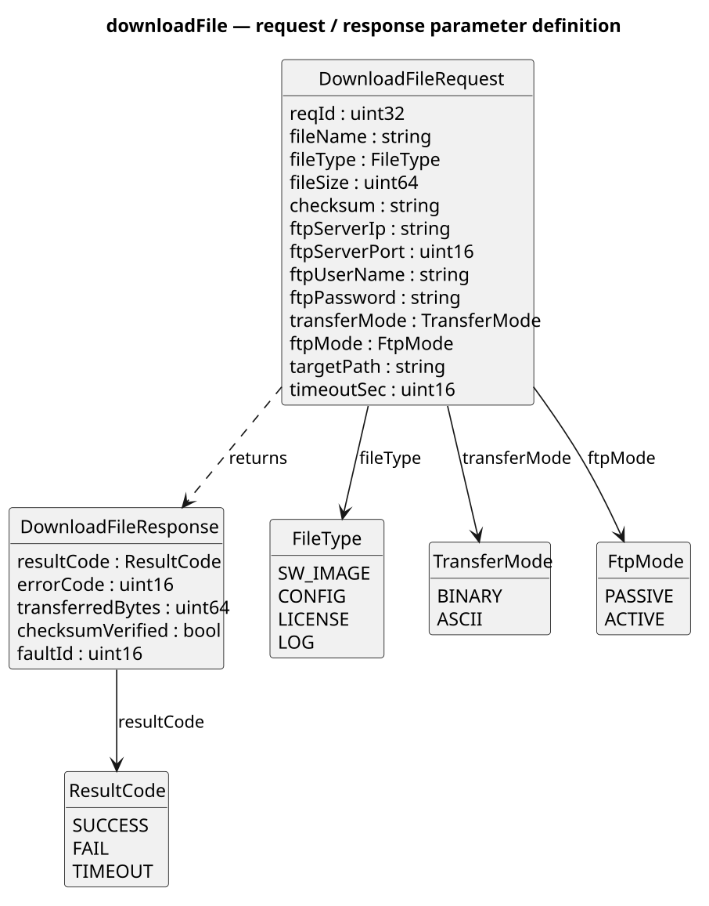
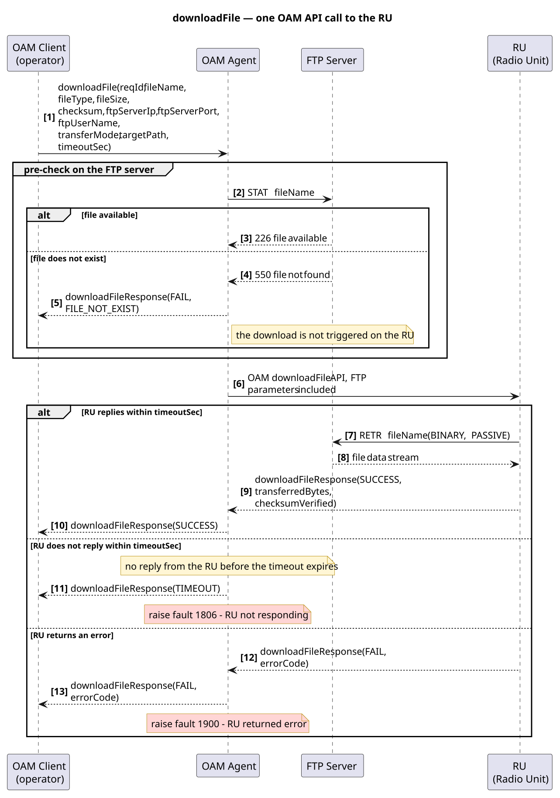

# Download File to RU

## 1. Requirement Summary

| Field | Value |
| --- | --- |
| Feature | feature-0000 |
| Low-level Requirement ID | LLR-000 |
| Testable | Yes — verification cases: successful download, file does not exist, RU timeout, RU error response |

**Owner**: doc-team@test.com

## 2. Purpose

Download a file to the radio.

## 3. Precondition

The radio is connected.

## 4. Trigger

The user initiates a file download to the radio.

## 5. Parameter Definition and Call Sequence

### 5.1 Parameter Definition

#### Request parameters

| Parameter | Type | Mandatory | Description |
| --- | --- | --- | --- |
| reqId | uint32 | Y | Transaction identifier; used to correlate the response with the raised alarm |
| fileName | string | Y | Name of the file to be downloaded from the FTP server |
| fileType | FileType | Y | File type: SW_IMAGE / CONFIG / LICENSE / LOG |
| fileSize | uint64 | Y | File size in bytes; used for the storage check and the integrity verification |
| checksum | string | Y | File checksum (MD5 / SHA-256); verified after the file has been stored |
| ftpServerIp | string | Y | FTP server address (IPv4 / IPv6) |
| ftpServerPort | uint16 | Y | FTP port (21 = FTP, 990 = FTPS) |
| ftpUserName | string | Y | FTP login user name |
| ftpPassword | string | Y | FTP login password (FTPS is recommended; plaintext transfer is not allowed) |
| transferMode | TransferMode | Y | Transfer mode: BINARY (firmware / image) or ASCII (text configuration) |
| ftpMode | FtpMode | N | FTP connection mode: PASSIVE (default) or ACTIVE |
| targetPath | string | Y | Destination path on the RU |
| timeoutSec | uint16 | N | Timeout, in seconds, for the OAM agent to wait for the RU response (default: 60) |

#### Response parameters

| Parameter | Type | Description |
| --- | --- | --- |
| resultCode | ResultCode | Execution result: SUCCESS / FAIL / TIMEOUT |
| errorCode | uint16 | Failure reason: FILE_NOT_EXIST / FTP_CONN_FAIL / FTP_AUTH_FAIL / NO_SPACE / CHECKSUM_MISMATCH / RU_ERROR |
| transferredBytes | uint64 | Number of bytes actually transferred; compared with fileSize |
| checksumVerified | bool | Whether the checksum verification passed |
| faultId | uint16 | Alarm ID raised for this failure (1806 / 1900; 0 on success) |

### 5.2 OAM API Call Sequence to the RU

## 6. PostCondition

The file is successfully downloaded to the radio, or exceptions are handled.

## 7. Note

| Scenario | Trigger Condition | Handling and Alarm |
| --- | --- | --- |
| File does not exist | fileName does not exist on the FTP server | Return FILE_NOT_EXIST; do not start the download to the RU; raise an alarm event |
| FTP connection failed | ftpServerIp:ftpServerPort is unreachable | Return FTP_CONN_FAIL; abort the download |
| FTP authentication failed | Incorrect FTP user name or password | Return FTP_AUTH_FAIL; abort the download |
| Insufficient storage on the RU | Free space on targetPath is insufficient | Return NO_SPACE; abort the download |
| Checksum mismatch | Checksum of the stored file does not match checksum | Return CHECKSUM_MISMATCH; discard the downloaded file |
| RU timeout (no reply) | The RU does not reply within timeoutSec | Return TIMEOUT; raise fault 1806 (RU not responding) |
| RU returns an error | The RU returns an error response | Forward the RU errorCode; raise fault 1900 (RU returned error) |

---

## Related

- HLD writing guide and prompt: [hld_writing_guide.md](hld_writing_guide.md)
- Release-level HLD: [R1.0](hld_r1.md) / [R2.0](hld_r2.md) / [R3.0](hld_r3.md)
- Requirements: [requirements.md](requirements.md)
- Documentation methodology: [methodology.rst](../07_about/methodology.rst)
