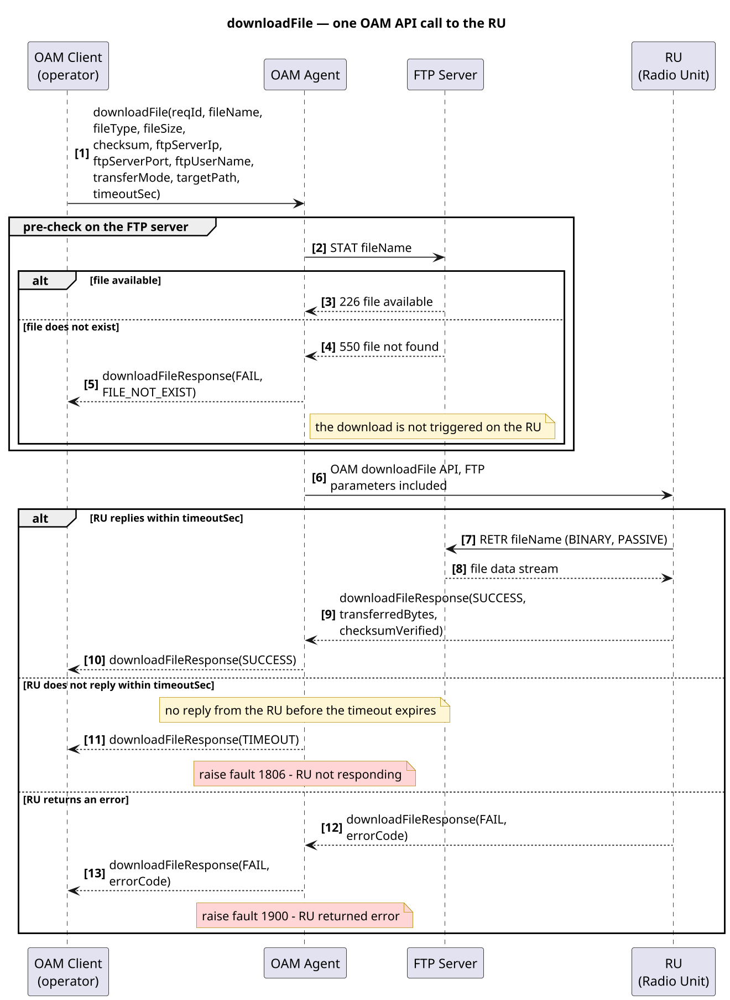

# 功能级 HLD 页面书写规范与提示词（downloadFile / OAM 调用类适用）

> 本文沉淀「**功能级 HLD（Feature-level HLD）**」页面的书写方法——
> 即**单个功能 / 单条接口**如何写成一页可评审、可追踪、可验收、可测试的设计页。
> 可作为可复用提示词直接喂给 AI，生成或重写同类页面。
> 样例页面见同目录 `hld_download_file.md`（Download File to RU）。

---

## 1. 目的与适用边界

**目的**：把「一个功能怎么设计」写清楚——**为什么做（Purpose）→ 什么前提（Precondition）→ 谁触发（Trigger）
→ 接口与参数是什么（UML）→ 做完是什么状态（PostCondition）→ 会出什么错（Note）**，
让评审人能一眼判断设计是否闭环，让测试能直接据此写用例。

**适用**：单条 OAM/RPC 接口、单个网元功能、单个数据处理流程的设计页。
**不适用**：整机 / 整栈的分层架构（那属于 Release 级 HLD，见 `hld_r1.md`）。

**与 Release 级 HLD 的关系**：Release 级 HLD 定分层与层间契约；功能级 HLD 定**单功能内的参数、时序、异常与告警**。
两级通过 Feature / LLR 编号挂钩（见 §4）。

---

## 2. 页面语言与公共声明（约定）

### 2.1 语言：页面正文全部英文

功能级 HLD 的读者是 **SW / RAN 工程师**（研发、测试、集成），因此**页面正文一律用英文书写**：
标题、章节名、表格列名、参数说明、异常描述、图内文本全部英文。
中文只允许出现在本规范（`hld_writing_guide.md`）与仓库 README 等**非交付文档**中。

- 术语、参数名、枚举值、错误码保持英文原名（`fileName`、`FTP_CONN_FAIL`、`SW_IMAGE` …），**不翻译**。
- 用简单现在时、主动语态；一句说一件事，避免长句与从句套嵌。
- 单元说明用祈使句或名词短语，例：`Timeout, in seconds, for the OAM agent to wait for the RU response (default: 60).`

### 2.2 公共声明：统一写在这里，**不写进页面**

以下内容属于**全库通用约定**。每页重复只会制造噪声 —— **页面里不写这些 note**，在本规范声明一次即可：

| 公共项 | 约定 |
| --- | --- |
| 编号占位 | Feature / LLR 未关联需求库时，填 `feature-0000` / `LLR-000`。真实项目**必须在评审前替换为需求库实际编号**，否则文档不可追溯。占位可以，假装有不行。 |
| 告警号 | 页面中的 `fault` 编号如为示例，**以产品《告警手册》（product alarm manual）为准**。 |
| 文档定位 | 「本页是样例 / 作品集 / 演示」这类元说明属于仓库 README，**不写进技术页**。 |
| 示例数据 | 任何示例数值（时延、容量、配额、默认值）必须标注示例口径，**绝不编造**。 |
| 自评与场景话术 | 只陈述可验证事实，不写自评与结论宣告（如「这正是…的定位」「我交付能力的证明」）；页面与声明中不出现**面向作者**的话术（如「请填你本人的项目数据」）。 |

> 一句话原则：**页面只写"这个功能怎么设计"，不写"这份文档是什么"。**

### 2.3 写作要求本身不进页面（重要教训）

**「作者收到的写作要求」不是文档内容。** 把"这一节要覆盖 RU 超时→fault 1806、RU 返回错误→fault 1900"
「本图展示了一次 OAM 调用」「下面这张图说明了……参数定义」这类**元描述 / 交付要求**写进 HLD，是最常见的低级错误：

- 它是**写给作者自己的**，不是写给 SW 工程师的；
- 技术信息已经在**图、表、正文**里表达过一次，再复述一遍 = 纯噪声；
- 评审人会立刻发现「这段读起来像需求方的话」——在正式交付文档里是硬伤。

**正确做法**：要求 → 转化为图上的分支、表里的一行、正文的一句设计结论。
只有一句价值时才留一句引导语（例：`The sequence diagram below covers the RU timeout and RU error branches.`），
**不要列清单复述要求**。

---

## 3. 页面骨架（强制顺序）

功能级 HLD 页面**必须**按下列顺序组织，缺一节即视为不完整：

| # | 区块 | 作用 | 是否必填 |
| --- | --- | --- | --- |
| 1 | 标题（功能名） | 一页一功能 | 必填 |
| 2 | 需求摘要表 | Feature / LLR / Testable | 必填 |
| 3 | Owner | 责任人与联系邮箱 | 必填 |
| 4 | Purpose | 做什么（一句话） | 必填 |
| 5 | Precondition | 前置条件 | 必填 |
| 6 | Trigger | 触发条件 | 必填 |
| 7 | 参数定义（UML 类图 + 参数表） | 接口输入/输出 | 必填 |
| 8 | 调用时序（UML 时序图） | 正常流 + 异常流 + 告警 | 必填 |
| 9 | PostCondition | 完成后状态 | 必填 |
| 10 | Note（异常场景） | 异常清单与处理 | 必填 |

> 顺序固定：评审人的阅读路径是「这功能干嘛 → 什么条件下触发 → 接口长什么样 → 怎么跑 → 跑完怎样 → 会怎么错」。
> 把异常写在最后不是"次要"，而是**先建立正常路径的心智模型，再逐条打补丁**。
> 公共声明（编号占位、告警号口径、文档定位）**不占篇幅**，见 §2.2。

**源文件用 Markdown（`.md`）**：MyST 已接入，`.md` 与 `.rst` 均可构建；
选 `.md` 是为了同一份源文件在 github.com 上也能被直接阅读、渲染与审阅。

对应的 Markdown 骨架（照抄改内容即可，正文英文）：

````markdown
# Download File to RU

## 1. Requirement Summary

| Field | Value |
| --- | --- |
| Feature | feature-0000 |
| Low-level Requirement ID | LLR-000 |
| Testable | Yes — verification cases: <list the constructible cases> |

**Owner**: <role>@<domain>

## 2. Purpose

<one sentence: what is done>

## 3. Precondition

<precondition>

## 4. Trigger

<trigger>

## 5. Parameter Definition and Call Sequence

### 5.1 Parameter Definition


#### Request parameters

| Parameter | Type | Mandatory | Description |
| --- | --- | --- | --- |
| ... | ... | ... | ... |

#### Response parameters

| Parameter | Type | Description |
| --- | --- | --- |
| ... | ... | ... |

### 5.2 OAM API Call Sequence to the RU


## 6. PostCondition

<final state, covering both success and exceptions>

## 7. Note

| Scenario | Trigger Condition | Handling and Alarm |
| --- | --- | --- |
| ... | ... | ... |
````

---

## 4. 需求摘要表：Feature / LLR / Testable 的写法

**固定三行，一行一项，用两列表格（`Field | Value`）**：

| 行 | 键 | 填什么 | 找不到时 |
| --- | --- | --- | --- |
| 1 | Feature | 需求库中的 Feature 编号 | `feature-0000`（占位） |
| 2 | Low-level Requirement ID | 对应的底层级需求编号（LLR） | `LLR-000`（占位） |
| 3 | Testable | `Yes` / `Partial` / `No`，并给**可验证依据** | 不可测须写替代验证方式 |

**硬规则**：

1. **Feature 与 LLR 必须来自需求库**，编号对不上 = 文档不可追踪。没有需求库时写占位编号
   `feature-0000` / `LLR-000`（占位规则见 §2.2）——**占位可以，假装有不行**。
   **占位说明不写在页面里**，统一在 §2.2 声明。
2. **Testable 不是打勾，是给依据**。写 `Yes` 必须能说出「用哪几类用例验证」；
   例：`Yes — verification cases: successful download, file does not exist, RU timeout, RU error response.`
3. `Partial` / `No` 要写**替代验证方式**（如：靠统计观测、靠问卷、靠代码走查）。

**Owner** 另起一行写在表格下方（不塞进表格里），格式 `**Owner**: xxx@yyy`：
Owner 是"这页出问题找谁"，必须是**可达的邮箱/组**，不能只写人名。

---

## 5. UML 的写法（PlantUML：类图定参数，时序图定流程）

> 本节是功能级 HLD 的技术核心。**参数定义用类图，调用流程用时序图**，两张图缺一不可：
> 类图回答"接口长什么样"，时序图回答"一次调用怎么走、错在哪一步、报什么警"。

**图用什么写**：本仓库用 **PlantUML**（`.puml` 源码 + 预渲染 SVG）。
理由与替代方案见 §9.2——**PlantUML 表达力最强、是通信/网元类 HLD 的行业惯例**；
Mermaid 可作为"必须在 GitHub 上原生渲染"时的备选。

### 5.1 参数定义 —— 用 PlantUML 类图

- 一个 `DownloadFileRequest` 类承载**全部输入参数**：每个参数 = 类的一个属性，格式 `名称 : 类型`。
- 一个 `DownloadFileResponse` 类承载**全部返回参数**。
- 枚举值（文件类型 / 传输模式 / 结果码）单独建 `enum` 类，用 `-->` 关联到请求/响应类。
- 请求与响应之间用 `..>` 依赖箭头标注 `: returns`，表达"一次请求产生一次响应"。
- 建议加 `skinparam classAttributeIconSize 0` + `hide circle`，去掉可见性图标和类图标，图面更干净。

```plantuml
@startuml download_file_class
skinparam dpi 160
skinparam classAttributeIconSize 0
skinparam shadowing false
hide circle
hide empty members

title downloadFile — request / response parameter definition

class DownloadFileRequest {
  reqId : uint32
  fileName : string
  fileType : FileType
  fileSize : uint64
  checksum : string
  ftpServerIp : string
  ftpServerPort : uint16
  ftpUserName : string
  ftpPassword : string
  transferMode : TransferMode
  ftpMode : FtpMode
  targetPath : string
  timeoutSec : uint16
}

class DownloadFileResponse {
  resultCode : ResultCode
  errorCode : uint16
  transferredBytes : uint64
  checksumVerified : bool
  faultId : uint16
}

enum FileType { SW_IMAGE
  CONFIG
  LICENSE
  LOG }

enum TransferMode { BINARY
  ASCII }

enum FtpMode { PASSIVE
  ACTIVE }

enum ResultCode { SUCCESS
  FAIL
  TIMEOUT }

DownloadFileRequest --> FileType : fileType
DownloadFileRequest --> TransferMode : transferMode
DownloadFileRequest --> FtpMode : ftpMode
DownloadFileResponse --> ResultCode : resultCode
DownloadFileRequest ..> DownloadFileResponse : returns
@enduml
```

**类图之后必须跟参数表**（图给结构，表给语义）：请求参数表列 `Parameter | Type | Mandatory | Description`；
返回参数表列 `Parameter | Type | Description`。**每个参数都要写清"是什么、干什么用"**，
例：`ftpServerPort` → `FTP port (21 = FTP, 990 = FTPS)`。
`timeoutSec` 这类**与告警直接相关**的参数必须写明默认值（它决定了 `fault 1806` 何时触发）。

### 5.2 调用时序 —— 用 PlantUML 时序图

- 参与者至少 4 个：**客户端 / OAM Agent（发起方） / 外部资源（如 FTP Server） / RU（被调方）**。
- **一条主调用链**：客户端 → OAM Agent → RU，中途对外部资源的访问画成被调方与资源的交互。
- **异常分支必须用 `alt / else` 显式画出**，不能只在文字里提。
- **告警上报用 `note over <参与方>` 表达**，并写清 **fault 号 + 含义**；建议用底色区分告警类型。
- 用 `autonumber` 给消息编号，评审时可以直接说"第 11 步超时"。



**时序图硬规则**：

1. **超时必须有独立分支**，且写明「超时多少秒（`timeoutSec`）→ 报什么 fault」。
   例：`RU does not reply within timeoutSec` → `raise fault 1806 - RU not responding`。
2. **被调方返回错误必须有独立分支**，写明「透传错误码 → 报什么 fault」。
   例：`RU returns an error` → `raise fault 1900 - RU returned error`。
3. **告警表述统一格式**：`raise fault <编号> - <英文含义>`，编号与《告警手册》一致，含义用英文短句。
4. 消息文本过长时用 `\n` 折行（PlantUML 用 `\n`，Mermaid 用 `<br/>`）；**参数用逗号分隔列举**。
   注意：**Mermaid 的消息文本不能用冒号**（`:` 是字段分隔符）；PlantUML 无此限制，
   但在两侧语法间迁移时要留意这一差异。

---

## 6. PostCondition 与 Note 的写法

### 6.1 PostCondition

一句话写**终态**，且必须**覆盖成功与失败两条路**（否则读的人默认"成功了"）：

```
The file is successfully downloaded to the radio, or exceptions are handled.
```

### 6.2 Note（异常场景）

用表格（`Scenario | Trigger Condition | Handling and Alarm`）逐条列出异常。**异常清单的完备性 = 这页设计的质量**。

**必须覆盖的异常类型**（接口类功能逐类自查）：

| 类别 | 检查项 | 示例 |
| --- | --- | --- |
| 输入/资源不存在 | 源文件、目标路径、依赖服务是否存在 | `file does not exist` |
| 连接类 | 网络不可达、端口拒绝、认证失败 | `FTP_CONN_FAIL` / `FTP_AUTH_FAIL` |
| 资源不足 | 磁盘空间、内存、句柄 | `NO_SPACE` |
| 数据完整性 | 校验和、长度比对 | `CHECKSUM_MISMATCH` |
| 超时 | 被调方无响应（→ 对应 fault） | `TIMEOUT` → **fault 1806** |
| 被调方错误 | 被调方返回错误码（→ 对应 fault） | 透传 `errorCode` → **fault 1900** |

**每条异常三要素**：**触发条件**（什么情况下会发生）+ **返回值**（errorCode / resultCode）+
**处理与上报**（终止 / 重试 / 回滚 / 上报哪个 fault）。

---

## 7. 常见错误清单（写之前先看）

| 错误 | 后果 | 正确做法 |
| --- | --- | --- |
| **把写作要求 / 交付要求当正文写进页面**（"本图展示了一次 OAM 调用，覆盖 RU 超时→fault 1806…"） | 元描述占篇幅、复述图上已有信息，评审一眼看出是需求方的话 | 要求转化为图上的分支、表里的行、正文的设计结论；最多留一句引导语（见 §2.3） |
| 页面里写"这是样例 / 编号是占位 / 告警号是示例"等 note | 公共说明每页重复，稀释技术信息 | 公共声明统一放 §2.2，页面不写 |
| 页面正文混中文（读者是 SW 工程师） | 术语歧义、评审沟通成本上升 | 正文全英文（见 §2.1），参数名/错误码不翻译 |
| **图只在浏览器里渲染（Mermaid CDN / 客户端 JS）** | 在 github.com 上看源文件时是代码块；离线或 CDN 不通时图消失 | 需要"源文件即图"就选用 GitHub 原生支持的写法；否则构建期渲染成图（见 §9.2） |
| **PlantUML 依赖在线渲染服务** | 服务器不可达时整页无图，构建不可复现 | 本地渲染成 SVG/PNG 并入库（见 §9） |
| Feature / LLR 编号凭空写 | 文档不可追踪，评审直接打回 | 取自需求库；没有就写 `feature-0000` / `LLR-000` |
| Testable 只写 `Yes` | 测试无法据此设计用例 | 写 `Yes` + 列出可构造的用例类别 |
| 只画正常流时序图 | 异常全靠口口相传，测试漏测 | `alt/else` 画出超时、返回错误等分支 |
| 超时分支不写 fault 号 | 告警无法关联，运维定位不了 | 写 `raise fault <编号> - <含义>` |
| 参数表缺"必选 / 默认值" | 调用方不知道该不该传 | 必选列 + 默认值（尤其 `timeoutSec`） |
| `PostCondition` 只写成功态 | 读者默认无异常路径 | 写"成功 or 异常被处理" |
| 异常清单只列 1~2 条 | 设计不完备 | 按 §6.2 的六类逐类自查 |

---

## 8. 可复用提示词（直接喂给 AI）

````text
你是写高层级设计（HLD）的文档工程师。按「功能级 HLD」规范，为下面这个功能写一页设计文档（Markdown）。

【语言要求 · 最重要】
- 页面正文**全部用英文书写**（读者是 SW / RAN 工程师）：标题、章节名、表格列名、参数说明、
  异常描述、图内文本一律英文。
- 参数名、枚举值、错误码保持英文原名（fileName / FTP_CONN_FAIL / SW_IMAGE），不翻译。
- 用简单现在时、主动语态，一句说一件事。

【不要写进页面的内容（公共声明，已在规范中声明）】
- **不要复述我给你的写作要求**：不要写"本图展示了一次调用，覆盖超时→fault xx"这类元描述；
  要求要转化成图上的分支、表里的行、正文的设计结论。
- 不要写"本文是样例/作品集/演示"之类的元说明。
- 不要写"编号是占位、评审前须替换"的 note。
- 不要写"告警号是示例、以告警手册为准"的 note。
- 页面只写该功能的技术内容。

【功能信息】
- 功能名（页面标题）：<如 Download File to RU>
- 接口名：<如 downloadFile>
- Feature 编号：<没有就写 feature-0000>
- 底层级需求编号 LLR：<没有就写 LLR-000>
- Owner 邮箱：<如 doc-team@test.com>
- Purpose：<一句话，做什么>
- Precondition：<前置条件>
- Trigger：<触发条件>
- 参数清单：<逐个列出：参数名 / 类型 / 是否必选 / 含义 / 默认值>
- 返回参数：<逐个列出>
- 异常场景：<逐个列出：场景 / 触发条件 / 返回值 / 处理与上报告警>
- 告警号：超时=<>，被调方返回错误=<>

【强制结构，顺序不可变】
1. 一级标题 = 功能名（英文）
2. 需求摘要表（两列表格 Field|Value），三行依次为：
   Feature / Low-level Requirement ID / Testable
   —— Testable 写 Yes/Partial/No 并附可验证依据（列出可构造的用例类别）
3. 表格下方一行：**Owner**: <邮箱>
4. 二级标题 Purpose → 一句话
5. 二级标题 Precondition → 前置条件
6. 二级标题 Trigger → 触发条件
7. 二级标题 Parameter Definition and Call Sequence：
   7.1 三级标题 Parameter Definition，嵌入 PlantUML 类图渲染出的图片，并附参数表
       （列：Parameter / Type / Mandatory / Description），返回参数表列 Parameter / Type / Description
   7.2 三级标题 OAM API Call Sequence to the RU，嵌入 PlantUML 时序图渲染出的图片：
       - 参与者：Client / Agent / 外部资源 / 被调方
       - 正常流一条链
       - 用 alt/else 显式画异常分支：至少包含「被调方超时无回复」与「被调方返回错误」
       - 用 note over 表达告警：raise fault <编号> - <英文含义>
8. 二级标题 PostCondition → 一句话，覆盖「成功 or 异常被处理」
9. 二级标题 Note → 表格（Scenario / Trigger Condition / Handling and Alarm），
   按「资源不存在 / 连接类 / 资源不足 / 数据完整性 / 超时 / 被调方错误」六类逐类自查补齐

【图与文件约定】
- UML 用 PlantUML 写：源码放 <模块目录>/uml/<feature>_class.puml 与 <feature>_sequence.puml，
  用 scripts/render_uml.py 渲染为 docs/_static/uml/<feature>_*.svg，页面用
   引用（alt 文本写清图的内容，别写"这张图是…"）。
- 跨页引用用 Markdown 相对链接，如 [R1.0](hld_r1.md)——站点构建与 GitHub 阅读两边都成立。
- 表格、标题、强调一律用 Markdown 原生语法；只有在需要 Sphinx 专有指令时才用 ::: 围栏。
````

---

## 9. 渲染与发布（本仓库已配好）

### 9.1 本仓库现状

- 源文件支持 **Markdown（`.md`）与 reStructuredText（`.rst`）混写**：
  `docs/conf.py` 已启用 `myst_parser`，`source_suffix` 同时登记两种后缀。
  新文档**一律用 `.md`**（理由见 §9.2）。
- **HLD 的 UML 图 = PlantUML 预渲染 SVG**：
  - 源码：`docs/02_design_docs/uml/*.puml`（唯一真相源）
  - 产物：`docs/_static/uml/*.svg`（入库，页面直接引用）
  - 渲染：`python scripts/render_uml.py`（`--check` 只检查是否需要重渲，`--format png` 输出 PNG）
- Java 依赖由 **`jdk4py`**（PyPI 自带 JRE）+ **`plantuml.jar`**（首次运行自动从 Maven 中央仓库获取）解决，
  无需在系统里安装 JDK，也**不依赖 plantuml.com 在线服务**。
- Mermaid 仍可用：`sphinxcontrib.mermaid` 已启用并内置本地引擎（`docs/_static/mermaid/`）。
  `conf.py` 里的 `myst_fence_as_directive = ["mermaid"]` 让 ` ```mermaid ` 围栏既被 Sphinx 渲染，
  又保留 github.com 原生渲染能力。

构建命令：

```bash
pip install -r requirements.txt
python scripts/render_uml.py            # 改动过 .puml 才需要
sphinx-build -b html docs docs/_build/html
```

新增页面上线后，记得在 `docs/index.md` 的 **设计文档** 分组 `toctree` 中登记，否则不出现在导航：

````markdown
## 设计文档

```{toctree}
:maxdepth: 1

02_design_docs/hld_r1
02_design_docs/hld_r2
02_design_docs/hld_r3
02_design_docs/hld_download_file   # ← 新增页在这里登记
02_design_docs/requirements
02_design_docs/hld_writing_guide
```
````

### 9.2 为什么是 PlantUML + 预渲染（含 GitHub 渲染对照）

选择图示方案时，**先问"这份文档会在哪里被读"**。同一个图的三种渲染位置，结论完全不同：

| 阅读场景 | PlantUML | Mermaid |
| --- | --- | --- |
| **github.com 直接读源文件**（`.md` 预览、Issue、PR、Wiki） | ❌ 代码块，不渲染 | ✅ **GitHub 原生渲染** |
| **构建后的静态站点**（如 GitHub Pages） | ✅ 构建期出图，`` 直显 | ✅ 浏览器端 JS 渲染 |
| **需要离线 / CDN 不可达** | ✅ 图已入库，无外部依赖 | ⚠️ 需把 JS 引擎一并入库 |

由此得到两条互补的做法：

1. **要"源文件在 GitHub 上就是图"→ 用 Mermaid**（` ```mermaid ` 围栏，GitHub 原生支持）。
   代价：渲染依赖浏览器端 JS，CI 与离线场景要自己托管引擎。
2. **要表达力、可复现、可离线、评审友好 → 用 PlantUML 预渲染成图片入库**。
   代价：改图后要重跑一次渲染脚本；但换来的是**图与站点构建解耦**——
   任何人 clone 下来 `sphinx-build` 就能出版，不需要 JVM、不需要联网。

> 本仓库 HLD 采用第 2 条（PlantUML 预渲染），因为它更贴近通信/网元类 HLD 的行业惯例，
> 也是评审时更易被逐条引用的形式；Mermaid 作为备选能力保留（§9.1）。
