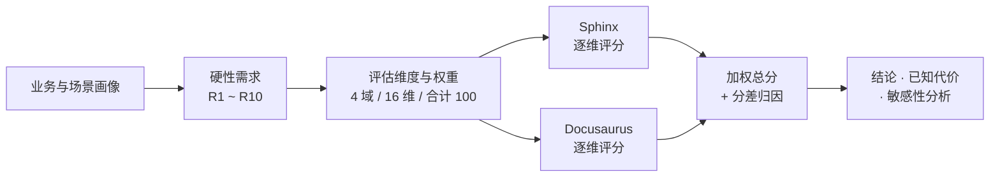

# 文档平台选型分析报告 · Sphinx vs Docusaurus

:::{note}
本页为「公司文档初始化项目」下的 **选型分析（Toolchain Selection）** 子页面，用于回答
「一套文档平台如何同时满足内部规范、对外门户与离线交付三类需求」。

> **版本说明**：本页为**公开去标识版本**，只保留可核实的方法论与行业事实；
> 含公司业务事实、内部需求编号与实施里程碑的**完整版仅在内网文档站发布**。分级判据与两版差异见 §11。

组织方式分三步：**先定义目标文档系统应具备的形态（§1）→ 再建立加权评分模型（§2）→ 最后对两个候选逐项量化评分并给出结论（§3–§5）**。

评估维度与权重由「目标场景」的硬性需求派生；权重、得分与阈值为示意口径，用于说明选型方法。实际选型需以组织架构、团队技能栈与安全基线复核。
:::

## 0. 摘要（Executive Summary）

| 候选方案 | 技术栈 | 加权总分（满分 100） | 判定 |
| --- | --- | --- | --- |
| **Sphinx**（MyST + sphinxcontrib-mermaid + 静态站） | Python / 构建期渲染 | **86.4** | ✅ **采纳** |
| Docusaurus（MDX + React SSG） | Node.js / 客户端渲染 | 70.2 | 备选（本次不采纳） |

**结论**：采纳 Sphinx。两者差距 **16.2 分**，但差距不是某一项拉开的，而是分布在 **10 个维度**上的结构性累积（原始分差 81 / 500）。本版的前提为**已配备专职文档岗**（见 §1.5 / §2.5）——该前提使差距由 14.2 扩大至 16.2。

- Docusaurus 的领先只有 2 项：内置多版本管理、版本/语言切换导航体验——均属**读者体验与前端形态**，可在二期通过换主题与前端定制部分补齐；**写作者门槛一项在"有专职文档岗"前提下已打平**（见 §2.5）；
- Sphinx 的领先集中在 **API 参考自动生成、PDF/离线交付、多格式与交叉引用**——其中 **PDF/离线交付在 Docusaurus 侧没有补齐路径**；**API 自动生成与交叉引用虽有第三方桥接方案（见 §3.4），但需自建并维护一条额外的 Doxygen 链、且能力降级**；**「修改前后双版本对比评审」两候选均无内置功能，实际靠 Git 源 diff + 自建流水线承载，属打平项**（见 §3.5）；
- 分差归因与权重敏感性见 §3.3 / §4.4：把 Docusaurus 优势维度的权重**大幅放大**、同时把 Sphinx 的王牌维度权重**集体压到基准的一半左右**，Docusaurus 仍落后 5.2 分——结论不翻转。
- **行业对标（§4.5）**：NVIDIA 的 CUDA 文档栈同样是 **Sphinx + Doxygen/Breathe + MyST + pydata 系主题**——与本报告的推荐在**四个关键选择上逐条一致**，构成一条独立于本模型的旁证。
- **反向对标（§4.6）**：国内同行**摩尔线程 MUSA** 的公开文档中心实测为 **Docusaurus v3.10.1**（Algolia DocSearch、4 版本并存、**无 PDF、无机密分级**）。同为 GPU 厂商、同样输出 C/C++ API 参考，NVIDIA 收敛到 Sphinx、摩尔线程收敛到 Docusaurus——**分野在交付场景，不在工具优劣**。这同时给 §3.4 的 A1 修正补了一个国内生产先例。**它为何没选 Sphinx 的四条归因，见 §4.6.2。**
- **第三种形态（§4.7）**：另一家国内 GPGPU 厂商**沐曦 MetaX** 的文档站实测为「**自建 Next.js 门户 + Sphinx 内核**」——渲染内核仍是 Sphinx（`sphinx-quickstart` 2021 生成、源文件为 reST），但**门户、服务与托管全部自建**。⚠️ **复核后修正早期误读**：该站 `objects.inv` 确有产出但**内容为空壳**（471 条中 0 个 C/C++ 符号，全是章节标签），且整份 API 参考为**纯手写 reST、无任何自动抽取链**（源文件 7,062 行 / 1,419 KB 可下载实证）。因此它是 §4.3「混用工具链可接受」的**架构形态**现场实例，**但不能作为 A5「符号级引用」的生产背书**——反过来，它给 §14.2「API 参考不能手写」这条红线提供了一个**反面活样本**。
- **成本视角（§8）**：能力分之外，另附**全生命周期成本清单**（搭建 / 运行 / 隐性风险 / 退出迁移）。短期 **Docusaurus 更低**（开箱、无系统级大依赖、前端零门槛），长期 **Sphinx 更低**（构建稳定、PDF / 分级 / API 开箱、依赖审计面小）；**交叉点由「有无专职文档岗 / 是否需要 PDF+分级+内网 / 是否超过数千页」三个变量决定**——目标场景三项全落在 Sphinx 一侧（其中"专职文档岗"已明确配备，见 §1.5）。
- **AI 时代重估（§9）**：把时间尺度拉到 5–10 年（文档新增一类读者＝**Agent**），同一模型重算为 **Sphinx 89.2 : Docusaurus 66.2**，差距由 16.2 **扩大到 23.0**，**结论强化**。分差重心从 A 域（API/PDF）移到 **B2 机器可验＋A5 符号图（`objects.inv`）＋C3 访问边界＋C1 语义检索**；Docusaurus 的传统领先项（多版本 / 导航 / 写作者门槛）**全部被降权**——它们只服务人类读者。⚠️ **`llms.txt` 是低成本保险、不是护城河**（采用率约 10%、主流 LLM 未承诺读取），且两套栈均有插件；§9.6 另写明两个会让结论反向的情形。

- **内容分级（§11）**：报告分**公开版 / 完整版**两个版本——完整版含公司业务事实与内部编号，**公开版（本页）为其去标识派生**。§11.1 说明两版关系，§11.2 给三级判据，§11.3 逐节给出分级与公开版处置，§11.4 是公开发布前的 6 项检查清单。
- **按分级重估（§12）**：只改与"内部信息"强相关的 5 个维度权重（C3 权限 7→1、B3 双版本评审 6→3、C1/C2/C4 各 +3），**含内部信息场景 Sphinx 86.4 : 70.2（差 16.2）**，**不含内部信息场景 Sphinx 82.2 : 76.6（差 5.6，微胜）**。⚠️ 关键澄清：**"脱敏"本身不足以翻转结论**——翻转需要场景整体改变（§6.3 的产品文档站场景才是 Docusaurus 83.8 反超），区别见 §12.5。
- **许可与付费（§13）**：三套工具**本体均免费开源**（BSD / MIT），付费点全在**生态与托管**——Read the Docs Business **$50 / $150 / $250 每月**（Enterprise $10k 起/年，私有仓库与 SSO 属付费项）、**Material for MkDocs Insiders 最低 $15/月**、**GitHub Pages 免费档仅限公开仓库**、**Algolia DocSearch 免费档要求站点公开可访问且 ≤10,000 条记录**。⇒ **付费的真正驱动因素是"内容是否对外"，不是工具**：文档公开→可零现金成本；含内部信息→必然产生权限/托管支出。

§2 的评估模型与 §3 的评分明细可直接复用于其他文档平台候选（如 MkDocs Material、Antora、GitBook、Confluence）。**§6 附录**用同一模型重算了「互联网对外产品文档站」场景，结论发生翻转（Docusaurus 83.8 反超）——用于说明本模型对场景敏感，结论不是为某个工具预设的（注意与 §12 的"仅脱敏"场景区分，见 §12.5）。

> **只想看结论的读者，可直接跳到下面的 §7 决策速览**：三个候选各 5 条最重要的优缺点 + 「是否混用」的三方案判定，一页拍板；**§8 另给两套栈的全生命周期成本账，§9 给出 AI 时代（5–10 年）的前瞻重估**。

---

## 1. 目标文档系统的需求画像

选型前先回答一个问题：**目标文档系统应该长什么样？** 这一节从业务约束与交付场景出发，把"应该是什么样"拆成可评估的约束；§2 的评估维度全部由本节派生，不引入画像之外的主观偏好（反向可追溯性）。

### 1.1 定位：一套源，三类交付面

目标场景设定为**一家 GPU 软件栈供应商**：其文档系统同时承担三种角色，且必须由**同一份源文件**产出——这就是「单一信息源（SSOT）」原则的含义：

| 交付面 | 读者 | 可达性 | 关键约束 |
| --- | --- | --- | --- |
| **内部开发者文档站** | 内部 SW/测试/运维 | 内网，需登录 | 含机密级 HLD / 接口规范，必须**权限分级** |
| **对外开发者门户** | GPU 客户与生态开发者 | 公网，只读 | 结构对标 NVIDIA CUDA / 摩尔线程 MUSA；需**按 SDK 版本**取数 |
| **离线交付件** | 客户现场工程师 | 断网 / 内网 | GPU 客户环境多为内网，需 **PDF 或离线包** |

三类交付面共享目录结构、模板与术语表；差异只在**发布目标与权限**，不在内容副本。任何要求"维护两套内容"的方案直接违反 SSOT 原则。

### 1.2 读者与场景分层

| 读者 | 主要场景 | 触及文档类型 | 对该场景的硬约束 |
| --- | --- | --- | --- |
| 外部开发者（GPU 客户） | 查 API、跑通样例、跨平台移植 | API 参考 / 编程指南 / 移植指南 / 安装 | 按 SDK 版本锁定、可检索、可下载 PDF |
| 技术文档工程师（TW，专职岗） | 文档体系与规范设计、模板、API 参考与指南撰写、术语与引用治理 | 全类型（主编） | **本场景的专职写作者**；承担工具链与语法门槛 |
| SW 工程师（内部，供稿方） | 设计与接口对齐、Code Review 参考；按规范补充头文件注释与初稿 | HLD / 接口规范 / 需求文档 | 需 PR 评审与**修改前后双版本对比**；内网可用 |
| 测试 / 集成 | 对照接口判可测性、验收 | 接口规范 / 需求文档 | 需可追溯、版本可回溯 |
| 运维 / SRE | 部署、升级、回滚 | 安装部署 / 发布说明 / FAQ | 需分级权限；步骤可复现 |
| 市场售前 / 客户支持 | 对外口径、一线排障 | Release Notes / FAQ / 手册 | 按版本取数，不能串版本 |
| 新人（HR 培训） | 3–5 天 onboarding | 手册 / HLD / FAQ | 路径化、导航清晰、可全文检索 |

### 1.3 内容形态矩阵

| 文档类型 | 内容来源 | 更新频率 | 是否需机器生成 | 规模量级 |
| --- | --- | --- | --- | --- |
| **API 参考** | C/C++/Python 源码注释、头文件 | 每个 release | **是（必须自动生成）** | 千级公开符号 |
| HLD / 设计文档 | 工程师手写 | 随版本节奏 | 否（但需图示） | 每模块 10–20 页 |
| 需求文档 | 产品 / TW（专职岗）主写 | 持续 | 否 | 每特性 1 份 |
| 编程指南 / 移植指南 | TW + 工程师合写 | 随版本节奏 | 否（含代码示例） | 数十页 |
| 安装部署 / FAQ / Release Notes | 多部门供稿 | 持续 | 部分（变更点来自版本库） | 累计型 |

矩阵中唯一**无法靠人力维持**的是 API 参考：GPGPU 软件栈的 API 面覆盖运行时、编译器、算子库、调试工具多条线，符号量在千级，且每个 release 都可能增删签名。这类文档的产出方式（自动提取 vs 手工维护）是选型的第一性判据。

### 1.4 派生的硬性需求（R1–R11）

下表把 §1.1–§1.3 的画像收敛为 10 条硬性需求，并标注它对应 §2 的哪个评估维度——这样"Sphinx 为什么赢"可以逐条回溯到具体业务诉求，而不是工具偏好。

| 编号 | 硬性需求 | 来源 | 对应维度 |
| --- | --- | --- | --- |
| R1 | API 参考必须从源码注释自动生成，人工不可持续维护 | §1.3 | A1 |
| R2 | 文档必须按 release / SDK 版本归档，读者按版本切换 | §1.1 §1.2 | A2 |
| R3 | 架构与接口必须能出类图 / 时序图，且图示可复现（源码即图源） | §1.3 | A3 |
| R4 | 必须能产出 PDF / 离线包交付内网客户 | §1.1 | A4 |
| R5 | 模块间交叉引用与术语一致性必须可机器校验 | §1.3 | A5 |
| R6 | 文档变更必须走 Git / PR / CI，可与代码同版本发布 | §1.1 §1.2 | B1 B4 |
| R7 | 必须支持「修改前 / 修改后」双版本渲染对比评审 | §1.2 | B3 |
| R8 | 统一库必须支持公开 / 内部 / 机密三级权限 | §1.1 | C3 |
| R9 | 中 / 英双语叠加多版本后，导航与切版本仍可用 | §1.1 | C2 |
| R10 | 文档体系由**专职文档岗（TW）**主写、研发工程师按规范供稿；工具链门槛不能成为产出瓶颈 | §1.5 | D1 |
| R11 | 术语表与跨项目符号引用由专职岗统一治理，须可机器校验 | §1.5 | A5 |

> 补充约束（不计入加权，作为一票否决的筛除项）：**构建必须能完全离线完成**（内网 CI 无公网出口）、**源文件必须能在 Git 托管页面上直接阅读**（评审与检索不依赖构建产物）。

### 1.5 组织前提：配备专职文档岗

§1.1–§1.4 描述的是**需求**；本节补一条**组织前提**——它不是需求，而是本报告评分的**边界条件**：

| 项 | 设定 |
| --- | --- |
| 岗位 | **技术文档工程师（TW）专职岗**，1 人起，归口文档 / 研发效能方向 |
| 职责 | 文档体系与目录设计、模板与规范、API 参考与指南撰写、术语表与跨项目引用治理、评审流程执行、工具链维护 |
| 与研发分工 | 研发工程师按规范**补充头文件注释与初稿**；TW 负责结构化、规范化与发布 |
| 为什么写进报告 | 它是 §2.5 权重校准的前提（D1 下调、A5 上调），也是 §8 组织归属成本的落点 |

> **为什么强调这条**：同一套工具，**有专职岗与没有专职岗，评分结论不同**。有专职岗时，Sphinx 的两项组织短板（语法门槛 + 需新建 Python 文档能力）被补齐；没有专职岗、由前端 / 研发团队兼任时方向相反（见 §6.3）。本报告采用**有专职岗**作为基准前提。

---

## 2. 评估模型与权重

### 2.1 评分标尺与决策流

评分采用 **0–5 分**定序尺度。为抑制主观漂移，每一档的锚点由**落地成本**（该维度在目标场景场景下要花的二次开发代价）定义，而非"好用/不好用"的笼统感受：

| 分值 | 锚点定义 |
| --- | --- |
| **5** | 官方原生支持，开箱即用，二次开发成本 ≈ 0 |
| **4** | 官方或一级生态支持，少量配置即可达成交付要求 |
| **3** | 需成熟第三方插件，或工程量可控的二次开发 |
| **2** | 需自研，成本高 / 风险中，或只覆盖场景的一部分 |
| **1** | 基本不可行，须引入额外工具链替代 |
| **0** | 结构性缺失，无可行路径 |

打分只依据**已发布能力**（官方文档 / 成熟插件 / 已验证实践），不依据路线图承诺；同一维度两候选必须按同一把尺子打分。

### 2.2 维度与权重（4 域 / 16 维 / 合计 100）

权重代表**"该项做不到时对项目目标的杀伤力"**，不表示工作量，也不表示工具实现的复杂度。若把权重当工作量分配，就会得出"图表支持比 API 自动生成更重要"这类与业务倒挂的结论。

#### A 域 · 内容与工程栈适配（合计 37）

| 编号 | 评估维度 | 权重 | 派生需求 |
| --- | --- | --- | --- |
| A1 | API 参考自动生成（从 C/C++/Python 源码注释提取） | **12** | R1 |
| A2 | 多版本管理（按 release / SDK 版本归档与切换） | **8** | R2 |
| A3 | 图表与架构表达（PlantUML / Graphviz / Mermaid、时序图、类图） | **6** | R3 |
| A4 | 多格式输出（HTML / PDF / 离线包） | **5** | R4 |
| A5 | 交叉引用与术语一致性（强类型引用、跨项目链接、术语校验） | **6** | R5 R11 |

#### B 域 · Docs-as-Code 流水线契合度（合计 25）

| 编号 | 评估维度 | 权重 | 派生需求 |
| --- | --- | --- | --- |
| B1 | Git / PR 工作流与 CI 集成成熟度 | **8** | R6 |
| B2 | 构建期质量门禁（warning-as-error、死链检查、拼写与术语 lint） | **7** | R5 |
| B3 | 修改前后双版本对比评审 | **6** | R7 |
| B4 | 构建速度与可复现性（含完全离线构建） | **4** | R6 R10 |

#### C 域 · 读者体验与交付（合计 25）

| 编号 | 评估维度 | 权重 | 派生需求 |
| --- | --- | --- | --- |
| C1 | 检索质量（离线 / 在线搜索、中文分词、Top-N 命中） | **7** | §1.2 |
| C2 | 版本 / 语言切换与导航体验（含移动端） | **6** | R9 |
| C3 | 权限与分级访问（公开 / 内部 / 机密） | **7** | R8 |
| C4 | 阅读性能与可访问性（首屏、无障碍、纯静态可达） | **5** | §1.1 |

#### D 域 · 组织落地与可持续性（合计 13）

| 编号 | 评估维度 | 权重 | 派生需求 |
| --- | --- | --- | --- |
| D1 | 学习曲线与写作者门槛（专职岗主导、工程师供稿） | **4** | R10 |
| D2 | 生态扩展与社区活跃度 | **5** | R6 |
| D3 | 供应链安全与依赖维护成本 | **4** | 安全基线 |

### 2.3 计分公式

设某维度权重为 **w**（该维度满分即 w）、Sphinx 得分为 **s**、Docusaurus 得分为 **d**（s、d ∈ [0, 5]），则：

- **单维度加权分** = 得分 ÷ 5 × 权重
- **加权总分** = Σ(单维度加权分)，满分 = Σw = **100**
- **归一化总分** = Σ(得分 × 权重) ÷ (5 × 100) × 100%

分差归因用**原始分**（未除 5）做拆解：单维分差 **Δ = (s − d) × w**，正值记 Sphinx 领先，负值记 Docusaurus 领先；**ΣΔ** 即两者原始总分差。

### 2.4 权重分配理据

| 编号 | 权重 | 该权重为什么是这个数 |
| --- | --- | --- |
| A1 | 12 | 唯一「人力不可替代」项：千级 API 符号 + 每 release 变更，手工维护必然漂移，直接决定 API 文档能不能存在 |
| A2 | 8 | 客户按 SDK 版本用文档，版本归档是商业约束不是体验偏好；无版本化则旧客户无法取数 |
| A3 | 6 | HLD 与接口规范以图为主载体，但图可预渲染后入库，工具侧替代路径多，故低于 A1/A2 |
| A4 | 5 | 内网客户交付的刚性需求，但只需 1 条输出链路，成本可控 |
| A5 | 6 | 专职文档岗的核心专业价值＝术语表与跨项目引用治理；有专人运营时，可机器校验的符号级引用价值显著上升（本版权重由 4 上调） |
| B1 | 8 | Docs-as-Code 是项目核心诉求，工作流不契合则整套流水线立不起来 |
| B2 | 7 | 质量门禁决定文档是否"能评审"；warning-as-error 与死链检查是站点的既有验收口径 |
| B3 | 6 | 三方 PR 评审机制的载体，双版本对比直接决定评审效率与准确性 |
| B4 | 4 | CI 时长影响评审体验，离线构建是内网硬门槛；但两者都有工程绕行手段 |
| C1 | 7 | "可检索"是 SSOT 的明确目标；中文分词质量直接影响国内开发者体验 |
| C2 | 6 | 双语 × 多版本叠加后导航复杂度上升；但以阅读舒适度为主，权重低于检索与权限 |
| C3 | 7 | 机密级 HLD 与对外门户共存于一套源，权限是合规硬约束 |
| C4 | 5 | 对外门户形象与移动端可达性；影响面宽但不致命 |
| D1 | 4 | 文档由专职岗主写，语法 / 指令门槛由专人消化，工程师只按模板供稿——门槛对产出的杀伤力下降（本版权重由 6 下调） |
| D2 | 5 | 属于长期可维护性，短期不构成阻塞 |
| D3 | 4 | 企业安全扫描与依赖升级成本真实存在，但有流程手段缓解 |

> 权重合计校验：37（A）+ 25（B）+ 25（C）+ 13（D）= **100**。

### 2.5 组织前提：专职文档岗对权重的影响

本报告的基准场景**已配备专职文档岗**（技术文档工程师，1 人起，见 §1.5）。这一条不是背景描述，它直接改变两个维度的权重——**一降一升，合计不变**：

| 维度 | 调整前 | 调整后 | 理由 |
| --- | --- | --- | --- |
| D1 写作者门槛 | 6 | **4** | 专职岗承担语法 / 指令 / 引用体系的学习成本，工程师只按模板供稿——"门槛"对产出的杀伤力下降 |
| A5 交叉引用与术语一致 | 4 | **6** | 术语表治理与跨项目符号级引用正是专职岗的核心职责；有专人运营时，可机器校验的引用体系价值上升 |

两点说明：

1. **这不是"为让 Sphinx 赢而调权重"。** D1 与 A5 的调整方向相反、净权重不变，且两项都直接源自"有一个专职岗"这一事实：专职岗既消解了语法门槛（D1 下降），也放大了引用治理的收益（A5 上升）。
2. **评分同步调整。** D1 上 Sphinx 由 3 分升至 **4 分**（专职岗 + 全站 MyST，门槛不再抑制产出），与 Docusaurus 的 4 分**打平**——这是全部 16 维中唯一因本前提而改变评分的维度。

> 对照：若**没有**专职岗（文档由前端 / 研发团队兼任），方向正好相反——D1 权重应升至 10、A5 回落，Sphinx 的组织成本上升、差距相应收窄。§6.3 的「互联网对外产品文档站」场景即属此类，故其结论发生翻转。

---

## 3. 逐项量化评分

### 3.1 评分明细（16 维）

| 编号 | 评估维度 | 权重 | Sphinx | Docusaurus | 加权分 S / D | 判定依据（关键事实） |
| --- | --- | --- | --- | --- | --- | --- |
| A1 | API 自动生成 | 12 | **5** | 3 | 12.0 / 7.2 | Sphinx：autodoc / autoapi / Breathe+Doxygen 为**第一方**支持，覆盖 Python 与 C/C++；Docusaurus：**无第一方 C/C++ 提取**，但可经 Doxygen XML → MDX **第三方桥接**达成（xpack 插件 / Microsoft doxysaurus / Doxy2MDX，见 §3.4）——桥接链需自建自维护、且拿不到符号级引用，故评 3 分 |
| A2 | 多版本管理 | 8 | 4 | **5** | 6.4 / 8.0 | Docusaurus 内置 versioned_docs 与版本切换器，开箱；Sphinx 依赖 sphinx-multiversion / sphinx-versioning 等第三方插件，配置繁琐 |
| A3 | 图表与架构表达 | 6 | **5** | 4 | 6.0 / 4.8 | Sphinx：PlantUML / Graphviz / Mermaid 全支持且可预渲染 SVG 入库；Docusaurus：官方 theme-mermaid，无 PlantUML 原生链 |
| A4 | 多格式输出 | 5 | **5** | 1 | 5.0 / 1.0 | Sphinx：LaTeX/PDF、epub、man 原生 builder；Docusaurus：仅 HTML（SSG/SPA），PDF 须自研（paged.js 等） |
| A5 | 交叉引用与术语一致 | **6** | **5** | 3 | 6.0 / 3.6 | Sphinx：intersphinx 跨项目强类型引用、`:ref:` 语义锚点；Docusaurus：相对链接 + Link 组件，无跨项目符号级引用。权重 4→6（专职岗放大引用治理价值，见 §2.5） |
| B1 | Git / PR / CI 契合 | 8 | **5** | **5** | 8.0 / 8.0 | 两者源文件天然版本化，PR + Actions 集成均成熟，打平 |
| B2 | 构建期质量门禁 | 7 | 4 | 3 | 5.6 / 4.2 | Sphinx：`-W` warning-as-error、nitpick 校验、spelling 扩展；Docusaurus：onBrokenLinks 可失败构建，但缺等价的全量告警门禁与外链校验 |
| B3 | 双版本对比评审 | 6 | 4 | 4 | 4.8 / 4.8 | **打平**：两者**均无内置"两版对比"功能**；主渠道是**源文件 git diff**（随 PR 走，与工具无关），渲染产物 diff 二者皆为 SSG 多页静态 HTML 故同样可行——Docusaurus 需过滤 hydration / hash 资源名 / 内联 JSON 噪声。"双版本在线并存"由 Docusaurus 内置，但已计入 A2，不在此重复（详见 §3.5） |
| B4 | 构建速度与可复现 | 4 | 3 | 3 | 2.4 / 2.4 | Sphinx：依赖少、可完全离线，但全量 autodoc 重建慢；Docusaurus：增量快，npm 依赖树大、冷启动慢 |
| C1 | 检索质量 | 7 | 4 | 3 | 5.6 / 4.2 | Sphinx：内置离线 searchindex.js（无第三方依赖，中文分词需补丁）；Docusaurus：Algolia DocSearch 中文效果好但为云端服务、需申请，本地搜索插件能力弱于 Algolia |
| C2 | 版本/语言切换与导航 | 6 | 3 | **5** | 3.6 / 6.0 | Docusaurus：版本切换器与 i18n 语言切换器内置、导航体验最佳；Sphinx：需靠主题 + 插件拼装，体验依赖主题选型 |
| C3 | 权限与分级访问 | 7 | 4 | 3 | 5.6 / 4.2 | 两者产物均为静态资源、本身无鉴权；Sphinx 多页静态 HTML 更易直接置于内网反代 + SSO 网关，并可经 Read the Docs 私有版本托管；Docusaurus 依赖平台级 password protection，内网自建链路更长 |
| C4 | 阅读性能与可访问性 | 5 | 4 | 3 | 4.0 / 3.0 | Sphinx：多页纯静态 HTML，首屏快；Docusaurus：React SSG/SPA，首屏 JS 体积更大 |
| D1 | 学习曲线与写作者门槛 | **4** | **4** | **4** | 3.2 / 3.2 | **打平**：专职岗承担 Sphinx 侧的指令 / 引用体系学习成本（本方案以 MyST 走 Markdown，工程师侧门槛已消除），故 Sphinx 由 3 升至 4；Docusaurus：MDX 上手平缓，深度定制才需 React。权重 6→4（见 §2.5） |
| D2 | 生态与社区活跃度 | 5 | **5** | 4 | 5.0 / 4.0 | Sphinx：技术出版与 API 文档领域 20 年沉淀，插件生态深；Docusaurus：Meta 维护、前端社区活跃，但文档专用插件纵深不及 Sphinx |
| D3 | 供应链安全与依赖维护 | 4 | 4 | 2 | 3.2 / 1.6 | Sphinx：Python 依赖少、审计面小；Docusaurus：npm 依赖树达千级，CVE 告警密集，企业扫描与升级成本高 |
| — | **合计** | **100** | — | — | **86.4 / 70.2** | 原始分 432 / 351（满分 500），归一化 **86.4% / 70.2%** |

### 3.2 分类小计

| 域 | 权重合计 | Sphinx 加权分 | Docusaurus 加权分 | 得分率 S / D | 差距 |
| --- | --- | --- | --- | --- | --- |
| A · 内容与工程栈适配 | 37 | **35.4** | 24.6 | 95.7% / 66.5% | +10.8 |
| B · Docs-as-Code 流水线契合度 | 25 | **20.8** | 19.4 | 83.2% / 77.6% | +1.4 |
| C · 读者体验与交付 | 25 | **18.8** | 17.4 | 75.2% / 69.6% | +1.4 |
| D · 组织落地与可持续性 | 13 | **11.4** | 8.8 | 87.7% / 67.7% | +2.6 |
| **合计** | **100** | **86.4** | **70.2** | **86.4% / 70.2%** | **+16.2** |

要点：**差距的 67%（10.8 / 16.2）集中在 A 域**。B 域与 C 域几乎打平（各差 1.4 分），说明 Docusaurus 在"读者体验"上确实不弱——它输在内容生产能力，而不是输在好看不好看。（D 域差 +2.6，其中大部分来自"有专职岗"前提对 A5 的上调。）

### 3.3 分差归因（原始分拆解）

| 排名 | 维度 | 权重 | Δ = (s − d) × w | 归因 |
| --- | --- | --- | --- | --- |
| 1 | A1 API 自动生成 | 12 | **+24** | Docusaurus 侧需第三方桥接（Doxygen XML → MDX），链需自建自维护且丢符号级引用；权重最高，仍为最大单项分差 |
| 2 | A4 多格式输出 | 5 | **+20** | Docusaurus 仅 HTML，PDF 需另建工具链 |
| 3 | A5 交叉引用 | 6 | **+12** | Sphinx 有跨项目符号级引用，Docusaurus 无；权重经"专职岗"前提由 4 上调至 6（见 §2.5） |
| 4 | D3 供应链安全 | 4 | **+8** | npm 依赖树规模带来的审计成本 |
| 5 | B2 质量门禁 | 7 | **+7** | warning-as-error 与外链校验能力差异 |
| 6 | C1 检索 | 7 | **+7** | 离线搜索 vs 云端搜索的可用性差异 |
| 7 | C3 权限分级 | 7 | **+7** | 静态产物 + 内网反代 SSO 的链路长度差异 |
| 8 | A3 图表表达 | 6 | **+6** | PlantUML 原生链差异 |
| 9 | C4 阅读性能 | 5 | **+5** | 多页静态 vs SPA 首屏 |
| 10 | D2 生态纵深 | 5 | **+5** | 文档专用插件生态深度差异 |
| 11 | **C2 版本/语言切换与导航** | 6 | **−12** | **Docusaurus 领先**：版本与语言切换器内置 |
| 12 | **A2 多版本管理** | 8 | **−8** | **Docusaurus 领先**：versioned_docs 开箱 |
| — | **D1 写作者门槛** | 4 | **0** | **打平**：专职岗消化 Sphinx 侧门槛（评分升至 4），Docusaurus 的"上手平缓"不再构成差异（见 §2.5） |
| — | B1 / **B3** / B4 | 8 / **6** / 4 | 0 | 打平 |

**Sphinx 领先维度合计 +101，Docusaurus 领先维度合计 −20，净差 +81**（原始分，满分 500）。

结论性读法：**Sphinx 领先 10 个维度、Docusaurus 领先 2 个维度**，不存在"只要改一项就能反超"的杠杆点；而 Docusaurus 的 2 项领先全部集中在读者可见的前端形态层——这一层是 Sphinx 可以通过主题替换与前端定制去追的，反之 Docusaurus 侧的 **A4 无法通过配置补齐**、**B2 须自研插件**，**A1 / A5 则须引入并维护一条第三方 Doxygen 桥接链**（见 §3.4）。**可替代性不对称**，这是本次决策的核心依据。

### 3.4 补充：C/C++ API 生成的桥接路径（A1 评分修正说明）

> **修正说明**：本报告初稿把 A1 表述为「Docusaurus **无** C/C++ API 提取路径」，评 2 分。经复核，该表述**过强**——API 提取引擎与站点生成器是**解耦**的两层，Docusaurus 侧存在真实可用的**桥接链**，且已有生产先例。故 A1 由 **2 分修正为 3 分**（对应标尺"需成熟第三方插件，或工程量可控的二次开发"）。修正后总分 67.0 → **69.4**，与 Sphinx 的差距 19.0 → **16.6**，结论不变。（注：以上为 A1 修正**当时**的口径，彼时尚未计入 §2.5 的专职岗权重校准；本版最终基准为 **86.4 : 70.2**。）

#### 关键事实：为什么桥接可行

- **Doxygen 是工具无关的提取引擎**，输出 HTML / LaTeX·PDF / RTF / man / DocBook / **XML**（注意：Doxygen **不输出 Markdown 站点**，Markdown 只是注释的*书写*语法）。跨工具互操作的事实标准是 **XML**。
- 连 Sphinx 的 C/C++ 方案（**Breathe**）**也是读 Doxygen XML**——所以"API 能不能自动生成"这件事，两个候选用的是**同一个引擎**。真正的差异落在**集成层**：Sphinx + Breathe 是第一方、且能给出 intersphinx 符号级引用；Docusaurus 侧要自己接一条链。
- 桥接链的通用形态：**Doxygen（注释 → XML）→ 转换器（XML → Markdown/MDX）→ 站点**，在 CI 里串成两步即可。

#### Docusaurus 侧的四条桥接路径（按成熟度排序）

| # | 方案 | 机制 | 成熟度 / 证据 |
| --- | --- | --- | --- |
| 1 | `@xpack/docusaurus-plugin-doxygen` | Docusaurus **插件**：解析 Doxygen XML → 生成 `/docs/api/` 下的 MDX + 侧边栏 + 导航下拉 | 已发布 npm 包，配置即用；README **明确提示大站点需加大 Node 堆**（`--max-old-space-size=8192`）——千级符号场景有内存风险 |
| 2 | `@rnw-scripts/doxysaurus`（Microsoft） | Doxygen XML → Docusaurus Markdown；`yarn doc` 一键 + `--watch` 边写边看 | **生产级证据**：react-native-windows 用它为 `Microsoft.ReactNative.Cxx` 生成 C++ API 文档站——真实大型 C++ API 已跑在 Docusaurus 上 |
| 3 | `Doxy2MDX`（Python） | Doxygen XML → MDX（含 frontmatter + CSS） | 轻量、易读易改模板；单作者维护 |
| 4 | `doxybook2` / `clang-doc` | doxybook2：Doxygen XML → Markdown/JSON（"任意 SSG"）；clang-doc：LLVM 官方工具，`--format=md` **原生出 Markdown** | doxybook2 **原仓库已被作者归档**，靠社区 fork 续命；clang-doc 仍自述 "very early development stage" |

#### 但为什么仍停在 3 分（未上调到 4~5）

| 判据 | 事实 | 影响 |
| --- | --- | --- |
| **非第一方** | 四条路径全是第三方 / 社区件，**没有一条由 Docusaurus 官方维护** | 与 Sphinx+Breathe（第一方、20 年沉淀）在**可持续性**上不同量级 |
| **供应链风险已现** | doxybook2 原仓库**被作者归档**；xpack 插件为单厂商维护 | 桥接链本身变成需要长期保养的资产（对应 D3 供应链安全） |
| **丢符号级交叉引用** | 桥接产出的是静态 Markdown 页面，**不产生 intersphinx 式的跨项目符号引用** | 连带压低 A5——SSOT 的黏合能力无法靠桥接补齐 |
| **规模风险** | 千级符号 → Node 内存告警（插件 README 已注明） | GPGPU 符号量正落在风险区 |
| **仍无 PDF** | 桥接只解决 A1，**A4（PDF / 离线交付）依旧无路径** | 内网客户交付缺口不变 |

**结论**：桥接路径**真实存在且已有生产先例**（Microsoft RNW），因此 A1 评 2 分偏低、已修正为 3 分；但四条路径**全属第三方**、且**只解决"生成"、不解决"引用与交付"**，不足以支撑到 4 分。修正后 Sphinx 仍领先 **16.2 分**（本版基准，见 §3.2），A1 仍是最大单项分差（**−24**）。

### 3.5 补充：「修改前后双版本对比评审」的能力归属（B3 评分修正说明）

> **修正说明**：本报告此前把 B3 评为 Sphinx **5** / Docusaurus **3**，理由写作"Sphinx 静态多页产物可 diff、Docusaurus SPA 产物需自研"。经复核，该判断有两处错误，B3 修正为 **Sphinx 4 / Docusaurus 4（打平）**。连锁更新：总分 Sphinx 86.0 → **84.8**、Docusaurus 69.4 → **70.6**，差距 16.6 → **14.2**；B3 单项分差 +12 → **0**，退出归因榜。**结论不变。**（注：该链条为 B3 修正**当时**的口径；本版在 §2.5 专职岗权重校准后，最终基准为 **86.4 : 70.2**，差 **16.2**。）

#### 错误一：把"产物属性"当成了"Sphinx 的功能"

**Sphinx 没有任何内置的"双版本对比"能力**：

- **core 无 diff builder。** Sphinx 的 builder 清单是 html / dirhtml / singlehtml / latex / epub / man / texinfo / text / gettext / **changes** / linkcheck / doctest / coverage / pickle / json / xml 等——其中 `changes` 生成的是**同一份文档内的版本变更日志**（来自 `.. versionadded::` / `versionchanged::` / `deprecated::` 指令），**不是两版文档的对比视图**；
- **官方从不提供"对比两版"的入口。** 唯一沾边的第三方扩展 `sphinxdiff` 是个人项目（GitHub 0 star、无发布版本），其 README 自述"**不追求全自动**，只给编辑一个 diff 草稿"——恰好反证这条能力需要自建；
- **多版本托管同样非官方。** 版本并存浏览依赖第三方插件（`sphinx-multiversion` / `sphinx-versioning`），这一项**已在 A2 计为 Docusaurus 领先**（原始分 −8），不应在 B3 重复计分。

> 补充一个易混点：Sphinx 有第一方的 `literalinclude :diff:`，但它的对象是**两段代码文件**（生成 unified diff 代码块），与"对比两版文档"无关。

#### 错误二：低估了 Docusaurus 的产物形态

Docusaurus 是**静态站生成器（SSG）**，不是"只有 SPA"。`docusaurus build` 产出的 `build/` 目录里，**每个路由都有一份预渲染好的 `index.html`**——原文表述为 "prerendered HTML per route: every doc page exists as a complete index.html on disk, readable with curl and no JavaScript engine at all"。因此对两次构建做逐页比对**同样可行**。

真正的差别是**噪声**而非**能力**：Docusaurus 的 HTML 里含 hydration 脚本、hash 化的 `assets/js/*.<hash>.js` 引用与内联 JSON 快照，需要过滤后才能得到干净 diff。这是**成本差异**，可以量化，但不是"需自研渲染对比"这种能力缺口。

#### 真实机制拆解：三个渠道

| 渠道 | 是什么 | Sphinx | Docusaurus |
| --- | --- | --- | --- |
| ① **源文件级 diff** | 对 `.md` / `.rst` 源做 git diff / PR diff | ✅ 同 | ✅ 同 |
| ② **渲染产物 diff** | 对两次构建的静态 HTML 逐页比对 | ✅ 产物无 hydration、无 hash 资源名，diff 干净 | ✅ 可行，需过滤 hydration / hash 资源 / 内联 JSON 噪声 |
| ③ **双版本在线并存** | 两个版本同时可访问、可切换 | ⚠️ 需第三方插件（sphinx-multiversion） | ✅ 内置 versioned_docs |

**关键事实**：在 Docs-as-Code 工作流下，评审的**主渠道是 ①**——它**与工具完全无关**，两个候选都直接受益于 Git；三方 PR 评审机制，其载体正是源 diff。②是补充手段；③主要服务于 release 归档，已由 A2 计分。

#### 结论

扣除与 A2 的重叠后，三个渠道的净效果为**打平**，B3 评 **Sphinx 4 / Docusaurus 4**。

**性质须说清**：**"双版本对比评审"不是 Sphinx 的独有优势，而是两个候选共同依赖 Git 的工程动作**——把它记成 Sphinx 的加分项，会让报告看起来像在给结论凑分。修正后 Sphinx 仍领先 **16.2 分**（本版基准，见 §3.2），该结论由 A 域（API 自动生成 / PDF / 交叉引用）单独支撑，不依赖 B3。

---

## 4. 决策结论

### 4.1 结论与理由

**采纳 Sphinx（MyST + sphinxcontrib + 静态站 + Git/CI 流水线），不采纳 Docusaurus。**

三条理由，按分量排序：

1. **高权重"生死项"上 Docusaurus 明显落后，且差距集中在"可替代性最低"的几项。** A1 / A4 / A5 三项权重合计 **23**，Sphinx 拿满 23.0/23（100%），Docusaurus 仅 11.8/23（51.3%）——这三项贡献 **11.2 分**，占全部差距 16.2 分的 **69%**。其中 **A4（PDF 交付）在 Docusaurus 侧无补齐路径**；**A1（API 自动生成）与 A5（跨项目符号引用）虽有第三方桥接方案（见 §3.4），但需自建并维护一条额外的 Doxygen 链、且拿不到 intersphinx 式引用**——A1 修正为 3 分后仍是最大单项分差（**−24**）。
2. **差距跨 10 个维度累积，没有单点杠杆可翻转。** 见 §4.4 敏感性分析：即使施加极端敌意权重，结论仍不翻转。
3. **可替代性不对称。** Docusaurus 的 2 项领先（C2 / A2）都位于主题与前端形态层，Sphinx 可通过换主题（pydata-sphinx-theme / Furo）、引入 multiversion 插件、以及全面改用 MyST 语法在本期或二期追平大部分；而 Docusaurus 侧的 A4 无法通过配置或主题补齐、B2 须自研插件，A1 / A5 只能靠一条第三方 Doxygen 桥接链部分弥补。

### 4.2 Sphinx 方案的已知代价与缓解

选型报告不写"零缺点"。Sphinx 的代价是真实存在的，逐条给出缓解措施与可验收口径——这些口径同时构成项目启动阶段的验收点：

| 已知代价 | 影响 | 缓解措施 | 验收口径 |
| --- | --- | --- | --- |
| reST 语法学习曲线陡 | 研发写作者上手慢，文档产出量受抑制 | **全站改用 MyST（Markdown）** + **专职文档岗承担指令 / 引用体系**，模板仓库 + 5 篇可复制示例；reST 仅保留给历史页面 | 新人首篇文档 PR 合入 ≤ 2 天 |
| 多版本管理依赖第三方插件 | 版本切换体验弱于 Docusaurus | 引入 sphinx-multiversion / sphinx-versioning + 主题版本菜单 | 版本切换器可用，同时构建 ≥ 3 个版本 |
| 默认主题（alabaster）观感朴素 | 对外门户形象偏弱 | 换 **pydata-sphinx-theme**（NVIDIA 主题的开源基座，见 §4.5）或 Furo / sphinx-immaterial + 品牌 CSS；对外站与内网站共用主题、分色系 | 首屏 LCP < 2.5s，移动端渲染无横向滚动 |
| 中文检索分词弱 | 国内开发者检索命中率下降 | 引入 jieba 分词补丁，或部署独立搜索服务（如 Meilisearch）离线托管 | 抽样 50 条查询，Top-5 命中率 ≥ 80% |
| SPA 交互能力弱（无 API try-it） | 部分对外文档的交互体验缺失 | 在关键示例页内嵌轻量交互组件（按需，不引入整站 SSG 迁移） | 至少 1 个 API 示例可在线运行 | 

### 4.3 为何不做双栈混合

一个自然的替代方案是"对外门户用 Docusaurus、API 参考与内部规范用 Sphinx"。评估结论：**本期不采纳。**

- 违反 SSOT 原则：同一术语与接口契约将在两套内容源里各存一份，漂移不可控；
- 维护成本乘二：两套构建链、两套 CI、两套依赖审计、两套权限模型；术语表与交叉引用需手工对齐；
- 前端形态层的收益（C2 / A2，合计权重 14）不足以覆盖上述成本。

**例外触发条件**：当对外门户与内部规范在内容上**完全解耦**（对外站只承载营销、教程与公开 API，不再引用内部 HLD 与机密接口），且对外站出现强交互诉求（在线 playground、交互式教程）时，重新评估混合架构。届时本报告的评分模型可直接复用，只需重算 C 域与 A 域的权重。

### 4.4 敏感性分析（权重扰动）

§2.2 的权重含主观成分，因此必须回答："换一套权重，结论会不会翻？" 以下三组扰动均在**保持 16 维得分不变**的前提下，只改权重并重新归一化到 100。

| 场景 | 权重调整方式 | Sphinx | Docusaurus | 差距 | 是否翻转 |
| --- | --- | --- | --- | --- | --- |
| 基准（**有专职文档岗**，见 §2.5） | 见 §2.2 | 86.4 | 70.2 | 16.2 | — |
| **扰动 1**：认为导航体验比 API 自动生成更重要 | A1 12→6，腾出 6 分给 C2（6→12） | 84.0 | 72.6 | 11.4 | ❌ 不翻转 |
| **扰动 2**：极端敌意（同时打击 Sphinx 王牌、放大 Docusaurus 优势） | A2 8→16、C2 6→12、D1 4→12（优势维度放大）；A1 12→6、A5 6→3、A4 5→3、B3 6→4、B2 7→4、C1 7→4、C3 7→4（Sphinx 王牌全部压到基准的一半左右） | 83.0 | 77.8 | 5.2 | ❌ 不翻转 |
| **翻转阈值**：需要多大扰动才能翻转 | 把 C2 的权重从 6 提到约 **24**（占 24%，基准的 4 倍），且腾挪出的权重必须取自 A4（5，取尽）与 A1（12）、A5（6）——即同时把 PDF 交付、API 自动生成与符号引用三项压到合计 ≈5（基准 23 的 22%） | ≈79.3 | ≈79.3 | ≈0 | ⚠️ 理论可翻转，但权重已超出任何可辩护区间 |

结论：**权重在 §2.4 理据可支撑的区间内扰动，结论不翻转。** 扰动 2 是关键证据——它在 Sphinx 侧已把王牌维度的权重压到基准的一半左右、在 Docusaurus 侧把优势维度权重大幅放大（已超出理据可支撑的范围），Docusaurus 仍落后 5.2 分。这说明分差来自**维度覆盖面**（Sphinx 领先 10 项 vs Docusaurus 领先 3 项），而不是权重分配的偶然。

### 4.5 行业对标：NVIDIA CUDA 的文档栈（正向验证）

§1.1 把对外门户的目标定为「结构对标 NVIDIA CUDA」。那么 **NVIDIA 自己用什么？** 核实结果：**NVIDIA 的文档栈与本报告的推荐高度收敛**——这构成一条独立于本模型的旁证。

| 层 | NVIDIA 的实际选择 | 证据 |
| --- | --- | --- |
| 站点框架 | **Sphinx** | NVIDIA 官方在 PyPI 维护 `nvidia-sphinx-theme`；CUDA 页面标题格式 `… — … documentation` 与 `¶ Permalink to this headline` 均为 Sphinx 特征 |
| 主题 | **`nvidia-sphinx-theme`**（**基于 PyData Sphinx Theme** 二次开发） | 其运行时依赖只有 `sphinx` + `pydata-sphinx-theme`（PyPI 元数据）。⚠️ 该主题为 **NVIDIA 专有许可**，仅限 NVIDIA 产品使用，第三方不可直接采用 → 对应方案应取其开源基座 **pydata-sphinx-theme** |
| C/C++ API 提取 | **Doxygen → Breathe**（Doxygen XML 桥入 Sphinx） | CUDA Runtime API 的 `Deprecated List` 页由 Sphinx/Breathe 渲染，但链接仍是 Doxygen 的分组名 `group__CUDART__…__DEPRECATED.html`——**后端 Doxygen、前端 Sphinx** 的组合铁证 |
| 写作语法 | 新项目用 **MyST Markdown**；API 页用 autodoc / autosummary | NVIDIA Elements 的 Sphinx starter 用 MyST；cuDF 文档明写「Documents … written using MyST … built using Sphinx」 |
| 构建口径 | `sphinx-build -W --keep-going -n -b html` | NVIDIA Elements 官方 starter 的构建命令——与本报告 §5 的验收口径**同款**（`-W` 把告警升级为错误） |
| 多版本 | 按 release 归档（每个 CUDA 版本有独立 Online Documentation） | CUDA Toolkit Archive 的 versioned online docs（R2 的落地先例） |

**读法**：NVIDIA 在「C/C++ API 密集 + 需 PDF + 需按版本归档 + 需分级」这套约束下，同样收敛到 **Sphinx + Doxygen/Breathe + MyST + pydata 系主题**。这与本报告对目标场景的推荐**在四个关键选择上逐条一致**（站点框架 / API 提取链 / 写作语法 / 构建门禁），差异只在**主题观感**——而 NVIDIA 的做法恰好证明 §4.2 的缓解路径（换一套现代主题）是**已在最大规模场景验证过的**。

> 一条侧证：`nvidia-sphinx-theme` 关掉了 Sphinx 署名（`html_show_sphinx = False`）。这说明"看起来不像 Sphinx"**纯属主题层**、与引擎无关——进一步支撑 §4.2「默认主题朴素是可缓解的代价」这一判断。

### 4.6 行业对标：摩尔线程 MUSA 的文档栈（反向验证——同行选了 Docusaurus）

§4.5 是一条正向旁证。但一条**反例**的信息量更大：**国内最直接的同行**——摩尔线程（国产全功能 GPU，MUSA 平台对标 CUDA）——它的官方文档中心，选的是 **Docusaurus**。这是对 §6 场景论的一次真实世界检验。

实测方式：直接抓取 `docs.mthreads.com` 的原始 HTML 读生成器指纹（非二手转述）。可复核入口（2026-10-13 逐条复检 HTTP 200）：

- 文档中心首页：`https://docs.mthreads.com/`
- MUSA SDK 概览：`https://docs.mthreads.com/musa-sdk/version-5.2.0/introduction/`
- 核心 API 参考（本次实测规模的三页）：`…/libraries/core_api/runtime_api_reference/`、`…/driver_api_reference/`、`…/math_api_reference/`
- 标签页（151 篇）：`…/tags/musa/`
- 版本路径可整段替换：把 `version-5.2.0` 换成 `version-5.1.0` / `version-4.3.x` / `version-3.1.0`，同一路径同样 200——这就是 Docusaurus 版本化目录的直接体现。

**C/C++ API 面不止核心三页**：`libraries/xlib/`（muBLAS / muBLASLt / muFFT / muSPARSE / muRAND（host + device）/ muSOLVER / muPP，**各一份独立 API 参考**）、`libraries/muDNN/`（C API + C++ API 两份）、`libraries/mccl/`（多卡通信）、`libraries/development_tools/muPTI_api_reference`、`toolkits/mcc_compiler`。**Docusaurus 在这里承载的是完整的 GPU 计算 API 面，不是零星几页**——这是 §3.4「A1 桥接可行」最直接的现场证据。

| 项 | 实测结果 | 逐字证据 |
| --- | --- | --- |
| 站点框架 | **Docusaurus v3.10.1** | `<meta name="generator" content="Docusaurus v3.10.1">` |
| 站点定位 | `docs.mthreads.com`「摩尔线程文档中心」——**面向外部开发者的公开站** | 首页标题；全站匿名可访问，无鉴权 |
| 检索 | **Algolia DocSearch** | `class="DocSearch DocSearch-Button"`、`DocSearch-Button-Placeholder` |
| 多版本 | **4 个版本并存**（`version-3.1.0` / `4.3.x` / `5.1.0` / `5.2.0`） | 版本下拉路由 + `docs-version-current` / `version-5-2-0-current` 版本标记类 |
| 标签体系 | **Docusaurus 内置 tags 页** | `/musa-sdk/version-5.2.0/tags/musa`（「151 篇文档带有标签『MUSA』」） |
| 双语 | i18n 已启用 | `<html lang="zh">`、`hreflang="zh"` / `"x-default"` |
| 数学公式 | KaTeX（CDN 引入） | `cdn.jsdelivr.net/npm/katex@0.13.24/dist/katex.min.css` |
| **PDF / 离线交付** | **无** | 全站（含 2.23 MB 的 API 页）**0 个 `.pdf` 链接** |
| 开发者门户 | **Next.js**（与文档站**分栈**） | `developer.mthreads.com` 含 `__NEXT_DATA__`；与 `docs.mthreads.com` 是两套独立构建 |

**关键发现：C/C++ API 参考的做法与 CUDA 同构，只是换了前端。**

| 层 | NVIDIA CUDA | 摩尔线程 MUSA |
| --- | --- | --- |
| 后端提取 | Doxygen | Doxygen 风格的节名与分组（`Deprecated List` ×1、`Parameters` ×570、`Returns` ×622、按 `Device Management` / `Execution Control` 分模块） |
| 前端渲染 | **Sphinx + Breathe** | **Docusaurus（MDX）** |
| 残留痕迹 | 链接仍是 Doxygen 分组名 `group__CUDART__…DEPRECATED.html` | **零 Doxygen HTML 痕迹**——产物是干净的 MDX，说明中间有一道转换/清洗 |
| 规模策略 | 按模块分页 | **单页承载**：Runtime API 参考 = **303 个函数锚点 / 1.76 MB**；Driver API 参考 = **430 个锚点 / 2.23 MB** |

三条读法：

1. **两个 GPU 厂商、同一个提取后端、两种前端——这是 §6 场景论的现场对照实验。** NVIDIA 的文档要覆盖「客户交付 + 分级 + PDF + 归档」，正落在 §1/§3 的场景，模型预测 Sphinx → 实测一致；摩尔线程的文档是**纯公开开发者门户**，正落在 §6.3 的场景，模型预测 Docusaurus **83.8** → 实测一致。**同一套模型在两个场景下给出的两个不同预测，各被一个真实厂商命中**——这比任何单点旁证都更能说明模型不是为某个工具预设的。
2. **它给 §3.4 的 A1 修正补了一个国内生产先例。** 上一轮把 A1 从 2 修正到 3 时，唯一的生产级先例是 Microsoft（react-native-windows）。摩尔线程证明：**国产 GPU 厂商确实把 300+ / 400+ 个 C/C++ 符号做进了 Docusaurus**——A1 = 3 因此更稳。（但仍不到 4：链需自建自维护，且拿不到 intersphinx 式的符号级引用。）
3. **同时暴露了 Docusaurus 在"大规模 API"上的代价。** 摩尔线程把整个 Driver API 放进**单页 2.23 MB**。这个体积在千级符号下会持续膨胀——它**证明 Docusaurus 能用**，但也证明规模必须靠**"分页策略"这样的自建工程**去压，而不是框架自带。这正对应 §2 的 C4（阅读性能）与 §3.4 提到的 Node 内存告警。

**但要注意：摩尔线程的选择不能直接搬到目标场景。** 两者的约束集不同：

| 变量 | 摩尔线程（公开开发者门户） | 目标场景 |
| --- | --- | --- |
| 读者 | 互联网上自主访问的外部开发者 | 内部研发 + 对外客户 |
| 机密分级 | 不需要（全站公开） | **需要**（对应 C3，权重 7） |
| PDF / 离线交付 | 不需要（实测 0 个 PDF 链接） | **需要**（内网客户交付） |
| 检索 | 用 Algolia DocSearch 免费档（因站点公开） | 内网无公网出口 → 免费档不可用 |
| 与 §6.3 场景的重合度 | 几乎完全重合 | 与 §6.3 不同 |

**这条对标不改变 §4.1 的结论，但改变了结论的论证性质。** 它把"工具优劣之争"彻底还原成"场景之争"：同为 GPU 厂商、同样要输出 C/C++ API 参考，NVIDIA 收敛到 Sphinx、摩尔线程收敛到 Docusaurus——**分野不在技术高低，而在"要不要交付给内网客户、要不要做机密分级"**。这恰好是 §1.4 的 R1–R11 与 §6.3 权重表里差异最大的那几项。

#### 4.6.1 附：API 参考的生成链路（黑盒取证推断）

上面证据只证明了"前端是 Docusaurus"。更值得追问的是：**从 C/C++ 头文件到最终页面的中间那一段，用了什么？** 摩尔线程没有开源文档仓库、没有 "Edit this page"，所以只能做**黑盒取证**——从生成产物的形态反推链路。下面是可复现的取证结论。

**先看产物形态（这些是"可证实"的部分）**

以 `runtime_api_reference` 为例（1.76 MB / 373 个标题 / 303 个函数）：

| 观察 | 逐字证据 | 说明 |
| --- | --- | --- |
| 章节体系 | `h2` = `1. Introduction` / `3. Modules` / `4. Data Types Index` / `5. Data Structures` / `6. Data Fields` / `7. Deprecated List` / `8. Experimental List`；`h3` = `3.2 Device Management`、`3.3 Device Management [DEPRECATED]` | 与 **NVIDIA CUDA Runtime API 手册大纲几乎逐条对应**（含 `[DEPRECATED]` 方括号写法） |
| 函数条目 | `<h4 id="musaarraygetinfo"><code>musaArrayGetInfo</code></h4>` + 紧跟一个语言标记为 `c` 的代码块（全文 **363** 个 `language-c` 块） | 标题是 `#### 函数名`，锚点 id 为**小写 slug**（Docusaurus 对标题文本 slug 化的结果）→ 内容是 Markdown 标题，不是手写 HTML 锚点 |
| 参数区 | `
<strong>Parameters</strong>
<ul><li class="">…` | `**Parameters**` + `- 条目` 被渲染成 `
<strong>` + `<ul><li>` → **生成器产出的是 Markdown，不是 HTML** |
| 索引表 | `Category`/`Name` 两列，取值 `define` / `enum` / `enumvalue` / `Structs` / `Module`+`API` | `define`/`enum`/`enumvalue` 是 **Doxygen 索引的类别术语**；宏名含 `__constant__`、`__device_builtin_*`、`__cluster_dims__` → 由**头文件符号**提取而来 |
| 版本参数化 | 「These APIs are included in the **MUSA SDK 5.2.0** release scope…」 | 句中的版本号是**变量**，按 release 注入 → 参数化模板 |
| 空 class 指纹 | `<li class="">` ×**4226**、`<a class="">` ×246 | 机器序列化器习惯性输出空 `class` 槽位；手写 MDX 不会这样 |

**再看"没出现什么"（否定性证据同样有力）**

| 未出现 | 计数 | 推论 |
| --- | --- | --- |
| `Public Attributes` / `Public Member Functions` / `Member Data Documentation` / `Detailed Description` / `Definition at line` / `Here is the caller graph` | **全为 0** | **Doxygen 的 HTML 模板完全没有被使用**——若直接把 Doxygen 输出搬进来，这些措辞必然出现 |
| `memname` / `memproto` / `memdoc` / `doxygen.css` / `group__*.html` | **全为 0** | 同上：连 Doxygen 的 CSS/HTML 痕迹都没有（对照 §4.5：CUDA 那边链接里 `group__CUDART__…` 是留着的） |

**由此推断的链路（"推断"的部分，按置信度排序）**

| 环节 | 最可能 | 备选 | 判据 |
| --- | --- | --- | --- |
| ① 符号提取 | **Doxygen（只取 XML，丢弃其 HTML）** | `libclang` / `clang-doc`；自研头文件解析 | 索引表带 `define`/`enum`/`enumvalue`（Doxygen 术语）+ 编译器内建宏；且章节骨架是 CUDA/Doxygen 手册形状 |
| ② 中间转换 | **自研转换器（Python / Node 脚本）** | `doxybook2` / `Doxy2MDX` / `@xpack/docusaurus-plugin-doxygen` | 输出是 **Markdown 原生**（`**Parameters**` + 列表），说明中间层自己写模板；现成工具的默认模板不产出这种样式；`class=""` 指纹指向机器序列化 |
| ③ 站点构建 | **Docusaurus v3.10.1 原生未改** | — | 代码高亮用 Docusaurus **默认**的 Prism github 主题（`#393A34` / `#f6f8fa`）；CSS 类名是原生 CSS Module（`anchorTargetStickyNavbar_*`、`codeBlockLines_*`）→ 没有 swizzle、没有换主题 |
| ④ 检索 / 统计 | **Algolia DocSearch** + **百度统计** | — | `docsearch:language` meta、`DocSearch-Button`；`hm.baidu.com/hm.js?9cc96…` |
| ⑤ 版本与发布 | Docusaurus `versioned_docs`（4 版本并存） | — | `version-5-2-0-current` 标记类；`/musa-sdk/<version>/…` 整段可替换 |

**一句话概括**：摩尔线程的链路与 NVIDIA **同构**——都是「**Doxygen 系的符号提取 → 自建模板 → 前端渲染**」；差别只在前端把 Sphinx/Breathe 换成了 Docusaurus + 自研 MDX 生成器。这恰好说明 §3.4 的判断：**Docusaurus 侧的缺口在"集成层"，不在"提取层"**——提取用的本来就是同一个引擎。

> **取证边界（必须说明）**：以上是**黑盒产物形态推断**，不是源码级确证。可证实的只有"产物长什么样"（Markdown 原生、零 Doxygen HTML 痕迹、版本参数化、stock Docusaurus）；**"用了哪个具体工具"仍是推断**，其中 ①② 两步存在多种等效实现。若要坐实，需要拿到其文档仓库或构建配置。

#### 4.6.2 附：为什么摩尔线程没选 Sphinx（反向归因）

> 取证边界：摩尔线程没有公开其选型过程。以下是从**已实测的产物事实 + 组织约束**做的归因推断，比 §4.6.1 的链路推断更偏解释性，不是其内部决策记录。

四条归因，按解释力排序：

1. **最关键的一条：它自己写了 API 管线，Sphinx 的核心优势对它不成立。** §4.6.1 已证明其产物是**机生 Markdown**（零 Doxygen HTML 残留、`class=""` 机器指纹）——说明它已经实现了「Doxygen 提取 → 自研模板 → Markdown」整段。而 Sphinx 相对 Docusaurus 的**唯一结构性优势**，正是 **Breathe / autodoc 把这段管线"开箱化"**。**当客户自己造了这一段，Breathe 就退化成"另一种前端适配器"，前端选谁差别不大。** 这解释了为什么"API 密集"这个通常倒向 Sphinx 的变量，在摩尔线程身上失效。
2. **Sphinx 的三项独门能力在它的场景里全部不计分。** 实测：全站 **0 个 PDF 链接**（A4 不计）、公开站**无鉴权**（C3 不计）、无跨项目符号级引用需求（A5 不计）——三项合计权重 **16** 在其场景里近乎归零。
3. **剩下真正比拼的 C 域与 D 域，本就不分伯仲。** 见 §3.2：C 域差距 **+1.4**、D 域差距 **+2.6**（D 域的 +2.6 主要来自"有专职岗"前提对 A5 的上调）；Sphinx 86.4 : Docusaurus 70.2 的 **16.2 分差里，10.8 分集中在 A 域**，而 A 域分差又主要来自 A1 / A4 / A5 三项。这三项一旦不计分，两者近乎平手——**这时"组织成本更低"的一方就会赢**。
4. **组织成本：它的人在前端侧，不在 Python 文档侧。** 其开发者门户 `developer.mthreads.com` 是 **Next.js**——同一套 React / Node 技术栈；文档站用 Docusaurus 可**复用同一个前端团队**，学习成本近乎为零；选 Sphinx 则要新建一种 Python 文档基础设施能力（国内几乎不存在的岗位）。§2.5 已说明：D1（写作者门槛）只给 4 分、A5 上调到 6 分的**前提是"有专职文档岗"**——摩尔线程显然没有这个角色。

**一句话归因**：不是"摩尔线程评估后否掉了 Sphinx"，而是**在它的约束集下，Sphinx 的差异化优势恰好全部不成立，而 Docusaurus 的组织成本更低**。这反过来给目标场景一个警示：**Sphinx 的高分是"场景给的分"，不是"工具自带的"**——若放弃 PDF / 分级 / 内网交付，优势会立刻缩水到 §6.3 的 **72.2 : 83.8**。

### 4.7 行业对标：沐曦 MetaX 的文档栈（第三种形态——自建门户 + Sphinx 内核）

§4.5 是一条正向旁证（NVIDIA = Sphinx），§4.6 是一条反向旁证（摩尔线程 = Docusaurus）。本节记录**第三种形态**——另一家国内 GPGPU 厂商**沐曦（MetaX）**：它的文档**内核选的同样是 Sphinx**，但**门户、服务与托管全部自建**——既不是 Read the Docs 这类托管 SaaS，也不是静态站框架一键直出。

实测方式与 §4.6 一致：直接抓取原始 HTML 与静态资源读指纹，非二手转述。**本节较 §4.6 更进一步——沐曦把 reST 源文件直接公开挂在站点上，因此链路可"读源定性"，不必做黑盒推断。** 可复核入口（2026-10-14 实测逐条 HTTP 200）：

- 文档中心（自研门户）：`https://developer.metax-tech.com/doc`
- 工具手册页（Sphinx 产物经网关分发）：`…/api/client/document/preview/333/index.html`（《曦云系列通用计算 GPU mxvs 测试工具套件使用手册》）
- **API 参考页**：`…/api/client/document/preview/1313/index.html`（《沐曦通用 GPU MXMACA 运行时 API 参考》）——**本节内容生产方式取证的主对象**
- 符号清单：`…/preview/1313/objects.inv`（对比 `…/preview/333/objects.inv`）
- **reST 源文件（可下载）**：`…/preview/1313/_sources/split_files/mxmaca_运行时api模块.rst.txt`（1,419 KB）、`…/preview/463/_sources/C500_RuntimeAPIProgrammingGuide_CN.rst.txt`（223 KB）

**分层指纹（逐层可证）**

| 层 | 实测选择 | 逐字证据 |
| --- | --- | --- |
| 前台门户 | **自研 Next.js + Ant Design v5** | 响应头 `X-Powered-By: Next.js`、`X-Nextjs-Cache: HIT`、`X-Nextjs-Prerender: 1`；样式表内含 `@layer antd` 与 antd v5 design token 变量 |
| 文档服务 | **自研文档网关** | 路径形态 `/api/client/document/preview/<doc_id>/index.html`，同级另有 `split_files/` 分页目录与 `_static/` 资源目录 |
| 渲染内核 | **Sphinx**（源文件为 reST `.rst`） | `_sources/index.rst.txt` 头注释原文：`mcdnn documentation master file, created by sphinx-quickstart on Thu Dec 23 10:54:51 2021`；`_static/documentation_options.js` 含 `BUILDER: 'html'`、`LANGUAGE: 'zh-CN'`、`HAS_SOURCE: true`、`SOURCELINK_SUFFIX: '.txt'` |
| **内容生产** | **纯人工手写 reST**（**无任何自动抽取链**） | API 参考主体源文件 7,062 行 / 1,419 KB：`doxygenfunction` / `doxygenstruct` / `c:function` / `c:type` / `autofunction` / `autoclass` **全部为 0**，`code-block` 仅 1；函数签名手写纯文本（`mcError_t mcInit`），参数用网格表手排（494 行），配 457 个手写 `.. _label:` |
| 主题与扩展 | **sphinx_rtd_theme** + copybutton + KaTeX + i18n | `<html class="writer-html5" data-content_root="./">`、`<body class="wy-body-for-nav">`、`_static/css/theme.css` 与 `_static/js/theme.js`（RTD 主题特征）；`copybutton.js`、`katex-math.css` / `katex_autorenderer.js`（KaTeX 的 CSS 走公共 CDN）、`translations.js`（Sphinx i18n）；站内另有自写 `custom.css`（品牌紫 `#660874`、思源黑体 / Courier New） |
| 托管 | **国内云自建**（非 RTD SaaS） | 响应头 `Server: volcalb`（云厂商 ALB 特征）；全站无 Read the Docs 域名与页脚标识 |

**取证要点一（本次复核修正）：`objects.inv` 确有产出，但内容不含任何 API 符号——它不是 A5 的证据。**

2026-10-14 逐份下载并解压该站各 `objects.inv`（Sphinx inventory v2，zlib 流），实测分布：

| 文档 | 文件大小 | 条目数 | 域分布 | C/C++/py 符号 |
| --- | --- | --- | --- | --- |
| mxvs 测试工具套件使用手册（doc 333） | 830 B | 39 | `std:doc` 2 + `std:label` 37 | **0** |
| 运行时 API 编程指南（doc 463） | 1,411 B | 50 | `std:label` 48 + `std:doc` 2 | **0** |
| **MXMACA 运行时 API 参考（doc 1313）** | 6,895 B | 471 | `std:doc` 7 + `std:label` 462 + 2 条格式异常项 | **0** |

两点结论：

1. **"产出 `objects.inv`"≠"使用符号级引用"。** `objects.inv` 是 **Sphinx 构建的默认副产物**——只要没有显式关闭就会生成。它的存在只能证明"用了 Sphinx"，不能证明"在用 intersphinx / 符号引用"。
2. **沐曦的清单里一个 C/C++ 符号都没有。** 471 条中 `std:doc` 7 + `std:label` 462（全是章节标题与手写 target；后者正是源文件里 457 个手写 `.. _label:` 的产物），编程域（`c:` / `cpp:` / `py:`）符号 **0 条**。要形成符号图，必须用 `.. c:function::` 这类域指令显式注册符号——沐曦没有用。

⇒ 本报告早先把"沐曦 `objects.inv` 在生产在用"当作 **§3.4 的 A5 国内生产背书**，**属误读（只看了文件存在与文件头，未解压看内容），现予撤销**：A5 的符号级能力在沐曦处**并未被实际利用**。（早先引用的 `830 B` 是 mxvs 工具手册那一份，并非 API 参考——属张冠李戴。）

**取证要点二（本次复核最关键发现）：API 参考为纯手写 reST——无 Doxygen、无 Breathe、无 autodoc。**

沐曦把 reST 源文件直接公开在站点上（`_sources/*.rst.txt`，HTTP 200 可下载），因此本节不必像 §4.6 那样做黑盒推断，**读源即可定性**。实测两份主源：

| 源文件 | 行数 / 体积 | 指令分布 | 自动抽取指令 |
| --- | --- | --- | --- |
| `mxmaca_运行时api模块.rst.txt`（**API 参考主体**） | **7,062 行 / 1,419 KB** | `note` 50 / `table` 8 / **`code-block` 仅 1** | **0** |
| `C500_RuntimeAPIProgrammingGuide_CN.rst.txt`（编程指南） | 2,793 行 / 223 KB | `code-block` 73 / `figure` 23 / `table` 7 / `note` 3 | **0** |

- `doxygenfunction` / `doxygenstruct` / `doxygenfile` / `c:function` / `c:type` / `c:macro` / `autofunction` / `autoclass` —— **全部为 0**；
- 函数签名是**手写纯文本**：`mcError_t mcInit`、`mcError_t mcChooseDevice`、`mcError_t mcDeviceGet`；参数用 **reST 网格表手工排版**（API 参考主体仅网格表行就有 494 行）；
- 457 个手写 `.. _label:`，正好对应 `objects.inv` 里的 462 条 `std:label`。

⇒ **沐曦的 API 文档是人工逐条书写的，不存在"从头文件自动抽取符号"的链路。** 这条发现推翻了本报告早先"三家共用同一个 Doxygen 系提取后端"的判断（见 §14.1）——**真实格局是"两种自动化后端 + 一种无后端"**。

**取证要点三：中文标题锚点同样回退——与本站同一个坑。**

该站页内锚点实测形如 `#6h234o055vny1`、`#pcie`、`#memory`：中文标题的 CJK slug 生成失败后回退为 hash / 拼音型 id。这与本站文档站（见 §10）遇到的问题**同源**——属 Sphinx 的通用行为，不是某一份配置的失误。含义有两条：其一，中文文档在 Sphinx 体系下必须为跨节引用准备显式策略；其二，站点与代码仓库两处的锚点规则本就不一致，**跨页深链须按站点 slug 复核**。

**取证要点四：多版本、单页长文档、下载件三种交付形态并存。**

URL 中直接嵌 SDK 版本段（`…/集群部署/云原生参考手册/<芯片系列>/0.16.1/3rd/10_metax_docker.html`），页面变量 `VERSION: 'V13'`；`toctree` 使用 `:numbered:` 与 `:maxdepth: 4`；门户层另设「下载文档」入口。这是**"在线读 + 离线带"双交付**的典型形态，与 §3.1 的 A4（PDF / 离线交付）在场景上吻合。

**三种形态对照**

| 维度 | NVIDIA CUDA（§4.5） | 摩尔线程 MUSA（§4.6） | 沐曦 MetaX（本节） |
| --- | --- | --- | --- |
| 渲染内核 | Sphinx + Breathe | Docusaurus + 自研 MDX 生成器 | **Sphinx（无 Breathe / 无自动抽取）** |
| 内容生产 | 头文件注释 → Doxygen 抽取 | 自研 MDX 生成器（机生） | **纯人工手写 reST** |
| 主题 | pydata 系（NVIDIA 专有） | Docusaurus 原生 | sphinx_rtd_theme + 自写 CSS |
| 门户 | 与文档站同栈 | Next.js（**与文档站分栈**） | **Next.js（文档内核嵌在其网关内）** |
| 托管 | 自建 | 自建 | **自建（云 ALB）** |
| 符号清单 | intersphinx（CUDA 生态） | 无（零 Doxygen HTML 痕迹） | **`objects.inv` 有产出，但 0 个 API 符号** |
| 交付形态 | 在线 + PDF + 按版本归档 | 纯在线（实测 0 个 PDF 链接） | 在线 + 下载件 + 多版本路径 |

**四条读法**

1. **它给"混用工具链"提供了一个真实样本。** §4.3 判定"混用工具链可接受（前提是同一份源）；混用内容源不可接受"。沐曦是这条判定的**现场实例**：内容源仍是 Sphinx 的 reST 单一真源，但**外层用自研 Next.js 承接检索、筛选与下载**——等于把 Sphinx 降格为"渲染内核"、把门户交给前端栈。这既保住 Sphinx 的多格式与 PDF 能力（**但注意：其符号图能力并未启用**，见取证要点一），又拿到产品化的门户体验。**这是 §6.3 与本节之外的一条独立路线。**
2. **它降低了 §4.2 中"Sphinx 观感朴素"这一代价的权重。** §4.2 给出的缓解路径是"换一套现代主题"；沐曦提供了另一种缓解——**换一层门户**：内页沿用 RTD 主题 + 自写 `custom.css`，品牌与导航交给 Next.js 外壳。对目标场景的启示是：**主题层不是必答题，门户层可以外包给前端团队。**
3. **它在 A5 上的意义与早先判断相反——不是背书，而是反例。** §9 把 `objects.inv` 列为 Sphinx **唯一的真非对称能力**，这仍是本报告的技术判断；但沐曦的实测**没有为它提供生产背书**：该站 `objects.inv` 里 0 个 API 符号（见取证要点一）。真正值得记的是另一面——**一家国产 GPU 上市公司、500+ 份公开文档、单份 API 参考 1,419 KB，全部人工手写**。这说明 §14.2 那条红线（"GPU 厂商的 API 参考页不能手写，必须有自动抽取链"）**极易被忽视**：它不是"人人都会自动做到"的基线，而是**需要明确立项、明确资源分配的工程动作**。**沐曦是这条红线的反面活样本。**
4. **参照它，只能参照"架构形态"，不能参照"内容生产方式"。** §14.1 的收口结论"参照沐曦形态的简化版"仍然成立——**参照的是"Sphinx 内核 + 最小门户 + 自建托管"这个架构选择**；但**绝不能参照它的内容生产方式**（手写）。沐曦的架构证明这套栈在国产 GPU 场景能跑通；它的内容生产恰恰是**要引以为戒的那一面**。

> **取证边界**：以上为**产物形态层 + 内容生产层取证**（响应头、静态资源、源文件头注释、`objects.inv` 解压内容、`_sources/*.rst.txt` 源文件指令分布），未接触其构建配置与内网内容仓库。可证实的是"它的站点由哪些组件构成""它的内容是怎么写出来的"；**"为什么这么搭、为什么这么写"仍属推断**。另需注意：其正文页由自研网关二次分发，`_static/` 路径为网关重写后的相对路径——这解释了为何单页的 CSS / JS 能正常加载。

---

## 5. 落地建议（启动前 6 周 · 通用实施模板）

选型结论只有落到里程碑才有意义。下表把 §4.2 的缓解措施转成一份**通用的 6 周落地模板**，可按项目实际裁剪后直接使用。

| 周 | 动作 | 交付物 | 验收口径 |
| --- | --- | --- | --- |
| W1 | 冻结选型与构建基线 | 本报告评审结论 + `requirements.txt` + CI 骨架 | 三方评审通过；`sphinx-build -W` 零告警 |
| W2 | 写作模板与目录规范 | 6 类文档模板（对应 Feature-A~F）+ 目录树 lint 脚本 | lint 全绿；示例页可复制即用 |
| W3 | API 自动生成 PoC | 选定 Breathe+Doxygen 或 autoapi 一条链，跑通 1 个模块 | 自动生成覆盖该模块 100% 公开符号 |
| W4 | 多版本构建 PoC | sphinx-multiversion 同时构建 2 个版本 | 版本切换器可用，历史版本可回溯 |
| W5 | 双版本对比评审 + CI 门禁 | GitHub Actions 流水线 + 前后构建对比渲染 | PR 自动产出修改前后对照页 |
| W6 | 权限分级与双发布 | 内网站（SSO）+ 对外站 + PDF 导出 | 三级权限用例通过；PDF 与站内容一致 |

**风险与前置依赖**：

- W3 的 API 自动生成依赖研发侧补充头文件注释规范，需在 W1 同步启动沟通，否则 W3 会因注释覆盖率不足而阻塞；
- W4 的第三方插件需纳入供应链审计（对应 D3 的已知代价），锁定版本并纳入依赖清单；
- 多版本构建会成倍增加 CI 时长，需在 W4 明确"只保留 N 个在线版本"的归档策略；
- **专职文档岗是单点**：规范、模板与工具链知识须沉淀为仓库内文档（并入 W1–W2 交付物），避免人员变动即断层。

---

## 6. 附录：为什么国内普遍选 Docusaurus / MkDocs —— 反向场景验证

§0–§5 的结论是"目标场景选 Sphinx"。一个自然的质疑是：**国内大量公司明明在用 Docusaurus 和 MkDocs Material，是不是 Sphinx 其实过时了？** 本附录用同一套模型回答这个问题——它同时是"该模型不是为某个工具定制"的验证。

> 先澄清一个易混点：Docusaurus 与 MkDocs 都是**静态站生成器**，通常二选一而非并用；只有在"对外门户 + 内部知识站"分栈时才会同时出现两个。

### 6.1 前提：多数国内公司要的不是这套文档系统

| 对比项 | 目标场景（本报告） | 国内典型互联网 / 软件公司 |
| --- | --- | --- |
| 文档主读者 | 内部 SW / 测试 / 运维 **+** GPU 客户 | 外部开发者 / 终端用户 |
| 涉密性 | 机密级 HLD 与对外门户同源 | 只对外，**公开可访问** |
| API 形态 | C/C++ 头文件，千级符号，需自动提取 | REST / GraphQL / TS / Python，OpenAPI 足够 |
| 交付形态 | 内网站 + 对外站 + **PDF / 离线包** | 仅 HTML 公网 |
| 评审机制 | 三方 PR + **修改前后双版本对比** | 通常无，改完直接发 |
| 维护者 | 技术写作组（专职） | 研发 / 前端工程师兼任 |
| 内部知识管理 | 由同一套体系承载 | 交给语雀 / 飞书文档 / Confluence，**不用静态站** |

**关键结论**：国内静态站生成器的主战场是**对外公开文档**，不是内部知识管理。内部文档在国内的主流是语雀 / 飞书文档 / Confluence——它们开箱带权限、协同、评论。这一分工一旦看清，"国内很多公司用 Docusaurus / MkDocs"与"目标场景选 Sphinx"根本不在同一命题上。

### 6.2 三个与技术优劣无关的真实原因

1. **默认选项由团队技术栈决定，而不是由文档需求决定。** 前端 / Node 团队自然选 Docusaurus，Python / 算法团队自然选 MkDocs——因为国内极少有专职 TW 团队，文档谁开发谁写，工具必须**零学习成本地融进现有工程与 CI**。这与 §2.5 中 D1（写作者门槛）权重只给 4 的假设，前提正好相反。
2. **需求集合不同。** 上表七项差异中任一项成立都会削弱 Sphinx 的优势；国内典型场景里七项同时成立。
3. **输出去向不同。** 不需要 PDF、不需要机密分级、不需要双版本 diff 评审 → §2 的 A4 / B3 / C3 三项合计权重从 **18 降到 6**。

### 6.3 反向场景重算：把 §2 的模型套到「互联网对外产品文档站」

只换权重、并按场景校准评分，**维度体系完全不变**（这是可比性的前提）。

**第一步：重新赋权**（合计仍为 100）

| 编号 | 维度 | 目标场景权重 | 产品文档站权重 | 变化 |
| --- | --- | --- | --- | --- |
| A1 | API 自动生成 | 12 | **4** | ↓↓↓（OpenAPI / typedoc 已够用） |
| A2 | 多版本管理 | 8 | **10** | ↑（SaaS 版本同样多，且要求开箱） |
| A3 | 图表表达 | 6 | 4 | ↓（Mermaid 够用） |
| A4 | 多格式输出 | 5 | **2** | ↓↓（不交付 PDF） |
| A5 | 交叉引用 | 6 | 3 | ↓↓ |
| B1 | Git / PR / CI | 8 | 8 | = |
| B2 | 质量门禁 | 7 | **4** | ↓（能构建成功即可） |
| B3 | 双版本对比评审 | 6 | **2** | ↓↓↓（无此机制） |
| B4 | 构建速度与部署 | 4 | 5 | ↑（一键托管 + PR 预览是刚需） |
| C1 | 检索质量 | 7 | **12** | ↑↑（外部用户检索＝生命线） |
| C2 | 版本 / 语言导航 | 6 | **12** | ↑↑（核心体验） |
| C3 | 权限分级 | 7 | **2** | ↓↓↓（文档本就公开） |
| C4 | 阅读性能与观感 | 5 | 8 | ↑（观感＝产品形象） |
| D1 | 写作者门槛 | 4 | **10** | ↑↑↑（本版有专职岗，产品站场景无） |
| D2 | 生态扩展 | 5 | 8 | ↑ |
| D3 | 供应链安全 | 4 | 6 | ↑ |
| — | **合计** | **100** | **100** | A 23 / B 19 / C 34 / D 24 |

**第二步：按场景校准评分**（关键几处与目标场景不同）

- **C1 检索**：公网站可申请 Algolia DocSearch，Docusaurus 由 3 → **5**；Sphinx 的离线搜索在公网场景失去优势、中文分词仍需补丁，由 4 → **3**。
- **D1 门槛**：目标场景已有专职岗（D1 打平）；本场景无专职 TW、写作者全是工程师，reST 学习代价被放大，Sphinx 由 4 → **2**。
- **B4 构建部署**：PR 预览部署与一键托管是产品文档站刚需，Docusaurus 3 → 4、MkDocs 4 → 5。
- **A2 多版本**：开箱版本化在"运维人力为零"的团队里价值更高。

**第三步：重算结果**

| 域 | 权重 | Sphinx | Docusaurus | MkDocs Material |
| --- | --- | --- | --- | --- |
| A · 内容与工程栈适配 | 23 | 20.4 | 17.8 | 12.4 |
| B · Docs-as-Code 契合度 | 19 | 15.8 | 16.0 | 16.2 |
| C · 读者体验与交付 | 34 | 20.8 | **31.6** | 23.0 |
| D · 组织落地与可持续性 | 24 | 15.2 | 18.4 | **21.2** |
| **加权总分** | **100** | **72.2** | **83.8** | **72.8** |
| 对照：目标场景得分 | — | **86.4** | 70.2 | 未纳入评估 |

> A1 说明：本节按 §3.4 修正后的基线持有（Docusaurus A1 = 3），故 Docusaurus 列已同步 +0.8。若对 A1 也做完整的场景校准（产品站 API 以 REST/TS 为主，Docusaurus 的 C/C++ 缺口在场景内几乎消失），Docusaurus 的领先只会更大——不影响本节结论。

**结论在同一模型上发生翻转**：Docusaurus 从 70.2 → **83.8** 反超，Sphinx 从 86.4 → 72.2。这说明两件事——一是该模型对场景敏感、结论不是为 Sphinx 预设的；二是**工具选型的差异本质是场景差异**，不是工具优劣。

> B3 说明：本节按 §3.5 修正后的基线持有（B3 打平 4 / 4），故 Sphinx 列 −0.4、Docusaurus 列 +0.4。B3 在产品文档站场景权重本就降到 2，影响可忽略。

> **一条对 C3 的硬约束佐证**：Algolia DocSearch 的免费档要求站点**公开可访问**、内容属 technical documentation、且必须保留 "Search by Algolia" 标识；涉密与内网站点不在免费范围内（须自建爬虫 + 付费 Algolia 账户）。这正是目标场景 C3（权限分级）权重给到 7 的现实理由——同一个"检索"能力，在公网与内网两个场景下成本完全不同。

### 6.4 三个工具的最佳适用边界

| 工具 | 最佳场景 | 决定性优势 | 明显短板 |
| --- | --- | --- | --- |
| **Sphinx** | 工程规范体系 / API 密集 / 需 PDF / 需分级 / 需多版本 | C/C++ 与多语言 API 自动生成、intersphinx 符号级引用、LaTeX/PDF 原生、出版级生态 | 默认主题朴素、reST 学习曲线、中文分词需补丁、导航体验依赖主题选型 |
| **Docusaurus** | 对外产品文档站 / 开源项目 / 官网 + 文档 + 博客一体 | 多版本 + i18n + blog 开箱、MDX 可嵌 React 组件（交互 demo）、Algolia 原生、托管一键 + PR 预览 | **C/C++ API 须第三方桥接**（Doxygen→MDX）、无 PDF 输出、SPA 首屏较重、npm 依赖树审计压力大 |
| **MkDocs Material** | 中小型文档站 / Python 项目 / 追求最快上线 | 上手成本最低（单 yml + Markdown）、Material 主题开箱即"像样"、构建极快、内置客户端搜索 | API 自动生成弱于 Sphinx、多版本需 mike 插件、无 PDF；部分关键功能（social cards、optimize、blog 高级项等）属 Insiders 付费档 |

生态补充：Vue 体系国内常选 VitePress，Go 体系常用 Hugo，Rust 用 mdBook。**选型的第一变量往往是团队已经在用什么语言**，而不是文档需求本身。

### 6.5 何时应当按本报告改判

满足以下条件 **≥3 条**时，本报告的 Sphinx 结论不再适用，应重估（重估时可直接复用 §2 的维度体系，只改权重与评分）：

1. 文档只对外、无机密分级需求；
2. 不需要 PDF / 离线交付件；
3. API 以 REST / GraphQL / TS / Python 为主，无大规模 C/C++ 头文件（若确有大 C/C++ API 但**愿意接受一条第三方 Doxygen 桥接链**并放弃符号级引用，此条可放宽——见 §3.4）；
4. 需要交互式 demo / playground，或要与官网、博客同站；
5. 维护者是无专职 TW 的前端 / 全栈团队；
6. 需要**开箱即用**的多版本文档托管，不愿引入 sphinx-multiversion 等第三方插件。

> 注：「修改前后双版本对比评审」**不在改判条件内**——该能力两个候选均无内置功能（见 §3.5），不构成选型差异。

---

## 7. 决策速览：三工具各 5 条优缺点 + 混用判定

§0–§6 是完整的加权推理过程。本节是它的**决策面板**——只保留"拍板需要的信息"，供评审会上快速过。

### 7.0 一句话结论

**选 Sphinx 单栈，不混用。** 目标场景的三类交付面（内网站 / 对外门户 / 离线 PDF）由**同一份 MyST 源**产出；Docusaurus / MkDocs 的领先项集中在"前端观感与上手门槛"，而这两项在 Sphinx 侧可用**换主题 + 多版本插件**补齐（见 §4.2）。混用只在一种前提下才值得考虑（§7.4 方案 B），且即便那时也必须保持**单一内容源**。

| 候选 | 加权总分 | 判定 | 一句话 |
| --- | --- | --- | --- |
| **Sphinx** | **86.4** | ✅ **采纳** | 内容生产层无对手（API 自动生成 / PDF / 交叉引用），代价是观感与门槛，可补 |
| Docusaurus | 70.2 | 备选 | 前端形态最强，但 PDF / 权限无补齐路径，C/C++ API 须第三方桥接 |
| MkDocs Material | 未纳入基准评估 | 仅在改判场景考虑 | 最快上线、主题开箱好看，但能力天花板低，撑不起千级 API 与多格式交付 |

**旁证**：NVIDIA 的 CUDA 文档栈（Sphinx + Doxygen/Breathe + MyST + pydata 系主题，见 §4.5）与本推荐**逐条一致**——目标场景的对外门户本就对标 CUDA，这等于直接采用同一套已被最大规模验证过的栈。

**反向对照**：国内同行**摩尔线程 MUSA** 的公开文档中心实测为 **Docusaurus v3.10.1**（见 §4.6）。它与 NVIDIA 同为 GPU 厂商、同样输出 C/C++ API 参考，却选了另一套栈——差异来自**交付场景**（摩尔线程是纯公开开发者门户，无 PDF、无分级）。这既不给本结论减分，反而说明：**结论成立于场景，而目标场景属于 NVIDIA 那一侧。** **第三种形态**：另一家国内 GPGPU 厂商**沐曦 MetaX** 的文档站选了 **Sphinx 内核 + 自建 Next.js 门户**（见 §4.7）——说明分歧不在"要不要 Sphinx"，而在"内核与门户是否分栈"。**但需补一句限定**：沐曦的 API 参考为**纯手写 reST、无自动抽取链**（见 §4.7 取证要点二）——它的**架构可参照，内容生产方式不可参照**。

### 7.1 Sphinx —— 5 条优点 / 5 条缺点

**最重要的 5 条优点**

| # | 优点 | 对目标场景场景的意义 |
| --- | --- | --- |
| 1 | **API 参考自动生成**：autodoc / autoapi / Breathe+Doxygen，覆盖 Python 与 C/C++ | GPGPU 千级 API 符号唯一可持续的产出方式（§3.1 A1 满分，原始分差最大来源） |
| 2 | **多格式原生输出**：HTML / LaTeX·PDF / epub / man | 内网客户离线交付（PDF）没有第二条路（A4 满分） |
| 3 | **intersphinx 跨项目符号级引用 + 语义锚点** | SSOT 的黏合剂，接口契约与术语一致性可机器校验（A5 满分） |
| 4 | **构建期质量门禁成熟**：`-W` warning-as-error、nitpick、死链检查 | 决定文档"能否评审"的硬门槛，可与 CI 直接绑定（B2 领先）。注：**双版本对比评审两候选打平**（均无内置功能，靠 Git 源 diff + 自建流水线），故已从本项移除、不作为 Sphinx 优点（见 §3.5） |
| 5 | **依赖少、可完全离线构建、易置于内网反代 + SSO** | 满足"内网 CI 无公网出口"与机密分级硬约束（D3 / C3） |

**最重要的 5 条缺点**

| # | 缺点 | 影响 / 缓解 |
| --- | --- | --- |
| 1 | **reST 语法曲线陡** | 无专职岗时研发写作者门槛高；缓解＝全站改用 MyST（Markdown）+ 模板仓库 + **专职岗承担指令体系**（本版有专职岗，D1 已与 Docusaurus 打平） |
| 2 | **多版本管理与版本对比均无官方原生** | 版本托管依赖 sphinx-multiversion / sphinx-versioning 第三方插件，切换体验弱（A2 4 分，正是 Docusaurus 的 5 分项）；"修改前后对比"亦无内置功能，靠 Git 源 diff + 自建渲染比对（B3 打平，见 §3.5） |
| 3 | **默认主题观感朴素** | 对外门户形象偏弱；缓解＝换 **pydata-sphinx-theme**（NVIDIA 同款基座）/ Furo / sphinx-immaterial + 品牌 CSS（C2 / C4） |
| 4 | **中文检索分词弱** | 内置 searchindex 需 jieba 补丁，或另建 Meilisearch 等离线搜索服务（C1） |
| 5 | **SPA 交互能力弱** | 无 API try-it / 在线 playground；缓解＝关键示例页按需内嵌轻量交互组件 |

### 7.2 Docusaurus —— 5 条优点 / 5 条缺点

**最重要的 5 条优点**

| # | 优点 | 对目标场景场景的意义 |
| --- | --- | --- |
| 1 | **多版本 + i18n + blog 三合一开箱** | versioned_docs 与版本切换器体验最佳，双语 × 多版本叠加最省事（A2 / C2 双领先项） |
| 2 | **MDX 可内嵌 React 组件** | 三个候选里**唯一**能做在线 demo / playground / 交互式教程的（Sphinx、MkDocs 均做不到） |
| 3 | **检索与 SEO 强** | Algolia DocSearch 原生、中文效果好，SSG 利于搜索引擎收录（受"公开可访问"限制，见缺点 5） |
| 4 | **前端形态与交付体验最佳** | 现代主题、暗色模式、移动端导航；PR 预览 + Vercel/Netlify 一键托管 |
| 5 | **前端 / Node 团队零学习成本** | 与现有工程、CI 同构，适合无专职 TW、谁开发谁写的团队；**在有专职岗的场景里该优势被抵消**（D1 打平，见 §2.5） |

**最重要的 5 条缺点**

| # | 缺点 | 影响 / 缓解 |
| --- | --- | --- |
| 1 | **无第一方 C/C++ API 提取**（官方链仅 typedoc TS / OpenAPI） | 须靠第三方桥接（Doxygen XML → MDX，见 §3.4）达成，链需自建自维护、且丢符号级引用（A1 3 分，−24，仍为全部差距之首） |
| 2 | **无 PDF / 离线输出**（仅 HTML） | 内网客户交付缺口，要 PDF 须自研 paged.js 链（A4 仅 1 分，−20） |
| 3 | **无权限分级** | 产物是公开静态站，与机密 HLD 同源时无鉴权，须依赖平台级 password protection，内网自建链路长（C3） |
| 4 | **构建期质量门禁弱于 Sphinx** | `onBrokenLinks` 可令构建失败，但缺 `-W` 等价的全量告警门禁与外链校验，须自研插件（B2 3 分，−7） |
| 5 | **npm 依赖树千级 + 首屏重** | CVE 告警密集、企业扫描与升级成本高（D3 2 分）；且 Algolia 免费档要求站点**公开可访问**，内网 / 涉密用不了（C1） |

### 7.3 MkDocs Material —— 5 条优点 / 5 条缺点

**最重要的 5 条优点**

| # | 优点 | 对目标场景场景的意义 |
| --- | --- | --- |
| 1 | **上手成本最低** | 单 `mkdocs.yml` + Markdown，几分钟起站；无专职 TW 时的最优解（D1 最高档） |
| 2 | **Material 主题开箱即"像样"** | 不必额外主题工程就达到观感阈值——相对 Sphinx 默认主题的最大优势（C4） |
| 3 | **构建极快、增量好** | CI 时长友好，评审迭代快 |
| 4 | **内置客户端搜索（社区版已含中文）** | 无需云端 Algolia，离线可用 |
| 5 | **插件生态广、部署极简** | mike 多版本、blog、social cards 等；GitHub Pages 一键发布 |

**最重要的 5 条缺点**

| # | 缺点 | 影响 / 缓解 |
| --- | --- | --- |
| 1 | **API 自动生成弱于 Sphinx** | mkdocstrings 可用，但 C/C++ 与多语言覆盖深度不及 autodoc / Breathe+Doxygen（A1） |
| 2 | **多版本需 mike 插件（第三方）** | 无官方原生版本模型（A2） |
| 3 | **无 PDF / 离线输出** | 内网客户交付缺口（A4） |
| 4 | **关键新功能属 Insiders 付费档**（$10–15/月起） | 社区版滞后，功能需按赞助档规划（social cards、optimize 等） |
| 5 | **无跨项目符号级引用、无权限分级** | 大型多项目体系下交叉引用只能靠相对链接；机密分级缺失（A5 / C3） |

### 7.4 混用判定：三种架构

"混用"分两种，一种可接受、一种不可接受，区别只在**内容源是不是唯一**。

| 方案 | 内容源 | 工具链 | 成本 | 判定 |
| --- | --- | --- | --- | --- |
| **A · Sphinx 单栈** | **一份** MyST 源 | 1 套 | 最低 | ✅ **本期采纳**：三类交付面（内网 / 对外 / PDF）一套源、一条 CI |
| **B · 一源双渲染** | **一份** Markdown / MyST 源 | 2 套渲染器（Sphinx 出内网站 + PDF；对外门户用 Docusaurus 渲染**同一份源**） | 中：需维护"源 → 对外站"的转换 / 同步层 | ⚠️ **条件触发**：仅当对外门户出现强交互诉求（playground / 交互式教程），且对外内容与内部规范解耦时评估。**关键：混的是渲染器，不是内容** |
| **C · 双内容源双栈** | **两套**内容各写一份 | 2 套 | 最高：两套构建 / CI / 依赖审计 / 权限模型，术语表与交叉引用手工对齐 | ❌ **避免**：违反 SSOT 原则，漂移不可控；收益（前端形态层，合计权重约 20）不足以覆盖成本 |

**一句话判据：混用工具链可接受（前提是同一份源）；混用内容源不可接受。** 目标场景本期走 **A**；将来若对外门户出现强交互诉求、且对外内容与内部规范彻底解耦，升级到 **B**，而不是 **C**。

### 7.5 若只能记一句话

> 目标场景要的是一套"**工程规范生产系统**"（自动出 API、能出 PDF、能跨项目符号引用、能分级），不是一套"**对外产品宣传站**"。前者是 Sphinx 的主场，后者是 Docusaurus / MkDocs 的主场——国内多数公司选后两者，是因为它们要的本来就是后者。

---

## 8. 全生命周期成本清单（Sphinx vs Docusaurus）

§0–§7 比的是"能力"。但长期成败往往由**成本**决定，而成本不是"好不好用"，它分四类：**一次性搭建 / 持续运行 / 隐性风险 / 退出迁移**。下面把两套栈逐项对齐（同一维度、同一口径）——它是 §3 那个 86.4 : 70.2 在成本维度上的对应展开。

### 8.1 一次性搭建成本

| 成本项 | Sphinx | Docusaurus |
| --- | --- | --- |
| 环境依赖 | Python venv + Sphinx + MyST + Breathe + **Doxygen 二进制**；出 PDF 还需 **TeX Live（约 2–5 GB）** | Node + npm（**依赖树千级包**）；若自建 C/C++ API 链同样需要 Doxygen 二进制 |
| 学习曲线 | reST / MyST + Sphinx 指令体系 + 主题定制（HTML / CSS / Jinja） | Markdown / MDX + React 组件 + `docusaurus.config.js`——**对前端团队接近零成本** |
| 主题调优至"可用观感" | 需换主题（Furo / pydata-sphinx-theme）+ 品牌 CSS，工作量中等 | **默认主题开箱即"像样"**，工作量低 |
| API 管线 | Breathe / autodoc **基本开箱**，以配置为主 | **需自建 Doxygen→MDX 链**（或采用第三方插件），工作量大 |
| 多版本 | 需引入并调试**第三方插件**（见 8.3） | **内置**，以配置为主 |
| PDF 管线 | LaTeX builder + **中文字体配置**（易踩坑） | **无**，需自研（paged.js / Playwright） |

### 8.2 持续运行成本

| 成本项 | Sphinx | Docusaurus |
| --- | --- | --- |
| 构建时长 | autodoc 大站点**分钟级**；以全量重建为主 | SSG 大站点慢；增量能力弱 |
| 构建内存 | **低**（纯 Python 进程，数百 MB 级） | **高**——官方维护者确认默认 Node 内存"跑不起来"，社区实测 **>12,000 篇即 OOM**，建议 **16–32 GB RAM / heap 12 GB+** |
| CI 资源 | 中；若出 PDF 需装 TeX Live，**镜像大、耗时** | 中高；需**大内存 runner**，否则构建中断 |
| 中文检索 | 需 **jieba 补丁**或另建外部搜索服务 | Algolia DocSearch（**仅公开站**可用免费档）；内网需自建 |
| 依赖维护 | Python 依赖 + 多个扩展，**部分扩展无维护** | **npm 依赖树千级**，CVE 密集，需持续升级与审计 |
| 版本升级风险 | **较平缓**（Sphinx 向后兼容性好） | **破坏性较强**：v2→v3 需 React 18 / Node 18+；MDX v1→v2→v3 均为破坏性变更 |

### 8.3 隐性成本与风险

| 风险项 | Sphinx | Docusaurus |
| --- | --- | --- |
| 供应链安全 | Python 包数量少、**审计面小**（这是 D3 得 4 分的现实理由） | **npm 千级依赖**，供应链攻击面大（历史上多起 npm 投毒事件） |
| 单点维护者风险 | **关键扩展靠个体 / fork 续命**：`sphinx-multiversion` 原作者仓库已停更，现实中靠 Scylla / zrepl / RosemanLabs 等多个下游 fork 各自维护 | 由 Meta 主导、社区活跃；但**大站点的架构决策长期依赖框架团队** |
| 观感债 | 默认主题朴素，需一次性投入主题工程 | 默认即"像样"，**观感债低** |
| 人才与交接 | reST / Sphinx 人才**稀缺**（尤其国内），交接成本高——**专职文档岗本身是单点**，须文档化规范、避免知识只存在于个人 | 前端人才**充沛**，交接成本低 |
| 内网 / 离线构建 | **完全离线可用**，内网反代 + SSO 友好 | 可选离线，但 npm 依赖需**内网镜像 / 私服** |

### 8.4 退出与迁移成本

| 成本项 | Sphinx | Docusaurus |
| --- | --- | --- |
| 内容资产 | MyST 源是纯 Markdown，**可迁移**；reST 源迁移需转换 | Markdown 可迁移；**MDX 中的 JSX / 自定义组件不可直接迁移** |
| 工具锁定度 | **低**（源与工具弱耦合） | **中**（MDX 与 React 组件耦合） |
| 重建成本 | 换 SSG 需重写主题定制 | 换 SSG 需重写 React 组件，并重做 API 管线 |

### 8.5 结论：两条成本曲线的交叉点

| 时期 | 成本更低的一方 | 原因 |
| --- | --- | --- |
| **短期（0–3 月）** | **Docusaurus** | 开箱即用、无系统级大依赖、前端团队零门槛、多版本 / i18n / 检索全内置 |
| **长期（3 月+，随规模与交付面增长）** | **Sphinx** | 构建稳定不吃内存、PDF / 分级 / API 开箱、依赖审计面小、升级平缓 |

**交叉点由三个变量决定**：① 是否有**专职 TW / 文档岗**（**有 → 倒向 Sphinx**；本版前提为**有**，见 §1.5）；② 是否需要 **PDF + 机密分级 + 内网交付**（需要 → 倒向 Sphinx）；③ 站点规模是否**超过数千页**（超过 → Docusaurus 的构建内存成本陡增）。**目标场景三项全部落在 Sphinx 一侧**——这正是 §3 的 86.4 : 70.2 在成本维度的对应解释。

> 补一条最容易被忽略的成本：**组织归属成本**。Docusaurus 可挂在**前端团队**名下（复用既有编制），Sphinx 需挂在**文档 / 研发效能团队**名下（往往是新建编制）。这一条不体现在任何评分表里，却常常是决策的**真实胜负手**——摩尔线程的案例正是如此（见 §4.6.2）。
> 本版前提"**已配备专职文档岗**"意味着这条成本**已完成支付**（编制已存在）；但须同时看到它的两面：这既是**持续人力成本**（1 名 TW 的年薪），也是**单点风险**（该岗离职会带走规范与工具链知识）——缓解方式见 §8.3。

---

## 9. 前瞻重估：AI 时代（2026–2036）下，结论会变吗？

§0–§8 的评估假设文档的读者是**人**。但如果把时间尺度拉到 5–10 年，这个假设本身会失效——文档多了一类读者：**Agent**。本节用同一套 16 维模型重估一次，并明确写出**哪些证据会让结论反向**。

### 9.1 为什么必须重估：文档多了一类"机器读者"

| 事实 | 状态（2026-10 核实） | 对选型的含义 |
| --- | --- | --- |
| **llms.txt 规范** | Jeremy Howard 2024-09 提出，**v2 于 2026-08 发布**：新增 `rel="alternate" type="text/markdown"`（页面的 Markdown 孪生）与 `rel="describedby"`（指向覆盖它的 llms.txt），支持子路径（`/docs/llms.txt`） | 文档需要额外产出**纯 Markdown 形态**与**发现元数据** |
| **实际采用率** | **约 10%**，主流 LLM 厂商**未公开承诺**在推理中读取；Google 明确表示 Search 忽略它 | ⚠️ **它是低成本保险，不是护城河**——不要为它付出选型代价 |
| **真正的消费者** | **IDE 编码 Agent**（Cursor / Claude Code / Copilot Agent / Windsurf）、**MCP Server**（Context7、mcpdoc 等）、站内 AI 助手 | 决定价值的是"**能否被 Agent 干净地取走**"，不是页面好看 |
| **MCP** | **是协议，不是平台**——可包装任意文档站，无需迁移（OpenAI 官方 docs 直接暴露 MCP + `.md` 孪生） | MCP 接入能力**两套栈都能做**，不构成选型差异 |
| **非对称项** | Sphinx 有 **`objects.inv`（intersphinx 清单）** = 机器可读的**跨项目符号级图谱**；Docusaurus **无同类物** | 这是 AI 时代唯一真正拉开的差距 |

### 9.2 两条工具链的"AI 就绪度"实测

| AI 就绪能力 | Sphinx | Docusaurus |
| --- | --- | --- |
| llms.txt + 每页 .md 孪生 | ✅ **`sphinx-llm`（NVIDIA 官方维护）** 提供 `sphinx_llm.txt`：生成 llms.txt + llms-full.txt + 每页 `.html.md`/`.md`，并注入 HTML 发现元数据；另有社区版 `sphinx-llms-txt` | ✅ `docusaurus-plugin-llms`（**周下载 32K、活跃维护**，支持版本化与多语言输出） |
| **机器可读符号图** | ✅ **`objects.inv`**——可被 RAG / GraphRAG / Agent 直接消费；也是交叉引用校验的基准 | ❌ 无等价物 |
| **跨项目 API 互引** | ✅ 直通 `torch` / `numpy` / `pandas` / `scipy` / `sklearn` / `matplotlib`——**AI/ML 生态原生**（PyTorch 教程即用 intersphinx 映射 torch 全家桶） | ❌ 仅相对链接 |
| MCP 接入 | ✅ 可包装（通用协议） | ✅ 可包装（通用协议） |
| 内容可机器校验 | ✅ `-W`（告警即失败）/ doctest / linkcheck / nitpick / 对象清单核对 | ⚠️ 仅 `onBrokenLinks` 可失败构建 |
| 交互式 AI 组件（问答面板 / playground） | ⚠️ 需自定义 HTML/JS 或 iframe | ✅ MDX 内嵌 React，天然 |

> **一句话**：AI 时代把"可机读性"抬成了新的评价轴，但**两套栈都有 llms.txt 插件**——真正拉开的只有 **符号图（A5）**、**生态互引（A5/C1）** 与 **机器可验（B2）** 这三处。

### 9.3 权重迁移：基准场景 → AI 时代

| 编号 | 维度 | 基准 | **AI 时代** | 变化 | 迁移理由 |
| --- | --- | --- | --- | --- | --- |
| A1 | API 自动生成 | 12 | **13** | ↑ | API 参考升格为 **Agent 的工具定义来源**（MCP tools / function-calling schema），成为产品接口本身 |
| A2 | 多版本管理 | 8 | **5** | ↓ | Agent 默认读 latest，"人工切换历史版本"的边际价值下降 |
| A3 | 图表表达 | 6 | **4** | ↓ | 图可由 AI 即时生成；但"源即图"（Mermaid/PlantUML 文本化）反而更重要，净小幅下降 |
| A4 | 多格式输出 | 5 | **5** | = | PDF 在**受监管 / 合同 / 离线**场景仍在；但"给人读"的份额下降，净持平 |
| A5 | 交叉引用与术语一致 | 6 | **10** | **↑↑** | **AI 时代最关键的一项**：`objects.inv` 是可直接喂 RAG/GraphRAG 的符号图；Docusaurus 无同类物 |
| B1 | Git / PR / CI 契合 | 8 | **8** | = | AI 生成的 PR 走同一流程，且**更需要审计** |
| B2 | 构建期质量门禁 | 7 | **10** | **↑↑** | **AI 大规模生成内容后，"机器可验"是新的生命线**——可校验的文档才敢让 AI 写 |
| B3 | 双版本对比评审 | 6 | **5** | ↓ | 与工具无关（已打平）；但变更审计需求上升，降幅有限 |
| B4 | 构建速度与可复现 | 4 | **4** | = | Agent 需要高频重建刷新 llms.txt / 向量索引，重要性略升 |
| C1 | 检索质量 | 7 | **10** | **↑↑** | 检索从关键词 → **语义/向量**；结构化语义标记直接决定 chunk 质量与检索精度 |
| C2 | 版本 / 语言切换与导航 | 6 | **4** | ↓ | 人类导航在弱化——对 Agent 无意义 |
| C3 | 权限与分级访问 | 7 | **9** | ↑ | **AI 抓取放大泄露风险**：Agent 会取走一切可达内容，分级边界成为合规刚需 |
| C4 | 阅读性能与可访问性 | 5 | **4** | ↓ | 人读占比下降 |
| D1 | 学习曲线与写作者门槛 | 4 | **2** | **↓↓** | **AI 代写进一步抹平语法门槛**——门槛从"会不会写 reST"变成"内容能否被机器校验"；有专职岗时本就已打平，AI 时代权重继续下探 |
| D2 | 生态与社区活跃度 | 5 | **4** | ↓ | 两者都在补 AI 插件（llms.txt/MCP），差距被填平 |
| D3 | 供应链安全 | 4 | **3** | ↓ | 相对权重被上位的 A/B/C 域稀释（绝对风险其实在上升，见 §8.3） |
| — | **合计** | **100** | **100** | A 37 / B 27 / C 27 / D 9 | |

### 9.4 评分校准（只列相对 §3.1 变化的项）

> 校准原则与 §6.3 一致：**同一能力在两个时代的落地成本不同，故分数随场景变**。其中两项**对 Docusaurus 有利**的让步也如实列出。

| 维度 | 基准 S / D | **AI 时代 S / D** | 方向 | 理由 |
| --- | --- | --- | --- | --- |
| A1 | 5 / 3 | 5 / **4** | **D ↑（让步）** | AI 编码 Agent 可低成本编写并维护 Doxygen→MDX 桥接链（摩尔线程已自建，见 §4.6.1）⇒"免自建"的溢价被压缩 |
| A4 | 5 / 1 | 5 / **2** | **D ↑（让步）** | headless 渲染 + paged.js 的出 PDF 链路可由 AI 快速搭出 ⇒ 代价下降，但**仍需自建** |
| A5 | 5 / 3 | 5 / **2** | **D ↓** | AI 时代"无机器可读符号图"更致命：RAG 与 Agent 导航都依赖结构化符号关系 |
| B2 | 4 / 3 | **5** / 3 | **S ↑** | 机器可验成为 AI 生成内容的生命线；Sphinx 的 `-W`/doctest/linkcheck/nitpick + 对象清单校验构成完整门禁 |
| B4 | 3 / 3 | 3 / **2** | **D ↓** | AI 管线要求高频重建，Docusaurus 的构建内存与时长缺陷被放大（见 §8.2） |
| C3 | 4 / 3 | 4 / **2** | **D ↓** | Agent 抓取放大泄露风险；静态公开 SPA + 平台级口令的边界更脆弱 |
| C1 / C2 / D1 | — | 分数不变 | = | 仅权重迁移，评分不动（C1 未上调，因中文分词短板依旧存在） |

### 9.5 重算结果：结论**强化**

| 域 | 权重 | Sphinx | Docusaurus | 差距 |
| --- | --- | --- | --- | --- |
| A · 内容与工程栈适配 | 37 | **36.0** | 24.6 | +11.4 |
| B · Docs-as-Code 契合度 | 27 | **24.4** | 19.6 | +4.8 |
| C · 读者体验与交付 | 27 | **20.8** | 16.0 | +4.8 |
| D · 组织落地与可持续性 | 9 | **8.0** | 6.0 | +2.0 |
| **加权总分** | **100** | **89.2** | **66.2** | **+23.0** |
| 对照：基准场景 | — | 86.4 | 70.2 | +16.2 |

**结论在 AI 时代下强化**：差距从 **16.2 → 23.0**。三点读法：

1. **分差的"重心"从 A 域移到 B/C 域。** A 域占差从 **67% 降到 50%**（AI 抹平了桥接成本，A1/A4 的 D 分反而上调），而 **B2（机器可验）+ C3（访问边界）+ C1（语义检索）+ A5（符号图）** 合起来构成了新的分差主体——这正是 AI 时代真正付费的能力。
2. **Docusaurus 的领先项（A2 多版本、C2 导航、D1 门槛）全部被降权。** 它们恰好都是"服务于人类读者"的能力——而这正是 AI 时代价值下降最快的一类。
3. **Sphinx 的短板（reST 门槛）被 AI 直接抹平（D1 权重 4 → 2），而其长板全部上位。** 这是一个**非对称**：AI 同时削弱了 Docusaurus 的优势项与 Sphinx 的劣势项，却在放大 Sphinx 的优势项。

### 9.6 两个反向情形：什么时候这个前瞻结论会失效

诚实起见，AI 的走向并非只有一条。以下任一情形成立，§9.5 的强化结论就要重估：

| 反向情形 | 机制 | 谁受益 | 观察判据 |
| --- | --- | --- | --- |
| **① "对话式交互文档"成为主界面** | 用户不再读页面，只在产品内与 AI 对话、并需要 **交互式 demo / playground / 可运行示例** | **Docusaurus**（MDX 内嵌 React 的优势被放大，Sphinx 侧只能力靠 iframe 近似） | 站内"AI 问答 + 交互示例"的交互占比是否超过页面浏览 |
| **② 读者纯机器化** | 人类不再读 HTML，只由 Agent 调用；**展示层（C2/C4/A3）权重归零** | **Sphinx**（比拼退化为纯粹的机读结构：符号图 + 校验 + 语义标记） | "Agent 调用量 / 人类页面浏览"的比值是否连续 3 年上升 |

> 判据可量化：**连续 3 年**跟踪「Agent 调用量 : 人类页面浏览」，若该比值 > 10 且交互界面成为主入口 → 走情形 ①，需重估；若人类入口萎缩到可忽略 → 走情形 ②，Sphinx 优势进一步扩大。**在当前可观测的证据下（llms.txt 采用率仅约 10%、主流 LLM 未承诺读取），两者都尚未成为现实。**

### 9.7 AI 就绪清单（R1 里程碑之外的新增项）

选型结论强化了，但**强化的是"Sphinx 更适合"，不是"什么都不用做"**。以下六项是 AI 时代新出现的交付义务（可直接并入 §5 的 W1–W6）：

| # | 动作 | 交付物 | 验收口径 |
| --- | --- | --- | --- |
| 1 | 启用 **`sphinx-llm`** | `llms.txt` + `llms-full.txt` + 每页 `.html.md` 孪生 + HTML 发现元数据（`rel="alternate"` / `rel="describedby"`） | 构建产物含 llms.txt；条目数与实际页数一致 |
| 2 | 发布 **`objects.inv`** 供 Agent 消费 | 跨项目符号图清单 | 外部 RAG 可用它解析出符号级链接 |
| 3 | 建 **MCP Server** 包装站内检索 | `/mcp` 端点（list-pages / get-page 两个基础工具） | 任一 MCP 客户端可检索并取回正文 |
| 4 | API 参考**额外输出机器 schema** | JSON Schema / 工具定义（供 function calling） | 千级符号可由脚本导出，无人工干预 |
| 5 | 语义锚点规范 | 与 RAG chunk 对齐的稳定锚点约定 | 同一页面重建后锚点不变 |
| 6 | CI 增加**机读产物门禁** | llms.txt / .md 孪生与实际页面的一致性检查 | 不一致即构建失败（与 `-W` 同一条流水线） |

> 这六项都**不改变 §4.1 的单栈结论**——它们只是同一份 MyST 源的额外输出目标。反过来，**若未来因情形 ① 升级到 §7.4 的方案 B（一源双渲染）**，这份清单同样是双语种（Sphinx / Docusaurus）都必须满足的最低门槛。

---

## 10. 附：MyST 与 reStructuredText 的关系（D1「写作者门槛」的理据补充）

**一句话**：两者不是两套互相竞争的文档引擎，而是**同一套文档模型的输入端**。MyST 的官方定位即"reStructuredText 的 Markdown 等价物"——*you can do anything in MyST that you can do with reStructuredText*。

### 10.1 概念对照

| 维度 | MyST Markdown（`.md`） | reStructuredText（`.rst`） |
| --- | --- | --- |
| 全称 | Markedly Structured Text | reStructuredText |
| 语法基础 | CommonMark（`markdown-it-py` 解析） | 自有语法：缩进敏感 + 标点语义重载 |
| 扩展机制 | 围栏指令 + 行内角色 | 指令 `.. note::` + 角色 `:doc:` |
| 解析器 | **`myst-parser`**（社区扩展，需安装） | docutils 自带（**Sphinx 原生**） |
| 解析产物 | 同一个 docutils 文档树 | 同一个 docutils 文档树 |
| 生态默认示例 | 需自行转译（指令名与选项名和 reST 一致） | 绝大多数第三方扩展文档的默认写法 |
| 在 GitHub 上直接预览 | 裸 Markdown 部分可渲染 | 不支持，指令会显示为字面量 |
| 写作门槛 | 低（Markdown 已普及） | 高（缩进敏感、标点重载） |

### 10.2 真正影响工程的四条差异

| # | 差异 | 对本项目的影响 |
| --- | --- | --- |
| 1 | **产物模型相同、后续行为一致**：文档一旦被解析进 Sphinx 文档树，行为不再取决于写作语法 | 这是"换 MyST 不会丢掉 Sphinx 能力"的根据——`toctree`、交叉引用、`-W` 门禁在 `.md` 与 `.rst` 中等价 |
| 2 | **MyST 不是可移植的 CommonMark**：指令与角色属于 CommonMark 之外的扩展，GitHub 只渲染裸 Markdown 部分 | 本站据此**禁用 `:doc:` / `{doc}` 角色**，跨页引用统一用 Markdown 相对链接（GitHub 与站点双通） |
| 3 | **两者可混编、可增量迁移**：`source_suffix` 同时登记后，两套解析器并存 | 本站现状即混编：`.rst` 15 篇（历史页）+ `.md` 9 篇（新页），新页一律 `.md` |
| 4 | **MyST 的可选语法需逐项显式开启**（`myst_enable_extensions`） | 本站已启 `colon_fence` / `deflist` / `fieldlist` / `attrs_block` / `attrs_inline` / `substitution` / `tasklist` 共 7 项；**未启 `dollarmath` → 数学公式只能写纯文本** |

### 10.3 一条共同限制：中文标题锚点

本站实测，**两种解析器表现一致**：

| 源文件类型 | ASCII 标题 | 含中文的标题 |
| --- | --- | --- |
| reST（`.rst` 页） | ✅ `company-documentation-initialization` | ⛔ 回退 `id1` / `id2` |
| MyST（`.md` 页） | ✅ `sphinx-vs-docusaurus` | ⛔ 回退 `id1`–`id4` |

因此页内跨节引用一律写纯文本「见 §X」，不写 `#中文锚点`——**这与选用哪种语法无关**，属 Sphinx 侧 CJK slug 的共性限制。

### 10.4 与 D1 评分的关系

D1 在本版给 **Sphinx 4 分、Docusaurus 4 分（打平）**，理据即在于此：本方案以 MyST 写作，把"会不会写 reST"这一层门槛**移回了 Markdown**；剩余的**指令体系与交叉引用学习成本**则由**专职文档岗**承担（见 §2.5）——两者叠加后，Sphinx 侧的门槛不再抑制产出，故由 3 分升至 4 分、与 Docusaurus 打平。若**无**专职岗（由工程师兼任），Sphinx 应回到 3 分甚至更低——**MyST 与专职岗都是 D1 的缓解手段**，缺一不可。

---

## 11. 公开版与完整版：内容分级判据与发布边界

§0–§10 是按**分析逻辑**组织的。同一份选型报告会面对两类读者——**公司内部评审者**与**外部读者**（作品集、技术分享、面谈）。两类读者能看的内容边界不同，必须显式切分：否则要么泄露内部信息，要么对自己人过度删减。

本节记录这次切分本身——它既是本报告的使用说明，也是"文档分级"在本项目上的一次实操。

### 11.1 两个版本

| 版本 | 载体 | 内容范围 |
| --- | --- | --- |
| **公开版（本页）** | 公开站点 / 公共仓库 | 方法论、评分模型、可核实的行业对标、开源工具的客观能力对比 |
| **完整版（内部）** | 内网文档站（受权限控制） | 本页全部内容 **+** 公司业务事实（产品定位与三类交付面）+ 内部需求 / 项目编号 + 启动期实施里程碑 |

两版**共用同一套评分模型与全部结论**；差异只在是否含公司业务事实与内部编号。公开版是完整版的**派生去标识版本**，不是另一份分析。

### 11.2 三级判据

| 级别 | 判据 | 处置 |
| --- | --- | --- |
| 🔴 **内部（Internal）** | 公司名 / 产品定位 / 内部项目与需求编号 / 内部组织与人力 / 安全基线 | **不得进入公开渠道**，仅内网与内部评审使用 |
| 🟢 **需改写（Anonymize）** | 结论本身可公开，但表述中夹带内部事实 | **去标识后**可公开 |
| 🟡 **可公开（Public）** | 纯方法论、公开可核实的行业事实、开源工具的客观能力对比 | 可直接公开发布 |

### 11.3 逐节分级与公开版处置

| 章节 | 内容摘要 | 级别 | 公开版处置 |
| --- | --- | --- | --- |
| §0 摘要 | 结论汇总 | 🟢 需改写 | 去公司名与内部编号 |
| §1 需求画像 | 目标定位、三类交付面、R1–R10 | 🟢 需改写 | 泛化为通用场景画像，去内部编号 |
| §2 评估模型 | 评分标尺、4 域 16 维、权重理据 | 🟡 可公开 | 保留 |
| §3 逐项评分 | 16 维打分与判定依据 | 🟡 可公开 | 保留（纯技术事实） |
| §4.1–§4.4 | 决策结论、已知代价、敏感性分析 | 🟢 需改写 | 保留，去内部指涉 |
| §4.5 / §4.6 / §4.7 | NVIDIA CUDA、摩尔线程 MUSA、沐曦 MetaX 对标 | 🟡 可公开 | 保留（公开可核实） |
| §5 落地建议 | 6 周实施路径 | 🟢 需改写 | 降级为**通用实施模板**，去内部编号 |
| §6 场景验证 | 产品文档站反向场景 | 🟢 需改写 | 保留，对照列去标识 |
| §7 决策速览 | 三工具优缺点 + 混用判定 | 🟢 需改写 | 保留 |
| §8 成本清单 | 全生命周期成本 | 🟢 需改写 | 保留 |
| §9 AI 时代重估 | 机器读者、权重迁移 | 🟢 需改写 | 保留 |
| §10 MyST vs reST | 纯技术与本站实测 | 🟡 可公开 | 保留 |
| §11–§14 | 本节、双场景重估、许可与付费、落地路径 | 🟡 可公开 | 保留 |

> **对照**：完整版中的 🔴 内部内容（产品定位细节、内部需求 / 项目编号、§5 中带内部编号的实施里程碑）已在公开版**移除或泛化**；上表记录了该分级过程，可复用于其他文档的发布边界判定。

### 11.4 发布前检查清单

| # | 检查项 | 动作 |
| --- | --- | --- |
| 1 | 公司名 / 产品名 / 内部代号 | 替换为中性描述（如"某 GPU 软件栈供应商"） |
| 2 | 内部需求与项目编号 | 移除或泛化为通用表述 |
| 3 | 团队规模、编制、预算数字 | 移除 |
| 4 | 内部安全基线与合规口径 | 移除 |
| 5 | 内部里程碑与跨团队依赖 | 仅保留在完整版 |
| 6 | 第三方可核实事实（NVIDIA / 摩尔线程 / 沐曦 / 定价 / 许可） | **保留**，并保留出处以便复核 |

### 11.5 两版一致性维护

- **单一真源**：完整版是唯一真源，公开版由它**去标识派生**；完整版更新时重跑派生流程，不手工双写。
- **规则固化**：去标识规则以脚本固化（随完整版一并维护），每次发布前执行 §11.4 清单。
- **不反向合并**：公开版不承接任何只属于完整版的内容改动，避免两版漂移。

---

## 12. 按内容分级重估：两个场景，两个结论

**内容分级不只决定"能发给谁"，它直接改变选型结论。** 原因很实在——本报告里 Sphinx 领先的两个关键维度（**C3 权限与分级**、**B3 双版本对比评审**）恰好**只对"含内部信息"的场景成立**。

### 12.1 两个场景的定义

| 对比项 | 场景 A：含公司内部信息 | 场景 B：不含公司内部信息 |
| --- | --- | --- |
| 内容范围 | 含机密 HLD / 接口规范 / 内部设计 | 面向外部开发者的公开文档 |
| 读者 | 内部 SW / 测试 / 运维 + 客户 | 公网开发者 |
| 关键约束 | 必须权限分级、内网可达 | 公网可检索、可托管 |
| 生效需求 | R1–R11 全部 | R1–R7、R9、R10、R11（**R8 权限分级消失**） |

### 12.2 权重差异：只动与「内部信息」强相关的维度

| 维度 | 场景 A | 场景 B | 变化 | 理由 |
| --- | --- | --- | --- | --- |
| C3 权限与分级 | 7 | **1** | −6 | 无机密内容，无需三级权限（R8 消失） |
| B3 双版本对比评审 | 6 | **3** | −3 | 无对内强制三方 PR 评审机制 |
| C1 检索质量 | 7 | **10** | +3 | 公开场景检索＝读者生命线 |
| C2 版本 / 语言导航 | 6 | **9** | +3 | 对外读者更依赖导航 |
| C4 阅读性能与观感 | 5 | **8** | +3 | 观感＝对外形象 |
| 其余 11 维 | — | **不变** | 0 | 与"是否含内部信息"无直接关系 |

调整后合计仍为 **100**（A 域 37 / B 域 22 / C 域 28 / D 域 13）。

### 12.3 评分校准：仅列变化项

| 维度 | 场景 A（S / D） | 场景 B（S / D） | 变化理由 |
| --- | --- | --- | --- |
| C1 检索 | 4 / 3 | 3 / **5** | 公网站可申请 Algolia DocSearch 免费档；Sphinx 的离线搜索优势在公网失效，中文分词仍需补丁 |
| C3 权限分级 | 4 / 3 | **4 / 4** | 无分级需求，两者打平 |
| C4 阅读性能 | 4 / 3 | 3 / **4** | 对外场景观感权重更高，Docusaurus 前端形态得分上升 |

### 12.4 重算结果：能力分

| 场景 | Sphinx | Docusaurus | 差距与判定 |
| --- | --- | --- | --- |
| **A 含公司内部信息** | **86.4** | 70.2 | **+16.2**，Sphinx 胜 |
| **B 不含公司内部信息** | **82.2** | 76.6 | **+5.6**，Sphinx 微胜 |

场景 B 的分域明细：

| 域 | 权重 | Sphinx | Docusaurus | 差 |
| --- | --- | --- | --- | --- |
| A · 内容与工程栈适配 | 37 | 35.4 | 24.6 | +10.8 |
| B · Docs-as-Code 契合度 | 22 | 18.4 | 17.0 | +1.4 |
| C · 读者体验与交付 | 28 | 17.0 | **26.2** | **−9.2** |
| D · 组织落地与可持续性 | 13 | 11.4 | 8.8 | +2.6 |
| **合计** | **100** | **82.2** | **76.6** | **+5.6** |

**读法**：脱敏把差距从 16.2 压到 5.6——**因为它恰好抹掉了 Sphinx 的两张王牌（权限分级 + 内部评审）**，同时把权重转移到 C 域（读者体验），而 C 域恰恰是 Docusaurus 唯一反超的域（−9.2）。但 Sphinx 依靠 A 域（API 自动生成 + PDF 交付）的 +10.8 仍保住微幅领先。

### 12.5 与 §6.3「对外产品文档站」的区别（必须澄清）

两个"对外"结论不同，不可混用：

| 对比项 | 本节场景 B | §6.3 对外产品文档站 |
| --- | --- | --- |
| 变化的量 | **只改与"内部信息"强相关的 5 维权重** | **按产品站整体重设 16 维权重** |
| API 形态 | 仍有大规模 C/C++ 头文件（A1 权重保持 12） | 以 REST / TS 为主（A1 降到 4） |
| 专职文档岗 | **具备**（本节两场景的共同前提，见 §1.5） | 假设没有（D1 权重 4→10） |
| 结果 | Sphinx **82.2** : Docusaurus 76.6 | Docusaurus **83.8** : Sphinx 72.2 |

**结论**：**"脱敏"本身不足以翻转结论**（16.2 → 5.6，Sphinx 仍领先）；**翻转需要场景整体改变**——即同时满足"无大 C/C++ API 面 + 无专职文档岗 + 无 PDF 交付"，这正是 §6.5 六条改判条件的作用。

---

## 13. 许可与付费：哪些环节真的要花钱

§8 谈的是成本结构（人力、运维、风险），本节只谈**现金支出与许可约束**——即"用这些工具到底要不要掏钱、哪里会卡住"。

### 13.1 三工具本体与生态的许可矩阵

| 组件 | Sphinx 栈 | Docusaurus 栈 | MkDocs 栈 |
| --- | --- | --- | --- |
| 本体许可 | BSD-2-Clause（免费） | MIT（免费） | BSD（免费） |
| C/C++ API 提取 | Breathe（BSD）+ Doxygen（免费） | **无第一方**，需第三方（多 MIT） | mkdocstrings（MIT），C/C++ 深度不足 |
| 主题 | alabaster / Furo / pydata-sphinx-theme 免费；⚠️ `nvidia-sphinx-theme` **专有**，仅限 NVIDIA 产品，不可复用 | 官方主题免费 | Material 社区版 MIT；⚠️ **Insiders 为付费档** |
| 多版本 | sphinx-multiversion（MIT，停更靠 fork） | 内置（免费） | mike（MIT） |
| 检索 | 内置离线搜索（免费）；中文需 jieba（免费） | **Algolia DocSearch 免费档**（条件见 13.2） | 内置客户端搜索（免费） |
| 托管 | GitHub Pages / 自建 / Read the Docs | 同上 + Vercel / Netlify | 同上 |

### 13.2 四项付费硬约束（2026-10 逐条核实）

| # | 事实 | 对选型的影响 |
| --- | --- | --- |
| 1 | **Algolia DocSearch 免费**，但仅限：开源项目文档 / 技术博客 / **公开可访问（不得在认证之后）** / production-ready；须保留 "Search by Algolia" 标识；免费额度 **10,000 条记录**，超出须自建或转付费账户 | **内网 / 涉密文档用不了免费档** → 必须自建搜索或付费 |
| 2 | **GitHub Pages 免费仅限公开仓库**；从私有仓库发布 Pages 需 **GitHub Pro / Team / Enterprise** | 含内部信息的文档站若走 Pages，**必然付费**或无法使用 |
| 3 | **Read the Docs**：Community 免费（仅开源 + 公开 + **带广告**）；Business **$50 / $150 / $250 每月**（Basic / Advanced / Pro），Enterprise **$10,000 起/年**。付费解锁：**私有仓库、文档鉴权（authentication）、SSO、审计日志** | **权限分级在托管平台上是付费功能**——这是 C3 权重高的现金解释 |
| 4 | **Material for MkDocs Insiders 最低 $15/月**（GitHub Sponsors）；MIT 许可但**不得公开源码**；取消订阅后可用已获版本、但失去更新 | MkDocs 栈存在**订阅墙**，关键新功能先给赞助者 |

### 13.3 E 域：许可与总拥有成本（5 维 × 20 = 100）

为不破坏 §3 / §6 / §9 那套 100 分能力模型的可比性，许可成本**单列为独立一域**（分值越高＝越省）：

| 维度 | 权重 | 含义 |
| --- | --- | --- |
| E1 本体许可 | 20 | 是否免费开源、可否商用 |
| E2 生态付费墙 | 20 | 主题 / 插件是否存在订阅档 |
| E3 搜索服务 | 20 | 检索是否需付费或自建 |
| E4 托管与 CI | 20 | 是否需要付费托管 / 大内存构建机 |
| E5 内网与离线 | 20 | 无公网环境下能否低成本运行 |

| 场景 | Sphinx | Docusaurus | MkDocs Material |
| --- | --- | --- | --- |
| **A 含公司内部信息** | **88.0** | 76.0 | 88.0 |
| **B 不含公司内部信息** | 88.0 | **96.0** | 88.0 |

> Docusaurus 在两个场景间的落差，全部来自"内网无免费 Algolia 档"与"npm 依赖需内网镜像"这两项；一旦文档公开，一键托管与免费检索档使它反超。

### 13.4 两个场景的现金成本估算

| 成本项 | 场景 A（含内部信息） | 场景 B（不含内部信息） |
| --- | --- | --- |
| 工具本体 | ¥0 | ¥0 |
| 检索 | 自建（人力）或 Algolia 付费账户 | **Algolia DocSearch 免费档** |
| 托管 | 自建内网服务器（多为既有资源）或 Read the Docs Business **$50/月起** | **GitHub Pages 免费** |
| 权限控制 | 必需 → 自建 SSO 或 RTD 付费档 | 不需要 |
| 大内存构建机 | 视站点规模（Docusaurus 侧更敏感） | 免费档通常足够 |
| **年化现金支出** | **≈ $0（自建）/ $600–3,000（用付费托管）** | **≈ ¥0** |

### 13.5 结论：付费的真正驱动因素是「内容是否对外」

**不是工具决定要不要花钱，是内容边界决定。** 三条干净的分界：

1. **文档只要公开 → 全栈可做到零现金成本**（开源工具本体 + GitHub Pages + Algolia DocSearch 免费档）；
2. **一旦含内部信息 → 必然产生支出或自建成本**（权限控制：Read the Docs $50/月起，或自建 SSO + 自建检索）；
3. **工具选型本身对现金成本影响很小**（三套本体均免费），真正的差异在**生态付费墙**（MkDocs Insiders $15/月）与**运维人力**（见 §8）。

把 E 域并入判断（能力分与成本分等权）：

| 场景 | Sphinx（能力 / 成本 / 综合） | Docusaurus（能力 / 成本 / 综合） | 综合胜出 |
| --- | --- | --- | --- |
| A 含公司内部信息 | 86.4 / 88.0 / **87.2** | 70.2 / 76.0 / 73.1 | **Sphinx**（+14.1） |
| B 不含公司内部信息 | 82.2 / 88.0 / 85.1 | 76.6 / 96.0 / **86.3** | **Docusaurus**（+1.2） |

**这张表是本节的收口**：把"许可与付费"计入后，**只有在"不含内部信息"的场景下 Docusaurus 才真正反超**——它同时赢在能力（C 域读者体验）与成本（免费检索档 + 一键托管）。而含内部信息的场景，Sphinx 在两个维度上全面领先。

> ⚠️ 这不推翻 §4 的结论。目标场景的文档系统**同时承载两类内容**（内部开发者站 + 对外门户），正确做法不是二选一，而是按 §4.3 / §7.4 的**「一份源、两个发布目标」**：内部面走 Sphinx（能力与成本双优），对外面若确需更强的前端体验，可在**同一份 MyST 源**上加一条 Docusaurus 渲染链——混用工具链可接受，混用内容源不可接受。

---

## 14. 从 0 建体系：参照对象、搭建路径、工期与角色依赖

§4.5–§4.7 回答的是"别人怎么做的"；本节回答**"我们照着谁做、分几步、要多久、需要谁配合"**——
从选型结论到可执行计划的最后一环，对应管理层摘要的 §3.4–§3.7。

### 14.1 参照对象：三家同业形态汇总

（三家的逐字指纹见 §4.5 / §4.6 / §4.7，此处只做形态汇总与选择判断。）

| 维度 | NVIDIA CUDA（§4.5） | 摩尔线程 MUSA（§4.6） | 沐曦 MetaX（§4.7） |
| --- | --- | --- | --- |
| 渲染内核 | Sphinx + Breathe | Docusaurus v3.10.1 + 自研 MDX 生成器 | Sphinx（源为 reST） |
| API 提取 | Doxygen → Breathe | Doxygen 只取 XML + 自研转换 | **无（纯手写 reST）** |
| 主题 | nvidia-sphinx-theme（pydata 基座，专有许可） | Docusaurus 原生 | sphinx_rtd_theme + 自写 CSS |
| 门户 | 与文档同栈 | Next.js（与文档分栈） | Next.js（内核嵌在自研网关） |
| 托管 | 自建 | 自建 | 自建（国内云 ALB） |
| 多版本 | 按 release 归档 | 4 版本并存（内置） | 版本路径段 |
| PDF / 离线 | 有 | 无（实测 0 个 `.pdf`） | 有（下载件） |
| 权限分级 | 有 | 无（全公开） | 未证实 |
| 检索 | 自建 / 内置 | Algolia DocSearch 免费档 | 自研门户检索 |
| `objects.inv` 符号图 | intersphinx | 无 | **有产出，但 0 个 API 符号** |
| 起步时间 | 2007（约 20 年） | 2022（约 4 年） | 2021-12（约 4.75 年） |
| 组织归属 | 专职 TW 团队 | 前端 / 研发兼任 | 推测有文档团队 |

**三条判断**：

1. **三家不是"同一个提取后端"，而是"两种自动化后端 + 一种无后端"**——NVIDIA（Doxygen → Breathe）与摩尔线程（Doxygen XML + 自研转换）都建了自动抽取链，**沐曦没有**（纯手写 reST，见 §4.7 取证要点二）。它们是三种形态，不是三代技术，也不应排成梯队看；**但"是否建自动抽取链"是一条硬分界**——前两家的产线可持续，沐曦的模式随内容量增长而不可持续。
2. **摩尔线程是最接近的同业参照系**（国产 GPU + 同样输出 C/C++ API）。其链路与 NVIDIA 同构，只是把 Sphinx/Breathe 换成了 Docusaurus + 自研 MDX 生成器——这说明**"自建 API 管线"是 GPU 厂商绕不开的必要投入**，不是可选项。
3. **沐曦证明 Sphinx 内核在国产 GPU 场景能跑通**：它用"自研 Next.js 门户 + Sphinx 内核"绕开了 Docusaurus 的导航优势，也绕开了 Read the Docs 的托管费。这条**架构路线**与目标场景"要分级 / 要 PDF / 要内网"的约束集最吻合。⚠️ 但**它不能作为"符号图可用"或"内容生产可省力"的参照**——其 `objects.inv` 里 0 个 API 符号（早先引用的 `830 B` 是工具手册那一份，非 API 参考），且整份 API 参考为人工手写。

**不要拿 4 年当工期**：两家从起步到现在都花了约 4 年，但那是**含量产产品迭代、全 API 面、多芯片系列**的完整体系。本项目的"基础可用"是另一个量级（见 §14.3）。

**收口结论**：参照**沐曦形态的简化版**——Sphinx 内核 + 最小门户（甚至先用默认主题），先出 MVP，再按季度加多版本、权限分级、PDF；**但 API 参考链必须按 §14.2 ② 建自动抽取（这一条参照 NVIDIA / 摩尔线程，不参照沐曦）**。

### 14.2 搭建路径：四步法

| 步 | 要干什么 | 验收要求 | 交付物 |
| --- | --- | --- | --- |
| ① 打地基 | 初始化 Sphinx 项目；设计目录树与导航；选主题 + 品牌 CSS；定文档类型模板（教程 / 指南 / 参考 / 概念）；定写作规范与术语表；建 Git 仓库与目录 lint | 构建零告警；模板复制即用；lint 全绿 | 可构建的文档仓库 · 配置与目录树 · 模板库（2–3 类）· 写作规范与 lint 脚本 |
| ② 通链路 | 配 Doxygen；用 Breathe 把头文件桥入 Sphinx；跑通 1 个核心库；与研发对齐注释规范 | 覆盖该模块 **100% 公开符号**；生成页非空壳；改头文件即自动更新 | 可复现的 API 生成链 · 1 个模块的 API 参考页 · 研发注释规范 |
| ③ 建流水线 | CI：提交触发构建 + 告警门禁；CD：产物自动发布到静态位（内网 = Jenkins + 依赖镜像） | 提交即自动构建；有告警自动拦截；发布自动或一条命令 | CI/CD 配置 · 发布脚本 · 一个可访问的站点 |
| ④ 产内容 + 交接 | 产出首批真实内容（入门 / 安装 / 1 个核心库 API）；写《体系维护手册》与《新人上手指南》 | 内容符合模板与术语规范；他人可照规范独立写作 | 首批 15–25 页内容 · 维护手册 · 上手指南 |

> **关键提示**：四步中 **② 是唯一的技术难点**，也是本场景与"普通文档站"的根本区别——
> **GPU 厂商的 API 参考页不能手写，必须有自动抽取链。**
> ⚠️ 这不是一句口号：**沐曦正是这条红线的反例**（见 §4.7 取证要点二）——它 500+ 份公开文档、
> 单份 API 参考 1,419 KB，全部人工手写。**这条红线极易被忽视，必须在项目里明确立项、明确资源分配。**

### 14.3 第一阶段工期：四档口径

| 档位 | 范围 | 人日（1 名专职文档岗） | 日历 |
| --- | --- | --- | --- |
| **L1 骨架可用** | ① 打地基 + ③ 建流水线 | 8 | **1.5–2 周** |
| **L2 基础可用（推荐起步）** | L1 + ② 通链路 + ④ 前段（首批内容 + 检索） | **27** | **5–6 周** |
| **L3 完整启动计划** | L2 + 多版本 + 权限分级 + PDF 双发布 | 40–45 | 8–10 周 |
| **L4 对标同业规模** | 全 API 面 + 多芯片系列 + 全量内容 | — | **6–12 个月** |

**两点说明**：

- **同业长成全 API 面约需 4 年**（§14.1），但那是含量产产品迭代的**公司级**时间；**L2 的 5–6 周才是"能开始产出价值"的时点**。
- L4 的 6–12 个月**瓶颈在内容量，不在工具**——工具在 L2 就全部就位。

### 14.4 人日明细（排期依据）

| 工作包 | 内容 | 人日 | 档位 |
| --- | --- | --- | --- |
| 环境与骨架 | Sphinx 初始化 + 主题 + 目录树 + 构建脚本 | 1.5 | L1 |
| Git 仓库 | 初始化 + 忽略规则 + 分支与提交规范 + 目录结构 | 0.5 | L1 |
| CI | 1 个构建任务：依赖安装 → 构建（告警即失败） | 1.0 | L1 |
| 模板与规范 | 2–3 类模板 + 目录 lint + 写作规范 | 2.0 | L1 |
| CD | 构建产物发布到单一目标 | 1.0 | L1 |
| 发布与验收 | 零告警验收 + 文档化交接 | 2.0 | L1 |
| **L1 小计** | | **8.0** | |
| API 自动生成链 | Doxygen + Breathe 跑通 1 个核心库 | 6.0 | L2 |
| 首批内容 | 入门 / 安装 / 1 个核心库 API（约 20 页） | 10.0 | L2 |
| 检索与体验 | 内置搜索（+ 中文分词补丁）+ 导航 + 品牌 CSS | 3.0 | L2 |
| **L2 小计** | | **19.0** | |
| **合计（L1 + L2）** | | **27.0** | |

> 说明：人日为**自上而下的示例估算**，非模块级明细；实际值随头文件注释覆盖率与内容量浮动。
> 影响因素排序：**注释覆盖率 > 专职与兼职 > 内容量口径 > 中文检索**。

### 14.5 角色与输入依赖：L1 / L2 分列

L1 / L2 的执行都是专职文档岗（1 人起，承担全部 27 人日），**但两个阶段对别人的依赖性质不同**：
**L1 要的是一次性输入，L2 要的是持续投入**。下表按阶段分列，是项目管理需要协调的全部内容。

| 角色 / 输入方 | L1 要提供什么 | L2 要提供什么（新增 / 升级） | 关键度 |
| --- | --- | --- | --- |
| **技术文档工程师** | 搭骨架、建 Git 仓、写 CI/CD、出模板（**8 人日**） | 配 API 抽取链、写首批内容、接检索、拉通评审（**追加 19 人日**） | 主执行 |
| **研发负责人 / 架构师** | 拍板文档仓结构、技术栈、头文件位置 | **批准注释补全排期**、指定各模块 API 侧接口人 | 高 · 第 1 周 |
| **研发工程师（API 作者）** | 1 个核心库的头文件 + 注释覆盖率基线 | **把该库头文件注释补到可生成**，此后增量维护 | **最高 · 最大变量** |
| **领域专家 / SME** | 评审 2–3 类模板 | **逐页评审首批内容的正确性** | 中 · L2 新增 |
| **DevOps / 运维** | 构建机、Python 依赖内网镜像、CI runner、静态发布位 | 装 Doxygen、CI 扩展为「抽取 + 构建 + lint」、构建机扩容 | 高 · 周期最长 |
| **Release / 产品经理** | — | 版本号、API 冻结窗口、文档与版本的对应关系 | 中 · L2 新增 |
| **项目管理 / 岗位负责人** | 批 L1 计划、协调上述三条依赖 | 批 19 人日预算、协调注释排期与 SME 评审 | 全程 |
| 安全 / 合规 · 设计 | 轻量告知内网口径 | 内网发布口径、品牌 CSS（按需） | 低 |

**L1 与 L2 的本质差别**：L1 的三条依赖是**一次性输入**——一个决策、一份样本、一套环境，给完即可开工；
L2 变成**持续性投入**——研发要排数天注释工时、SME 要审十几页内容、运维要动构建机，
**这些都不占 TW 的 27 人日，属于额外人力**。

> **因此 L2 的真实风险不是"TW 干不完"，而是"研发的注释排期批不下来"。**
> 只要注释覆盖率上不去，② 的 API 参考页就是空壳，内容写得再多也撑不起参考手册。

---

## 相关

- 项目入口（Feature 节点）：[公司文档初始化项目](company_doc_init.rst)
- 完整规格（HL / LL / 工时）：[规格页](company_doc_init_spec.rst)
- 需求文档书写规范：[需求文档书写规范与提示词](requirements_writing_guide.md)
- 变更追溯：[变更请求目录](../changerequest/change_requests.rst)
- 文档体系方法：[技术文档体系方法论](../07_about/methodology.rst)
