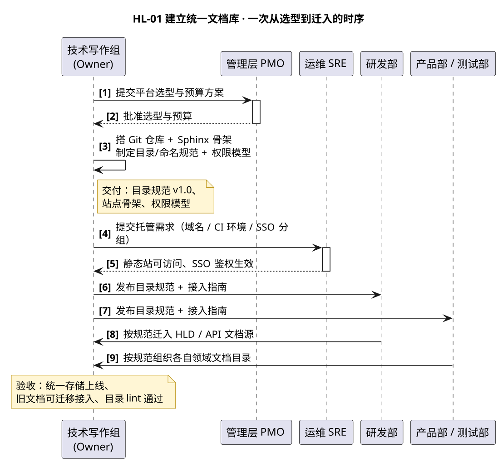

# HL-01 · 建立公司统一文档库 — 高层级设计

:::{note}
本页为「公司文档初始化项目」高层级需求 **HL-01（建立公司统一文档库）** 的高层级设计（HLD）。
给出该需求的模块交互、角色输入输出、调用接口与参考、脚本配置。条目为示例数据。
上游属性与底层级需求拆分见 [company_doc_init_spec.rst](../company_doc_init_spec.rst) §2.2.1~2.2.3。
:::

## 1. Requirement Summary

| Field | Value |
| --- | --- |
| Requirement ID | HL-01 |
| Feature ref | Feature-A / B / C / D / E / F |
| Priority | P0 |
| Target Release | R1（2026-Q4） |
| Testable | 可测试 — 站点可访问；目录结构 lint 通过；公开/内部/机密三级权限生效 |
| 对应底层级需求 | LL-001（存储平台） / LL-002（目录命名规范） / LL-003（权限访问控制） |

**Owner**: 技术写作组（示例邮箱 `doc-team@sunrise.example`）

## 2. Purpose

建立集中、可检索、带权限的单一信息源（Single Source of Truth）：以 Git 仓库为唯一真源、
Sphinx 构建静态站呈现，替代散落在 wiki / 网盘 / 个人电脑的文档。

## 3. Scope

- **包含**：Git 仓库与分支规范、Sphinx 站点骨架、目录/命名规范、三级权限模型（公开/内部/机密）；
- **不包含**：六类文档模板（属 HL-02）、流水线自动化（属 HL-03）、存量迁移（属 HL-04）。

## 4. Precondition

管理层已批准平台选型与预算；运维 SRE 可提供内网托管域名与 CI 运行环境。

## 5. 参与者与职责

| 角色 | 在本 HLD 中的角色 | 做什么 |
| --- | --- | --- |
| 技术写作组 | **Owner** | 选型并搭建 Git 仓库 + Sphinx 骨架；制定目录/命名规范与权限模型 |
| 管理层 PMO | 评审与把关 | 审批平台选型与预算、确认优先级 |
| 运维 SRE | 主责（托管） | 提供静态站托管、访问域名、CI 环境；配置 SSO 与权限分组 |
| 研发部 | 主责（迁入） | 将代码相邻技术文档（HLD/API）源文件迁入统一库 |
| 产品部 / 测试质量部 | 主责（迁入） | 按规范组织各自领域文档目录 |

## 6. 交互设计

下图给出 HL-01 从「选型审批」到「各团队迁入」的一次完整时序：



关键交互点：

1. **审批先行**：技术写作组先向 PMO 提交选型与预算，获批后才启动搭建（前置门禁）。
2. **Owner 自建**：Git 仓库、Sphinx 骨架、目录规范、权限模型由技术写作组一次性产出。
3. **托管委托**：静态站托管与 SSO 鉴权委托给运维 SRE，Owner 只提交需求、不直接碰生产环境。
4. **规范下发**：目录规范发布后，研发/产品/测试按规范迁入，产出「研发文档纳管、目录一致可检索」。

## 7. 角色输入输出

| 角色 | 输入（前置条件 / 输入物） | 输出（交付物） |
| --- | --- | --- |
| 技术写作组（Owner） | 管理层批准的选型与预算；SRE 的托管承诺 | 统一存储上线、目录规范 v1.0、权限模型、接入指南 |
| 管理层 PMO | 技术写作组提交的选型方案 | 预算与优先级确认 |
| 运维 SRE | 技术写作组提交的托管需求 | 站点可访问、CI 环境可用、SSO 鉴权生效 |
| 研发部 | 目录规范（LL-002）发布 | HLD/API 文档源统一纳管 |
| 产品部 / 测试质量部 | 目录规范发布 | 各自领域目录一致、可检索 |

## 8. 调用的接口与工具（含 reference）

| 接口 / 工具 | 用途 | reference 链接 |
| --- | --- | --- |
| Git 仓库 | 唯一真源、分支规范、变更追溯 | [git-scm.com/doc](https://git-scm.com/doc) |
| Sphinx + MyST-Parser | 源文件 → 静态站构建 | [sphinx-doc.org](https://www.sphinx-doc.org/) · [myst-parser](https://myst-parser.readthedocs.io/) |
| 目录结构 lint 脚本 | 校验「类型/模块/版本」目录层级 | 见 [§9 脚本](#9-脚本与配置) |
| nginx / 对象存储 | 静态站托管 | [nginx.org/en/docs](https://nginx.org/en/docs/) |
| SSO / 分组鉴权 | 三级权限（公开/内部/机密）落地 | 以公司统一认证平台为准（示例） |

## 9. 脚本与配置

### 9.1 目录结构 lint 脚本

**操作步骤**：

1. 将脚本存为 `scripts/check_doc_layout.py`；
2. 在 CI 中新增一步：`python scripts/check_doc_layout.py docs`（退出码非 0 即失败）；
3. 将允许的顶层目录类型写入 `ALLOWED_TYPES`，与目录规范保持一致。

**脚本内容**（示例，校验顶层目录只允许六类文档目录）：

```python
#!/usr/bin/env python3
"""目录结构 lint：校验文档顶层目录符合「类型」约定（示例口径）。

用法:
    python check_doc_layout.py <docs 根目录>
退出码 0 表示通过，非 0 表示存在违规。
"""
import sys
from pathlib import Path

# 顶层只允许这六类文档目录（对齐 HL-02 的六类模板）
ALLOWED_TYPES = {"requirements", "design", "api", "manual", "install", "release"}


def main(root: Path) -> int:
    top = [d for d in root.iterdir()
           if d.is_dir() and not d.name.startswith(("_", "."))]
    errors = [f"非法顶层目录: {d.name}（允许: {sorted(ALLOWED_TYPES)}）"
              for d in top if d.name not in ALLOWED_TYPES]
    for e in errors:
        print(f"[layout] {e}")
    if errors:
        print(f"[layout] FAIL（{len(errors)} 处违规）")
        return 1
    print("[layout] OK — 目录结构符合规范")
    return 0


if __name__ == "__main__":
    root = Path(sys.argv[1]) if len(sys.argv) > 1 else Path(".")
    raise SystemExit(main(root))
```

### 9.2 Sphinx 骨架配置（conf.py 关键项）

**操作步骤**：

1. 在仓库根执行 `sphinx-quickstart` 生成骨架；
2. 按下述关键项修改 `docs/conf.py`，登记 `.md` / `.rst` 双后缀并启用 MyST；
3. 执行 `sphinx-build -b html docs docs/_build/html` 验证可出站。

**关键配置**（示例）：

```python
# docs/conf.py
extensions = [
    "myst_parser",              # Markdown 支持
    "sphinxcontrib.mermaid",    # Mermaid 图（备选）
]

source_suffix = {
    ".rst": "restructuredtext",
    ".md": "markdown",          # 新文档一律 .md
}

exclude_patterns = ["_build", "Thumbs.db", ".DS_Store"]

# 三级权限不在此层实现，托管层（nginx + SSO）负责，见 HL-01 权限模型
```

## 10. PostCondition / 验收

- 统一存储上线，旧文档可迁移接入；
- 目录结构 lint 通过（顶层仅六类目录）；
- 站点可访问，公开/内部/机密三级权限按角色生效。

## 11. Note

| 风险 / 坑 | 说明与处理 |
| --- | --- |
| 权限落在托管层 | 三级权限由 nginx + SSO 实现，Sphinx 构建产物本身不分级；不要把敏感文档直接提交进公开仓库 |
| 目录规范先于迁入 | 目录规范（LL-002）必须先发布，否则各团队迁入后需二次返工 |
| 单一真源 | Git 仓库是唯一真源；任何未入库的网盘副本都不视为正式文档 |

---

## Related

- 需求属性与 LL-001~003 拆分：[company_doc_init_spec.rst](../company_doc_init_spec.rst)
- 项目总览与导航：[overview.md](overview.md)
- Owner 操作与配置：[actors_tech_writing.md](actors_tech_writing.md)
- 相关参与者：研发部 [actors_rnd.md](actors_rnd.md)、运维 SRE [actors_sre.md](actors_sre.md)、管理层 PMO [actors_pmo.md](actors_pmo.md)
- 书写规范与提示词：[hld_writing_guide.md](hld_writing_guide.md)
