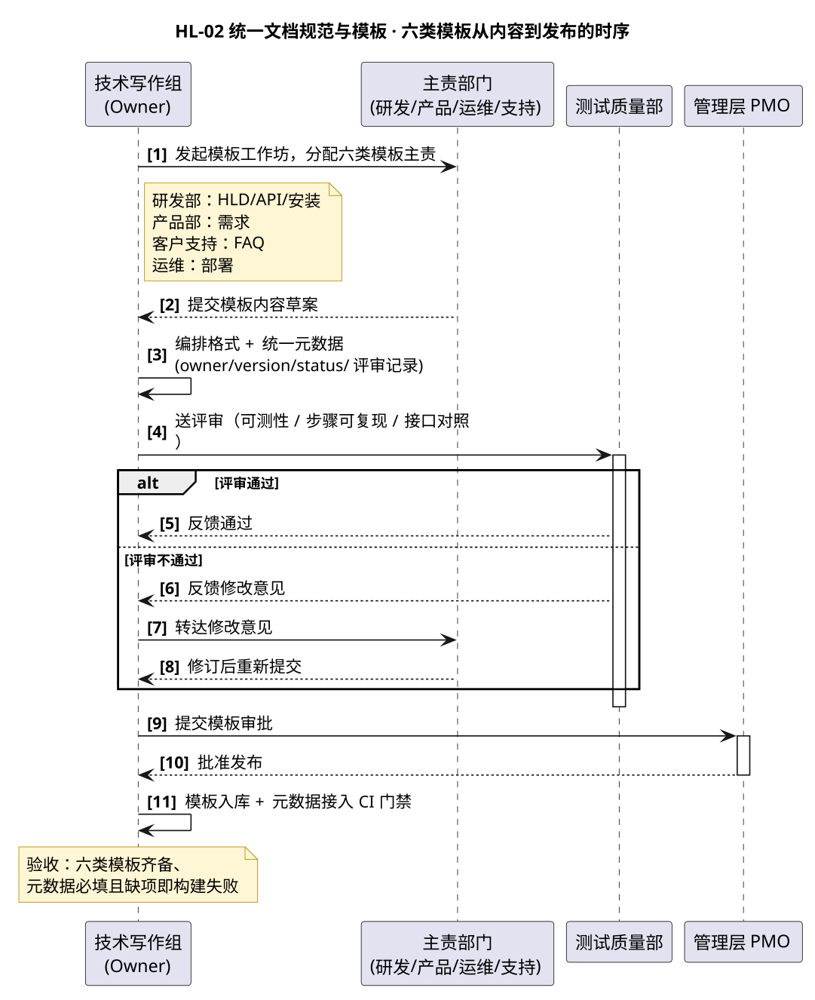

# HL-02 · 统一文档规范与模板体系 — 高层级设计

:::{note}
本页为「公司文档初始化项目」高层级需求 **HL-02（统一文档规范与模板体系）** 的高层级设计（HLD）。
给出六类文档模板的协作时序、角色输入输出、接口与参考、元数据校验脚本。条目为示例数据。
上游属性与底层级需求拆分见 [company_doc_init_spec.rst](../company_doc_init_spec.rst) §2.2.4~2.2.9。
:::

## 1. Requirement Summary

| Field | Value |
| --- | --- |
| Requirement ID | HL-02 |
| Feature ref | Feature-A / B / C / D / E / F |
| Priority | P0 |
| Target Release | R1（2026-Q4） |
| Testable | 可测试 — 六类模板齐备；owner/version/status/评审记录元数据必填且进 CI 门禁 |
| 对应底层级需求 | LL-004（需求） / LL-005（设计 HLD） / LL-006（API） / LL-007（手册） / LL-008（安装部署） / LL-009（发布 FAQ 与元数据） |

**Owner**: 技术写作组（示例邮箱 `doc-team@gx.example`）

## 2. Purpose

统一六类文档（需求 / 设计 HLD / API 参考 / 用户与操作手册 / 安装部署 / 发布说明与 FAQ）的模板与元数据规范，
保证文档结构一致、状态可追溯、验收可对齐，且元数据缺项会被 CI 门禁拦下。

## 3. Scope

- **包含**：六类模板的骨架与章节结构、统一元数据规范（owner / version / status / 评审记录）、元数据校验脚本；
- **不包含**：模板内容的自动生成（API 自动生成属 HL-03 的抽取链）、存量文档按模板重整（属 HL-04）。

## 4. Precondition

HL-01 的存储平台与目录规范已就绪；六类模板的主责部门已明确（见 §5）。

## 5. 参与者与职责

| 角色 | 主责模板 | 做什么 |
| --- | --- | --- |
| 技术写作组 | 编排全部 | 编排六类模板格式与统一元数据，入库并接入 CI 校验 |
| 研发部（主） | HLD / API / 安装部署 | 定架构分层、接口契约、ADR、构建与依赖说明 |
| 产品部（主） | 需求 | 定用户故事、功能/非功能需求、验收标准 |
| 客户支持（主） | 发布 FAQ / 排障 | 提供错误码、排障与 FAQ 字段要求 |
| 运维 SRE | 安装部署（部署/回滚部分） | 定义部署、升级、回滚文档要求 |
| 市场售前 | 对外清单 | 提供对外 API 清单与 Release Notes 写法 |
| 测试质量部 | 评审 | 评审验收标准可测性与操作步骤可复现性 |
| 管理层 PMO | 评审与把关 | 审批模板与规范 |

## 6. 交互设计

下图给出「六类模板」从工作坊到发布的通用协作时序（研发/产品/运维/支持按主责并行产内容）：



关键交互点：

1. **主责内容 + Owner 编排分离**：内容由各主责部门产出（研发定 HLD/API，产品定需求…），
   技术写作组只做「格式编排 + 元数据统一」，不替业务部门写内容。
2. **评审在审批前**：模板先送测试质量部评审可测性/可复现性，通过后才上 PMO 审批。
3. **元数据进 CI 门禁**：owner/version/status/评审记录四项设为必填，缺项即构建失败（见 §9）。

## 7. 角色输入输出

| 角色 | 输入（前置条件 / 输入物） | 输出（交付物） |
| --- | --- | --- |
| 技术写作组（Owner） | 各主责部门的内容草案 | 六类模板入库、元数据规范 v1.0、校验脚本 |
| 研发部（主） | HL-02 启动、模板工作坊 | HLD 模板、API 模板、安装部署模板 |
| 产品部（主） | HL-02 启动、模板工作坊 | 需求模板 v1.0 |
| 客户支持（主） | 模板草案、征集 | 排障/FAQ 字段纳入 |
| 运维 SRE | 模板草案、征集 | 部署/回滚内容纳入 |
| 市场售前 | 模板草案、征集 | 对外 API 清单、Release Notes 写法纳入 |
| 测试质量部 | 模板草案、评审会 | 可测性对齐、步骤校验 |
| 管理层 PMO | 评审通过 | 批准发布 |

## 8. 调用的接口与工具（含 reference）

| 接口 / 工具 | 用途 | reference 链接 |
| --- | --- | --- |
| Sphinx 源模板（.md / .rst 各一套） | 六类模板骨架，源格式统一 | [sphinx-doc.org](https://www.sphinx-doc.org/) |
| 元数据校验脚本（CI job） | 校验 owner/version/status/评审记录必填 | 见 [§9 脚本](#9-脚本与配置) |
| doc8 / rstcheck | reST 格式与语法校验 | [PyCQA/doc8](https://github.com/PyCQA/doc8) · [rstcheck](https://github.com/myint/rstcheck) |
| markdownlint | Markdown 格式校验 | [DavidAnson/markdownlint](https://github.com/DavidAnson/markdownlint) |
| Doxygen 注释规范 | 统一 API 注释块写法（自动生成的前置） | [doxygen.nl/manual](https://www.doxygen.nl/manual/) |

## 9. 脚本与配置

### 9.1 元数据必填校验脚本

**操作步骤**：

1. 将脚本存为 `scripts/check_metadata.py`；
2. 要求每篇文档以 YAML frontmatter 声明元数据（`owner` / `version` / `status` / `review`）；
3. 在 CI 门禁中新增 `python scripts/check_metadata.py docs`，退出码非 0 即失败。

**脚本内容**（示例，校验 frontmatter 必填四项）：

```python
#!/usr/bin/env python3
"""元数据必填校验：owner / version / status / review 四项缺一即失败（示例口径）。

用法:
    python check_metadata.py <docs 根目录>
"""
import re
import sys
from pathlib import Path

REQUIRED = ("owner", "version", "status", "review")


def parse_frontmatter(text: str) -> dict:
    m = re.match(r"^---\s*\n(.*?)\n---", text, re.S)
    if not m:
        return {}
    meta = {}
    for line in m.group(1).splitlines():
        if ":" in line:
            k, v = line.split(":", 1)
            meta[k.strip()] = v.strip()
    return meta


def main(root: Path) -> int:
    errors = []
    for f in sorted(root.rglob("*.md")):
        if "_build" in f.parts or f.name.startswith("."):
            continue
        meta = parse_frontmatter(f.read_text(encoding="utf-8"))
        if not meta:
            errors.append(f"{f}: 缺少 frontmatter")
            continue
        missing = [k for k in REQUIRED if k not in meta]
        if missing:
            errors.append(f"{f}: 缺少必填元数据 {missing}")
    for e in errors:
        print(f"[meta] {e}")
    print(f"[meta] {'FAIL' if errors else 'OK'}（{len(errors)} 处缺失）")
    return 1 if errors else 0


if __name__ == "__main__":
    root = Path(sys.argv[1]) if len(sys.argv) > 1 else Path(".")
    raise SystemExit(main(root))
```

### 9.2 frontmatter 元数据示例

```yaml
---
owner: doc-team@gx.example
version: v1.0
status: draft
review: tech-lead@gx.example, test-lead@gx.example
---
```

## 10. PostCondition / 验收

- 六类模板齐备且已入库；
- owner / version / status / 评审记录 元数据必填，缺项在 CI 门禁即构建失败。

## 11. Note

| 风险 / 坑 | 说明与处理 |
| --- | --- |
| 内容与格式职责不清 | 内容由主责部门出、格式由技术写作组编排；Owner 不替业务部门写内容 |
| 元数据不校验等于没规范 | 元数据必须进 CI 门禁，否则「必填」形同虚设 |
| API 模板依赖注释规范 | API 自动生成（HL-03）依赖统一的 Doxygen 注释规范，模板先行但注释补齐是最大变量 |

---

## Related

- 需求属性与 LL-004~009 拆分：[company_doc_init_spec.rst](../company_doc_init_spec.rst)
- 项目总览与导航：[overview.md](overview.md)
- Owner 操作与配置：[actors_tech_writing.md](actors_tech_writing.md)
- 相关参与者：研发部 [actors_rnd.md](actors_rnd.md)、产品部 [actors_product.md](actors_product.md)、运维 SRE [actors_sre.md](actors_sre.md)、客户支持 [actors_customer_support.md](actors_customer_support.md)
- 书写规范与提示词：[hld_writing_guide.md](hld_writing_guide.md)
