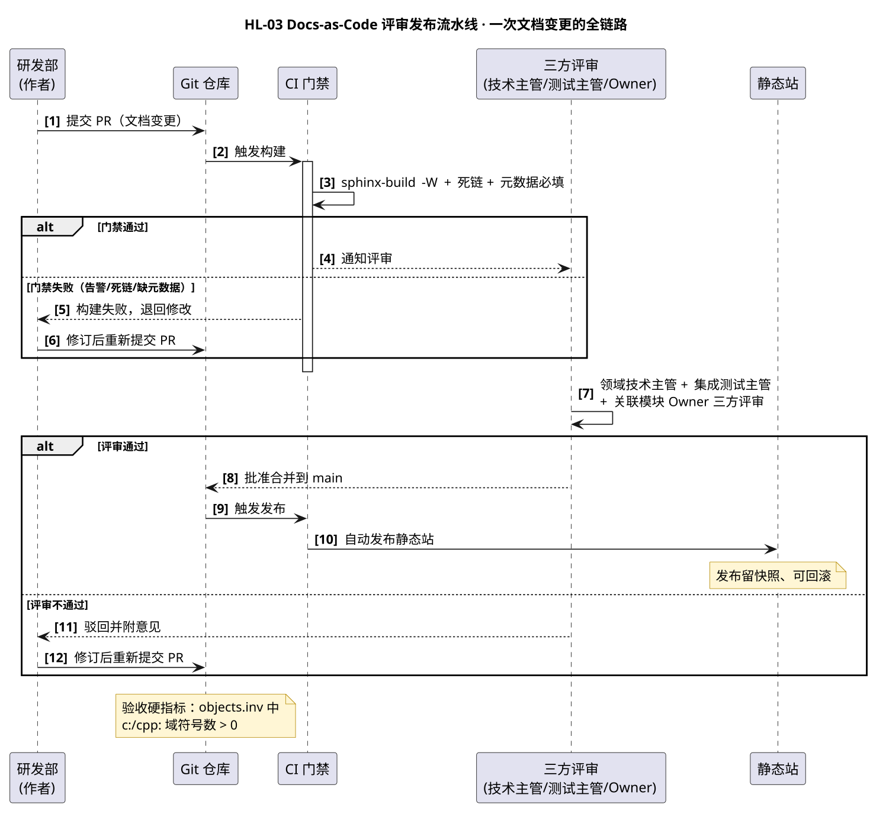

# HL-03 · Docs-as-Code 评审发布流水线 — 高层级设计

:::{note}
本页为「公司文档初始化项目」高层级需求 **HL-03（Docs-as-Code 评审发布流水线）** 的高层级设计（HLD）。
给出从 PR 提交到自动发布的完整链路、角色输入输出、接口与参考、CI 脚本。条目为示例数据。
上游属性与底层级需求拆分见 [company_doc_init_spec.rst](../company_doc_init_spec.rst) §2.2.10。
:::

## 1. Requirement Summary

| Field | Value |
| --- | --- |
| Requirement ID | HL-03 |
| Feature ref | HL-03-A / B / C / D / E / F |
| Priority | P1 |
| Target Release | R2（2027-Q1） |
| Testable | 可测试 — CI 门禁能拦下死链与元数据缺失；回滚演练成功一次 |
| 对应底层级需求 | LL-010（子特性 HL-03-A 入版本库 / B PR 三方评审 / C CI 构建 / D 静态站发布 / E 双版本对比 / F 追溯回滚） |

**Owner**: 技术写作组（示例邮箱 `doc-team@sunrise.example`）

## 2. Purpose

让文档像代码一样走「版本库 + PR 评审 + CI 门禁 + 自动发布」全链路，变更可追溯、发布可回滚，
评审记录留存于 PR，双版本可对比。

## 3. Scope

- **包含**：PR 三方评审机制、CI 门禁（构建 0 告警 + 死链 + 元数据必填）、静态站自动发布、快照与回滚；
- **不包含**：内容自动抽取链（Doxygen → Breathe）的实现细节，但验收硬指标与其产出相关（见 §10）。

## 4. Precondition

HL-01 的存储平台就绪；运维 SRE 已提供 CI 运行环境与静态站托管。

## 5. 参与者与职责

| 角色 | 在本 HLD 中的角色 | 做什么 |
| --- | --- | --- |
| 技术写作组 | **Owner** | 搭 PR 评审 + CI 门禁 + 静态站发布 + 双版本对比 + 回滚全链路 |
| 研发部 | 作者 / 评审 | 以 PR 提交文档变更，参与三方评审 |
| 测试质量部 | 评审（集成测试主管） | 参与三方评审，校验操作步骤与接口文档一致性 |
| 领域技术主管 | 评审 | 评审技术正确性（三方评审之一） |
| 运维 SRE | 主责（托管） | 托管 CI 运行环境与静态站 |
| 管理层 PMO | 评审与把关 | 审批重大发布（Phase Gate），决定放行或回滚 |

## 6. 交互设计

下图给出「一次文档变更」从 PR 到发布的全链路时序，含门禁失败与评审驳回两条异常分支：



关键交互点：

1. **门禁前置**：CI 先跑 `sphinx-build -W`（告警即错误）+ 死链 + 元数据必填，不通过直接退回作者，不进评审。
2. **三方评审**：领域技术主管 + 集成测试主管 + 关联模块 Owner，评审记录留在 PR 上可追溯。
3. **合并即发布**：评审通过合并 main 后自动发布静态站，每次发布留快照，可回滚。

## 7. 角色输入输出

| 角色 | 输入（前置条件 / 输入物） | 输出（交付物） |
| --- | --- | --- |
| 技术写作组（Owner） | LL-001 存储就绪 | 流水线 v1.0、发布记录、回滚演练记录 |
| 研发部（作者） | 流水线就绪 | 变更以 PR 合入、评审参与记录 |
| 测试质量部 | 评审机制就绪 | 集成测试主管评审记录 |
| 领域技术主管 | PR 提交 | 技术评审结论 |
| 运维 SRE | 托管需求 | CI 与站点可用 |
| 管理层 PMO | 发布计划 | Phase Gate 放行/回滚记录 |

## 8. 调用的接口与工具（含 reference）

| 接口 / 工具 | 用途 | reference 链接 |
| --- | --- | --- |
| Git + PR | 变更以 PR 提交，评审记录留在 MR/PR 上 | [git-scm.com/doc](https://git-scm.com/doc) |
| CI（GitHub Actions / Jenkins / GitLab CI） | 自动构建 + 门禁 + 发布 | [GitHub Actions](https://docs.github.com/actions) · [Jenkins](https://www.jenkins.io/doc/) · [GitLab CI](https://docs.gitlab.com/ee/ci/) |
| `sphinx-build -W` | 告警当错误：死链、交叉引用失效、标题层级错误合并前拦下 | [sphinx-doc.org](https://www.sphinx-doc.org/) |
| sphinx-multiversion | 按版本并列发布 | [sphinx-multiversion](https://holzhaus.github.io/sphinx-multiversion/) |
| 构建产物归档 + 快照 | 发布可回滚，离线包可归档 | 以托管平台对象存储为准（示例） |

## 9. 脚本与配置

### 9.1 CI 流水线配置（GitHub Actions 示例）

**操作步骤**：

1. 将配置存为 `.github/workflows/docs.yml`；
2. 推 `main` 或开 PR 即自动触发构建 + 门禁；
3. 门禁含「构建 0 告警」与「元数据必填」两步，任一步失败即阻断合并。

**配置内容**（示例）：

```yaml
name: docs
on:
  push:
    branches: [main]
  pull_request:

jobs:
  build:
    runs-on: ubuntu-latest
    steps:
      - uses: actions/checkout@v4
      - uses: actions/setup-python@v5
        with:
          python-version: "3.12"
      - name: Install dependencies
        run: pip install -r requirements.txt
      - name: Build (warnings as errors)
        run: sphinx-build -b html -W --keep-going docs docs/_build/html
      - name: Check metadata (owner/version/status/review)
        run: python scripts/check_metadata.py docs
      - name: Check directory layout
        run: python scripts/check_doc_layout.py docs
      - name: Deploy to static site (main only)
        if: github.ref == 'refs/heads/main'
        run: ./scripts/deploy.sh
```

### 9.2 抽取链验收命令（HL-03 硬指标）

**操作步骤**：

1. 解压构建产物中的符号表：`python -m sphinx.ext.intersphinx docs/_build/html/objects.inv`；
2. 统计 `c:` / `cpp:` 域符号数，验收判据为 **> 0 且覆盖该模块 100% 公开发布符号**。

```bash
# 解压 objects.inv，检查编程域符号（示例）
python -c "import zlib,sys; \
d=open('docs/_build/html/objects.inv','rb').read(); \
print(zlib.decompress(d[d.find(b'\\n', d.find(b'# Sphinx inventory'))+1:]).decode())" \
  | grep -cE '^(cpp|python|c):(function|class|member)'
```

## 10. PostCondition / 验收

- PR 评审 + CI 门禁 + 自动发布 + 可回滚全链路可用；
- **硬指标**：解压 `objects.inv` 后 `c:` / `cpp:` 域符号数 > 0，且覆盖该模块 100% 公开发布符号
  （不能只看「文件是否存在」——业界已有 `objects.inv` 存在、条目数百、编程域符号为 0 的反例）。

## 11. Note

| 风险 / 坑 | 说明与处理 |
| --- | --- |
| 门禁不过不进评审 | CI 先把告警/死链/元数据拦下，避免评审人把时间花在格式问题上 |
| 抽取链不能插 pandoc | API 符号域必须由抽取链（Doxygen XML + Breathe）提供；pandoc 中转会把函数签名降级成纯文本 |
| 发布留快照 | 每次发布留快照，重大发布走 Phase Gate 审批，放行或回滚有据可查 |

---

## Related

- 需求属性与 LL-010 拆分：[company_doc_init_spec.rst](../company_doc_init_spec.rst)
- 项目总览与导航：[overview.md](overview.md)
- Owner 操作与配置：[actors_tech_writing.md](actors_tech_writing.md)
- 相关参与者：测试质量部 [actors_test_qa.md](actors_test_qa.md)、管理层 PMO [actors_pmo.md](actors_pmo.md)
- 书写规范与提示词：[hld_writing_guide.md](hld_writing_guide.md)
