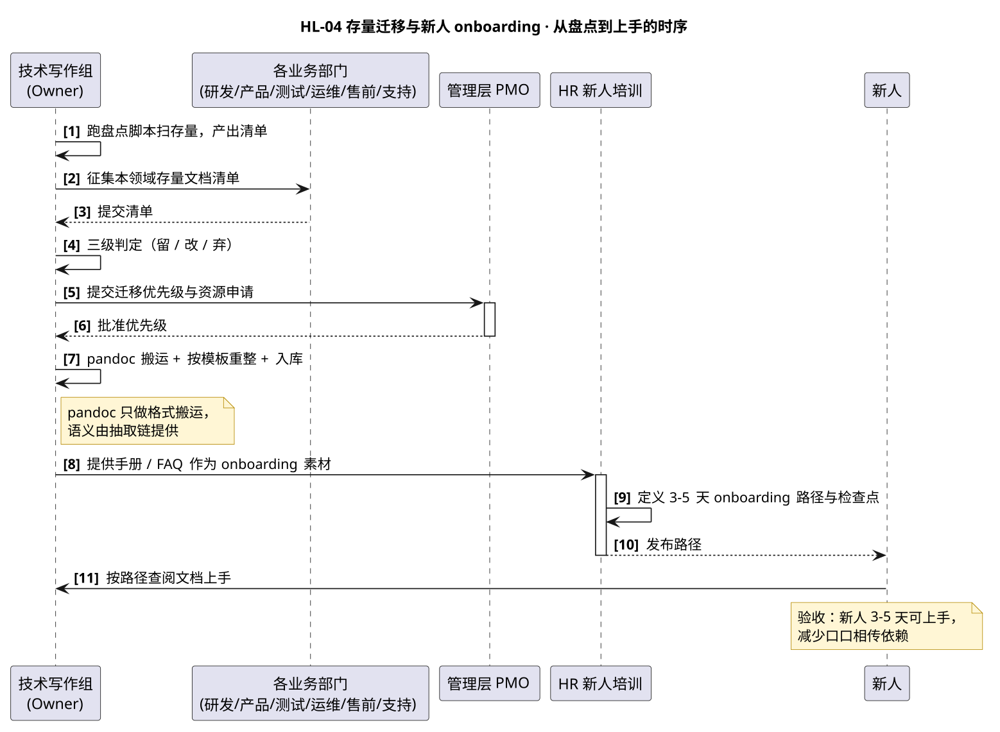

# HL-04 · 存量文档迁移与新人 onboarding — 高层级设计

:::{note}
本页为「公司文档初始化项目」高层级需求 **HL-04（存量文档迁移与新人 onboarding）** 的高层级设计（HLD）。
给出从存量盘点到新人上手的协作时序、角色输入输出、接口与参考、盘点脚本。条目为示例数据。
上游属性与底层级需求拆分见 [company_doc_init_spec.rst](../company_doc_init_spec.rst) §2.2.11~2.2.12。
:::

## 1. Requirement Summary

| Field | Value |
| --- | --- |
| Requirement ID | HL-04 |
| Feature ref | Feature-D / F |
| Priority | P1 |
| Target Release | R3（2027-Q2） |
| Testable | 部分可测试 — 盘点完整性与入库校验可验证；新人 ramp-up 周期靠问卷定性反馈 |
| 对应底层级需求 | LL-011（存量盘点迁移） / LL-012（新人 onboarding 3-5 天） |

**Owner**: 技术写作组（示例邮箱 `doc-team@sunrise.example`）

## 2. Purpose

先盘点（拉清单 + 三级判定「留 / 改 / 弃」），再按模板迁移入库，最后以手册与 FAQ 为素材
产出 3-5 天 onboarding 路径，减少对老人口口相传的依赖。

## 3. Scope

- **包含**：存量文档盘点清单、三级判定、按模板迁移入库、onboarding 路径与检查点；
- **不包含**：模板本身（属 HL-02）、流水线（属 HL-03）。

## 4. Precondition

LL-001/002 与 LL-004~009（存储平台、目录规范、六类模板）已就绪。

## 5. 参与者与职责

| 角色 | 在本 HLD 中的角色 | 做什么 |
| --- | --- | --- |
| 技术写作组 | **Owner** | 牵头盘点、评估、制定迁移计划并按模板迁移 |
| 研发部 / 产品部 / 测试质量部 / 运维 SRE | 主责（供清单） | 提供本领域存量文档清单并配合迁移 |
| 市场售前 / 客户支持 | 主责（供清单） | 提供对外文档、FAQ/排障清单并配合迁移 |
| HR 新人培训 | 主责（onboarding） | 定义 3-5 天 onboarding 路径与检查点 |
| 管理层 PMO | 评审与把关 | 审批迁移优先级与资源投入 |

## 6. 交互设计

下图给出「从盘点到新人上手」的完整时序：



关键交互点：

1. **盘点先行、分级在后**：技术写作组先跑盘点脚本拉清单，再征各团队补充，最后三级判定（留/改/弃），
   避免「迁了一堆垃圾」或「该迁的没迁」。
2. **pandoc 只做搬运**：格式搬运用 pandoc，语义由抽取链（Doxygen XML + Breathe）提供，绝不跨语义转换。
3. **onboarding 素材复用**：迁移后的手册 + FAQ 直接作为 onboarding 路径素材，一处沉淀多处复用。

## 7. 角色输入输出

| 角色 | 输入（前置条件 / 输入物） | 输出（交付物） |
| --- | --- | --- |
| 技术写作组（Owner） | LL-001/002/004~009 就绪 | 存量关键文档入库、迁移计划 |
| 各业务部门 | 盘点启动、征集 | 本领域文档清单、配合迁移 |
| 管理层 PMO | 盘点报告 | 迁移优先级与资源确认 |
| HR 新人培训 | 手册/FAQ 就绪 | 3-5 天 onboarding 路径 |
| 新人 | onboarding 路径 | ramp-up 周期缩短 |

## 8. 调用的接口与工具（含 reference）

| 接口 / 工具 | 用途 | reference 链接 |
| --- | --- | --- |
| 盘点脚本 | 扫目录拉出存量清单，供三级判定 | 见 [§9 脚本](#9-脚本与配置) |
| pandoc（仅格式搬运） | 把存量文档转换到统一源格式，**不做跨语义转换** | [pandoc.org/MANUAL.html](https://pandoc.org/MANUAL.html) |
| Sphinx + 模板库 | 迁移后按模板重整并入库 | [sphinx-doc.org](https://www.sphinx-doc.org/) |
| 手册 / FAQ 模板 | onboarding 路径的主要素材 | 见 [hl02_templates.md](hl02_templates.md) |

## 9. 脚本与配置

### 9.1 存量盘点脚本

**操作步骤**：

1. 将脚本存为 `scripts/inventory_docs.py`；
2. 对每个存量来源目录（wiki 导出 / 网盘 / 个人目录）跑一次，导出 CSV 清单；
3. 技术写作组会同各团队，对清单逐条做三级判定（留 / 改 / 弃）。

**脚本内容**（示例，扫描并导出文档清单）：

```python
#!/usr/bin/env python3
"""存量文档盘点：扫描目录，导出「路径 / 格式 / 大小 / 修改时间」清单供三级判定（示例口径）。

用法:
    python inventory_docs.py <目标目录> <输出.csv>
"""
import csv
import sys
from pathlib import Path

SUFFIXES = {".md", ".rst", ".doc", ".docx", ".pdf", ".txt", ".wiki"}


def main(src: Path, out: Path) -> int:
    rows = []
    for f in sorted(src.rglob("*")):
        if f.is_file() and f.suffix.lower() in SUFFIXES:
            st = f.stat()
            rows.append({
                "path": str(f),
                "format": f.suffix.lower().lstrip("."),
                "size_kb": round(st.st_size / 1024, 1),
                "modified": st.st_mtime,
                "decision": "",  # 留 / 改 / 弃
            })
    with out.open("w", newline="", encoding="utf-8-sig") as fh:
        w = csv.DictWriter(fh, fieldnames=["path", "format", "size_kb", "modified", "decision"])
        w.writeheader()
        w.writerows(rows)
    print(f"[inventory] 共 {len(rows)} 个文件 → {out}")
    return 0


if __name__ == "__main__":
    if len(sys.argv) < 3:
        print(__doc__)
        raise SystemExit(2)
    raise SystemExit(main(Path(sys.argv[1]), Path(sys.argv[2])))
```

### 9.2 pandoc 格式搬运命令

**操作步骤**：

1. 对判定为「改」的文档，用 pandoc 转换到统一源格式（如 `docx` → `md`）；
2. 转换后按模板手工重整章节结构，**不得让 pandoc 承担语义转换**。

```bash
# 仅格式搬运：docx → markdown（示例）
pandoc -f docx -t gfm --wrap=none source.docx -o target.md

# 仅格式搬运：markdown → reST（示例）
pandoc -f markdown -t rst source.md -o target.rst
```

> 关键约束：pandoc 是 markup→markup 转换器，不产 `c:function` 等符号域指令；
> 带语义的 API/签名内容必须回到 XML 上游（`GENERATE_XML=YES`）+ Breathe 抽取，见 [hl03_pipeline.md](hl03_pipeline.md)。

## 10. PostCondition / 验收

- 存量关键文档按三级判定迁移入库，盘点清单完整、迁移可校验；
- 新人按 3-5 天 onboarding 路径可上手，ramp-up 周期缩短（定性反馈佐证）。

## 11. Note

| 风险 / 坑 | 说明与处理 |
| --- | --- |
| pandoc 位置错 | 若让 pandoc 做「带语义格式 → 纯文本」搬运，函数签名被降级成普通标题，符号域被抹掉 |
| 该迁的没迁 | 盘点必须覆盖全部存量来源，三级判定「弃」需留理由，避免漏迁关键文档 |
| onboarding 素材复用 | 手册/FAQ 是 onboarding 的主要素材，迁移时优先补这两类 |

---

## Related

- 需求属性与 LL-011/012 拆分：[company_doc_init_spec.rst](../company_doc_init_spec.rst)
- 项目总览与导航：[overview.md](overview.md)
- Owner 操作与配置：[actors_tech_writing.md](actors_tech_writing.md)
- 相关参与者：HR 新人培训 [actors_hr.md](actors_hr.md)、研发部 [actors_rnd.md](actors_rnd.md)、客户支持 [actors_customer_support.md](actors_customer_support.md)、市场售前 [actors_presales.md](actors_presales.md)
- 书写规范与提示词：[hld_writing_guide.md](hld_writing_guide.md)
