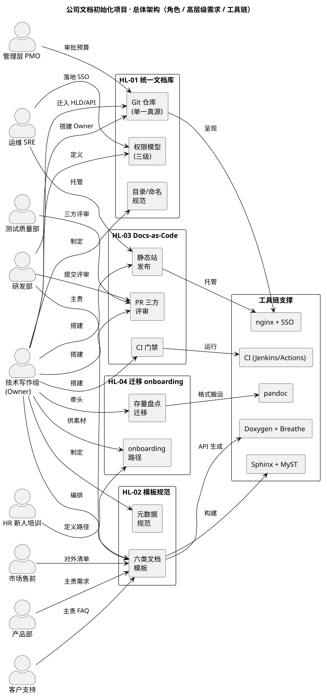

# 公司文档初始化项目 · 高层级设计（HLD）总览

:::{note}
本文为「公司文档初始化项目」的**高层级设计（HLD）总览页**：给出四条高层级需求
（HL-01 ~ HL-04）的设计入口、总体架构图与参与者分组导航。

各子项目的详细设计（模块交互、角色输入输出、接口与参考、脚本配置）见本目录下各子页面；
每个参与者「要做什么 / 操作与配置 / 上下文链接」见参与者归组页面。
条目为示例数据，工时与邮箱为示意口径。书写规范与可复用提示词见 [hld_writing_guide.md](hld_writing_guide.md)。
:::

---

## 1. 文档信息

| 项 | 内容 |
| --- | --- |
| **项目** | 公司文档初始化项目（Company Documentation Initialization） |
| **文档类型** | High Level Design (HLD) — 项目级 / Epic 级 |
| **版本** | v1.0（草稿，待评审） |
| **Owner** | 技术写作组（示例邮箱 `doc-team@sunrise.example`） |
| **上游需求** | 立项报告 [company_doc_init.rst](../company_doc_init.rst) · 规格 [company_doc_init_spec.rst](../company_doc_init_spec.rst) |

## 2. 概述

### 2.1 目的

本文档体系把四条高层级需求（HL-01 ~ HL-04）从「**做什么**」下沉到「**怎么做**」：
每条 HL 给出模块交互、每个角色的输入与输出、调用的接口与工具（附 reference 链接），
以及涉及脚本/配置时的具体操作步骤与脚本内容，使设计可评审、可落地、可验收。

### 2.2 范围（Scope）

- **包含**：四条 HL 的组件划分、角色协作时序、接口与工具选型、脚本与配置、验收标准；
- **不包含**：每个工具内部的具体实现机制、真实公司组织架构与账号信息（以示例口径呈现）。

## 3. 总体架构

总体架构分三层：

1. **角色层（9 个干系人部门）**：技术写作组为全局 Owner；研发 / 产品 / 运维 / 客户支持 / HR
   在各自领域承担主责；测试与 PMO 承担评审与把关；市场售前为对外内容输入与消费方。
2. **高层级需求组件层（4 条 HL）**：每条 HL 对应一批交付物组件，是设计的最小落点。
3. **工具链支撑层**：Sphinx / Doxygen / CI / nginx / pandoc 等，被组件依赖，不直接暴露给角色。

## 4. 四条高层级需求的 HLD 导航

| HL | 需求 | HLD 页面 | 主要交付物 |
| --- | --- | --- | --- |
| HL-01 | 建立公司统一文档库 | [hl01_unified_repo.md](hl01_unified_repo.md) | Git 单一真源、目录/命名规范、三级权限模型 |
| HL-02 | 统一文档规范与模板体系 | [hl02_templates.md](hl02_templates.md) | 六类文档模板、元数据规范 |
| HL-03 | Docs-as-Code 评审发布流水线 | [hl03_pipeline.md](hl03_pipeline.md) | PR 评审 + CI 门禁 + 静态站发布 + 回滚 |
| HL-04 | 存量迁移与新人 onboarding | [hl04_migration.md](hl04_migration.md) | 存量盘点迁移、3-5 天 onboarding 路径 |

## 5. 参与者导航

九个干系人部门各一页，按底层级需求（LL）逐条列出该角色的职责；无职责 / 仅消费的 LL 不列：

| 角色 | 页面 |
| --- | --- |
| 技术写作组（Owner） | [actors_tech_writing.md](actors_tech_writing.md) |
| 研发部 | [actors_rnd.md](actors_rnd.md) |
| 产品部 | [actors_product.md](actors_product.md) |
| 测试质量部 | [actors_test_qa.md](actors_test_qa.md) |
| 运维 SRE | [actors_sre.md](actors_sre.md) |
| 客户支持 | [actors_customer_support.md](actors_customer_support.md) |
| 市场售前 | [actors_presales.md](actors_presales.md) |
| 管理层 PMO | [actors_pmo.md](actors_pmo.md) |
| HR 新人培训 | [actors_hr.md](actors_hr.md) |

---

## Related

- 项目入口（立项报告 + 技术方案）：[company_doc_init.rst](../company_doc_init.rst)
- 完整规格（HL ↔ LL 拆分）：[company_doc_init_spec.rst](../company_doc_init_spec.rst)
- 本目录 HLD 书写规范与可复用提示词：[hld_writing_guide.md](hld_writing_guide.md)
- 功能级 HLD 书写规范（单功能/单接口，下钻一层）：[hld_writing_guide.md](../../02_design_docs/hld_writing_guide.md)
- 需求文档书写规范：[requirements_writing_guide.md](../requirements_writing_guide.md)
- 文档体系方法：[methodology.rst](../../07_about/methodology.rst)
