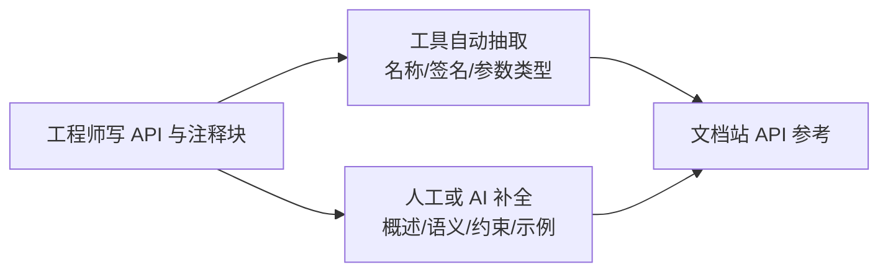

# 软件工程师文档书写指南（company_doc_init 适用）

:::{note}
本页为「公司文档初始化项目」下的 **研发侧写作指南** 子页面，面向参与 API 开发的软件工程师。

它解决一个具体问题：**在尚无统一 API 规范的过渡期，让代码里写下的信息足以支撑文档站生成一份可评审的 API 参考。**
全文分两章：

- **第一章 · 写 API 时应嵌入的信息** —— 一份属性清单，分 **必填（Required）** 与 **非必填（Optional）** 两类，规定每个 API 要留下什么；
- **第二章 · AI 补全提示词** —— **可直接复制粘贴**的提示词，让 AI 基于现有文档与资料，把这些信息补全成规范条目。

属性与示例均为 **示例口径**，采用 `sunrise*` 前缀示意，不对应任何真实源码；实际字段以公司 API 规范评审结论为准。
:::

:::{important}
**语言约定（最重要的一条）**：**最终用户在文档站上读到的文本，一律为英文（English only）。**
即概述、参数说明、返回值、错误码、前置/后置条件、注释与示例注释，全部用英文书写。

本指南正文（含「说明」列）用中文，只供工程师自己阅读，**不进最终交付物**。
判断标准很简单：**一段文字只要会出现在文档站上，就必须是英文。**
:::

## 0. 为什么要在代码里写信息

文档的单一真相源应尽量靠近代码。工程师在写 API 时顺手把契约信息写进注释块，文档站就能从源码抽取，
避免"代码改了、文档没改"的漂移：



**原则**：能靠代码表达的结构化信息（名称、签名、类型）交给工具抽取；语义、约束、示例这类"代码里读不出来"的信息，
必须由写代码的人在注释块里留下线索，或在过渡期用第二章的提示词让 AI 基于现有资料补全。

---

## 1. 第一章 · 写 API 时应嵌入的信息

### 1.1 两类属性与判定规则

| 类别 | 含义 | 判定规则 |
| --- | --- | --- |
| **必填（Required）** | 每个 API 都必须提供，缺一即文档不完整 | **缺任意一项即视为未完成，不得发布**；见 §1.2 |
| **非必填（Optional）** | 视 API 性质决定是否提供 | **满足"何时必须写"条件时转为必填**；不适用时显式写 `None`；见 §1.3 |

### 1.2 必填属性（Required）

「示例」列给出的即 **最终用户在文档站看到的英文原文**。

| 属性（English） | 说明（中文，给工程师） | 示例（English，最终用户所见） |
| --- | --- | --- |
| API name | 唯一标识符，与代码符号逐字一致 | `sunriseMalloc` |
| Summary | 一行概述，动词开头，只说"做什么" | Allocates a buffer on the device. |
| Module / Library | 所属模块与库，用于归类检索 | Runtime · Memory |
| Since | 该 API 自哪个版本可用 | R1.0 |
| Signature | 完整原型，含返回类型与参数类型 | `sunriseError_t sunriseMalloc(void** devPtr, size_t size)` |
| Return value | 成功/失败各返回什么、语义是什么 | Returns `sunriseSuccess` on success. |
| Error codes | 可能返回的错误码及各自触发条件 | `sunriseErrorOutOfMemory` — device memory exhausted |
| Parameters | 逐个参数填写，子字段见 §1.4 | — |
| Preconditions | 调用前必须成立的状态 | A device has been selected with `sunriseSetDevice()`. |
| Postconditions | 调用成功后系统所处状态 | `*devPtr` points to valid device memory. |
| Resource ownership & lifetime | 谁分配、谁释放、句柄有效期 | The caller must release the buffer with `sunriseFree()`. |
| Thread safety | 是否可并发调用、是否需外部同步 | Thread-safe across different handles. |
| Minimal example | 可直接编译或粘贴的调用片段 | See the Example blocks in the API reference. |
| Owner / Last updated | 谁负责、何时改过，便于评审找人 | @owner, 2026-10-14 |

### 1.3 非必填属性（Optional）

「何时必须写」一列说明：一旦满足条件，该属性即**转为必填**；确实不适用时，显式写 `None`（不要留空）。

| 属性（English） | 说明（中文，给工程师） | 何时必须写 |
| --- | --- | --- |
| Side effects | 除返回值外对系统状态的改变 | 有全局状态、缓存、计数器变更时 |
| Performance & latency | 复杂度、典型耗时、是否阻塞 | 热路径或异步 API |
| Units & dimensions | 参数/返回值的物理单位 | 涉及字节、纳秒、算力等量纲 |
| Platform / device compatibility | 支持的架构、设备代次 | 存在硬件依赖时 |
| Related APIs | 前置 / 后继 / 替代关系 | 存在调用顺序依赖时 |
| Deprecation | 是否废弃、替代 API 是谁 | **废弃任何 API 时必须写** |
| Revision history | 版本 → 变更点 | 每次改动签名或语义 |

### 1.4 参数级属性（逐个参数都必须写）

| 子字段（English） | 说明（中文，给工程师） | 示例（English，最终用户所见） |
| --- | --- | --- |
| Name | 参数名，与代码一致 | `devPtr` |
| Type | 完整类型，含 `const` 与指针层级 | `void**` |
| Direction | `in` / `out` / `inout` | `out` |
| Required / Default | 是否必填；可选参数给出默认值 | Required |
| Range / Unit | 合法区间与物理单位 | Greater than 0; in bytes |
| Constraints | 对齐要求、上限、所有权、失败行为 | Unchanged if allocation fails. |
| Description | 一句话说明用途 | Returns the device pointer to the allocated buffer. |

### 1.5 嵌入位置：注释块模板（英文）

契约信息写在 API 的 **声明处（头文件）**，用文档注释块承载，**不要写在实现文件里**。
注释内容即最终用户所见，**必须全英文**。以 Doxygen 风格为例：

```c
/**
 * @brief  Allocates a buffer on the device.
 * @since  R1.0 (2026-Q4)
 * @param  devPtr  [out] Returns the device pointer to the allocated buffer.
 *                       Unchanged if allocation fails.
 * @param  size    [in]  Number of bytes to allocate; must be greater than 0.
 * @return sunriseSuccess on success; sunriseErrorOutOfMemory,
 *         sunriseErrorInvalidValue, or another status code on failure.
 * @pre    A device has been selected with sunriseSetDevice().
 * @post   On success, *devPtr points to valid device memory that must be
 *         released with sunriseFree().
 * @note   Thread-safe across different handles. Calls on the same handle
 *         require external synchronization.
 * @see    sunriseFree, sunriseMemcpy
 */
sunriseError_t sunriseMalloc(void** devPtr, size_t size);
```

注释标签与文档站属性的对应关系：

| 注释标签 | 对应属性 |
| --- | --- |
| `@brief` | Summary |
| `@since` | Since |
| `@param`（含 `[in]/[out]/[inout]`） | Parameters（Direction + Description） |
| `@return` | Return value / Error codes |
| `@pre` / `@post` | Preconditions / Postconditions |
| `@note` | Thread safety、Side effects 等补充约束 |
| `@see` | Related APIs |
| 函数原型本身 | Signature、Module / Library、参数 Type |

### 1.6 哪些信息自动抽取，哪些要人工补

| 信息 | 来源 | 说明 |
| --- | --- | --- |
| Name / Signature / parameter Type | 代码自动抽取 | 由 Doxygen 等工具解析原型 |
| Summary / 参数语义 / Constraints | 注释块 | 代码里读不出来，必须人手写（英文） |
| Error code 枚举 | 代码自动抽取 | 枚举值可自动列出，**触发条件需靠注释** |
| Error code 触发条件 | 注释块 | 逐码写清楚 "returned when…" |
| Minimal example / 最佳实践 | 人工补 | 注释里给最小例，较长用法放编程指南 |
| Owner / Revision history | 版本库 + 人工 | 可由 Git 历史辅助，最终由人确认 |

---

## 2. 第二章 · AI 补全提示词（可直接复制粘贴）

> 适用场景：**现在只有 API 代码，没有统一规范文档**。用下面这段提示词，让 AI 基于你手上已有的文档与资料，
> 直接补出一份符合第一章属性清单的 API 说明 —— **输出全部为英文**。

### 2.1 使用前提

- 你手上至少有：**API 的代码**（签名，最好含关键实现）＋ **现有资料**（设计文档、需求、旧接口说明、测试用例等，能提供多少提供多少）。
- 目标是先产出 **可评审的 API 说明**，后续再收敛为正式规范。
- 提示词只做「**基于既有材料整理成结构化属性**」，**不允许编造**：材料里找不到的信息，AI 必须标注
  `[TBD: ...]` 并汇总成清单，而不是猜。
- **输出语言：英文**（唯一例外：末尾的「待确认清单」可用中文，因为它只是给工程师的内部提问，不进文档站）。

### 2.2 主提示词（把 `<>` 处替换后整体复制粘贴）

```text
You are a technical writer documenting C/C++ APIs. 你是技术写作工程师，负责为 C/C++ API 补全文档。

【任务】基于我提供的 API 代码与现有资料，按下方属性清单产出该 API 的结构化说明。

【语言要求（硬性）】
 - 所有属性正文、参数表、示例代码、注释，一律用英文（English only），不得出现任何中文（含中文标点）。
 - 唯一例外：最后的「待确认清单」可用中文向我提问，该清单不进最终文档。

【输入】
 - API code：<粘贴函数/类的声明与关键实现>
 - Existing material：<粘贴设计文档 / 需求 / 旧接口说明 / 测试用例；确实没有就写 "None">
 - Target release：<如 R1.0>

【输出属性（务必按此顺序，逐条给值，英文）】
 REQUIRED
   1. API name
   2. Summary（one line, imperative, ends with a period）
   3. Module / Library
   4. Since
   5. Signature（full prototype）
   6. Return value
   7. Error codes and their trigger conditions
   8. Parameters — table: Name | Type | Direction (in/out/inout) | Range / Unit | Constraints | Description
   9. Preconditions
  10. Postconditions
  11. Resource ownership & lifetime（who allocates / who frees / handle validity）
  12. Thread safety & concurrency constraints
  13. Minimal runnable example
  14. Owner / Last updated
 OPTIONAL（不适用时写 "None"，不要留空）
  15. Side effects
  16. Performance & latency
  17. Units & dimensions
  18. Platform / device compatibility
  19. Related APIs（prerequisite / follow-up / replacement）
  20. Deprecation（Yes/No + replacement API）
  21. Revision history

【硬性约束】
 - 只使用我提供的材料。材料中找不到的信息，写成 `[TBD: <question>]`，禁止编造。
 - 参数表用 Markdown 表格，表头固定为：Name | Type | Direction | Range / Unit | Constraints | Description；
   每列都必须有表头文字，不得留空单元格。
 - 错误码若在代码中是枚举，逐一列出；无法判断触发条件的标 `[TBD: trigger condition]`。
 - 示例代码必须包含错误检查与资源释放。
 - 用第三人称陈述句，不使用 "we" / "I"。
 - 属性正文不使用中文，不用任何中文标点。

【输出格式】先给出「待确认清单」（汇总所有 `[TBD]`，可用中文），再给出上述 21 项英文属性正文。
```

### 2.3 补齐材料的追问提示词（多轮）

把「待确认清单」里各项的补充材料补上，再喂这一段，让 AI 只改受影响属性：

```text
【接上文】这是上一步「待确认清单」中各项的补充材料：
 - 关于 <问题1>：<补充材料>
 - 关于 <问题2>：<补充材料>

请只更新受影响属性，其余保持不变，重新输出完整的 21 项英文属性正文 + 更新后的「待确认清单」。
仍未解决的项继续保留 `[TBD: <question>]`，不要猜测，不要用通用写法填充。
所有属性正文继续使用英文。
```

### 2.4 整理成文档站条目的提示词（可选）

属性补全后，再喂这一段，产出可直接被文档站收录的英文区块：

```text
把上一步的属性正文整理成文档站的 API 条目，结构如下（全部英文）：

 1. Summary — one sentence.
 2. Prototype — a C code block with the full signature.
 3. Parameters — a Markdown table, header: Name | Type | Direction | Range / Unit | Constraints | Description.
 4. Return value & Error codes — a Markdown table, header: Code | Meaning | Trigger conditions.
 5. Example — a minimal C code block with error checking and resource release.
 6. Preconditions / Postconditions / Thread safety / Resource lifetime — stated as bullet lists.
 7. Related APIs — a bullet list.

Requirements:
 - English only; do not use Chinese or Chinese punctuation anywhere.
 - Every table column must have a header text; never leave a cell empty.
 - Use third-person declarative sentences; do not use "we" or "I".
```

### 2.5 发布前自检清单（逐项打勾）

- [ ] API name 与 Signature 同代码逐字一致
- [ ] 必填 14 项属性全部齐备，无空缺
- [ ] 非必填属性中"满足条件"的已补齐，不适用的显式写 `None`
- [ ] 每个参数都有 Direction、Range / Unit、Constraints
- [ ] Error codes 都有触发条件，无 `[TBD]` 残留
- [ ] Preconditions 与 Postconditions 齐全
- [ ] Resource ownership 与释放责任明确
- [ ] Thread safety 有说明
- [ ] Example 包含返回值检查与资源释放
- [ ] **面向用户的文本全部为英文**，无中文残留
- [ ] 所有 `[TBD]` 已由 API Owner 确认后删除

---

## 相关

- 项目入口（Feature 节点）：[公司文档初始化项目](company_doc_init.rst)
- 完整规格（HL / LL / 工时）：[规格页](company_doc_init_spec.rst)
- 平台选型：[文档平台选型分析](company_doc_init_toolchain_eval.md)
- 需求书写规范：[需求文档书写规范与提示词](requirements_writing_guide.md)
- API 参考样例：[API 参考](../03_reference/api.md)
- 文档体系方法：[技术文档体系方法论](../07_about/methodology.rst)
